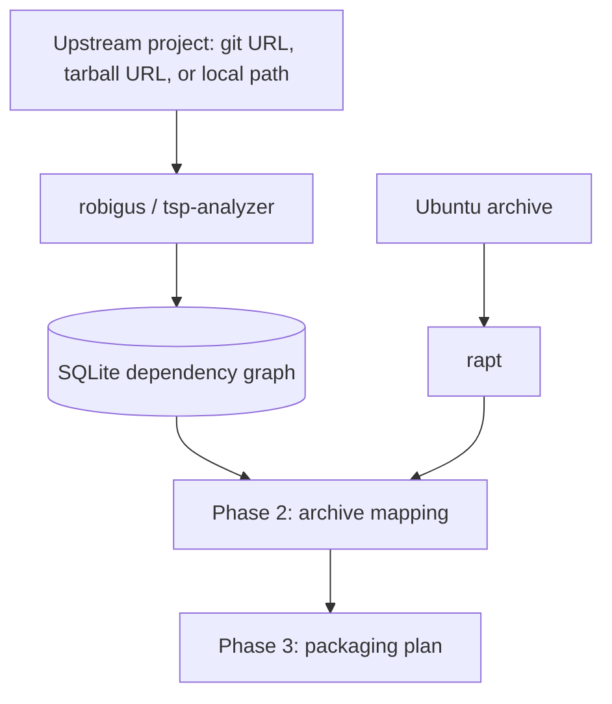

# robigus

[](https://github.com/canonical/robigus/actions/workflows/build-and-test.yml)
[](https://github.com/canonical/robigus/actions/workflows/fuzz.yml)

Tools for planning the Ubuntu packaging of arbitrary upstream software, written in pure async Rust.

This repository is a Cargo workspace with two crates:

| Crate | What it is | Status |
|---|---|---|
| [`robigus`](robigus/) | Library and `tsp-analyzer` CLI that discovers, records, and validates the complete dependency graph of a target software project (TSP). | Phase 1 in progress: Milestone M1 (foundations) is complete; analysis (`analyze`) arrives in M2/M3. |
| [`rapt`](rapt/) | Library and `rapt` CLI for querying the Ubuntu archive: package and source records, dependencies, reverse dependencies, `madison`-style version tables. | Usable; robigus will use it for Ubuntu archive mapping in Phase 2. |

The two crates are independent today. robigus answers *"what does this project depend on?"*; rapt answers *"what does Ubuntu already provide?"*. Phase 2 joins them to decide which dependencies the archive satisfies and which must be packaged.



## robigus

robigus analyzes a target software project, discovers and expands its full transitive dependency graph, and persists that graph so it can later be mapped onto the Ubuntu archive. The normative specification is [`robigus/AGENTS.md`](robigus/AGENTS.md); progress is tracked in [`robigus/plans/phase_1_plan.md`](robigus/plans/phase_1_plan.md).

### What is implemented (Milestone M1 and WP-2.1)

- **Acquisition** (`fetch`): git repositories (pinned commits, recursive submodules), source tarballs (gzip, xz, zstd), and local paths, stored in a content-addressed cache. Extraction is hardened against path traversal, escaping links, device nodes, setuid entries, and decompression bombs. A crates.io helper verifies checksums against the sparse index.
- **Detection** (`detect`): languages, build systems (Cargo, CMake, Meson, Autotools, Make, …), test systems, and analysis roots, including Cargo workspace membership rules.
- **Dependency model** (`model`): packages, edges with sets of dependency kinds (normal, build, development, runtime), unresolved requirements (crates, pkg-config modules, headers, sonames, tools), evidence, and confidence tiers, held in a `petgraph`-backed `DependencyGraph`.
- **Predicates** (`predicate`): a small language describing when an edge applies, for example `feature("asm") && arch("arm64") && !env("CC" = "clang")`. It covers Cargo `cfg(...)` and Debian architecture qualifiers, with canonicalization and evaluation against a configuration.
- **Debian versions** (`dpkg`): dpkg-compatible version parsing and comparison, tested against `dpkg --compare-versions`.
- **Persistence** (`store`): one SQLite database per analysis, with forward-only migrations, per-node analysis status (`Not_Started`, `Started`, `Complete`, `Error`) for resumable runs, recorded tool invocations, and an integrity checker.
- **Export** (`export`): lossless JSON snapshots and lossy Graphviz DOT.
- **Sandbox** (`sandbox`): a mandatory, fail-closed bubblewrap sandbox for any project code robigus runs (see [Sandbox requirements](#sandbox-requirements)).
- **Allowlist proxy** (`sandbox::proxy`): sandboxed commands that need the network reach it only through an allowlisting forward proxy. It enforces the host allowlist, `Host`/`CONNECT`/TLS SNI agreement and public-only upstream addresses, relays TLS without interception, and logs every request.

Not yet implemented: the `analyze` command, the Cargo and C/C++ analyzers, graph expansion and resume, the native (Landlock) sandbox, and LLM-assisted analysis. These are the rest of Milestones M2 and M3 in the plan.

### `tsp-analyzer` quickstart

```bash
# Build the CLI.
cargo build --release -p robigus
alias tsp-analyzer=target/release/tsp-analyzer

# Acquire a source; prints its local path and SHA-256 tree digest.
tsp-analyzer fetch ./path/to/project
tsp-analyzer fetch https://github.com/example/project.git --tag v1.2.3
tsp-analyzer --format json fetch https://example.org/project-1.2.3.tar.gz --sha256 <DIGEST>

# Work with an analysis database (produced by `analyze` once M2 lands).
tsp-analyzer --db analysis.db check                       # integrity report; exit 3 on problems
tsp-analyzer --db analysis.db print --kind build --depth 2
tsp-analyzer --db analysis.db --format json export > analysis.json   # lossless
tsp-analyzer --db analysis.db --format dot export | dot -Tsvg > graph.svg
```

Global options include `--db`, `--format text|json|dot`, `--offline`, `--cache <PATH>` (default `$XDG_CACHE_HOME/robigus`), `--config <PATH>` for TOML acquisition limits (see `tsp-analyzer --help`), `--sandbox auto|bwrap|native`, and `--verbose`.

Exit codes: `0` success, `1` analysis failure, `2` usage error, `3` database or schema error, `4` no sandbox available, `5` incomplete graph.

Exported JSON includes recorded tool arguments and environments; treat it as potentially sensitive.

### Library example

```rust,no_run
use std::path::Path;

use robigus::{
    Configuration, DetectionLimits, Evaluator, MachineArch, Predicate, ProjectTree, Store, detect,
};
use ubuntu_info_rust::Architecture;

#[tokio::main]
async fn main() -> Result<(), Box<dyn std::error::Error>> {
    // Detect languages, build systems, and analysis roots in a source tree.
    let tree = ProjectTree::discover(Path::new("."), &DetectionLimits::default()).await?;
    let report = detect(&tree);
    for root in &report.roots {
        println!("{}: {:?}", root.path.display(), root.analyzers);
    }

    // Parse, canonicalize, and evaluate a dependency predicate.
    let predicate = Predicate::parse(r#"feature("asm") && arch("arm64")"#)?;
    let mut config = Configuration::for_arch(MachineArch::Ubuntu(Architecture::Arm64));
    config.features.insert("demo".into(), ["asm".to_string()].into());
    assert!(Evaluator::new(config).evaluate(&predicate, Some("demo")));
    println!("{}", predicate.canonical_text());

    // Open (create or migrate) an analysis database and validate it.
    let store = Store::open(Path::new("analysis.db")).await?;
    println!("integrity ok: {}", store.check().await?.is_ok());
    Ok(())
}
```

Every public item has rustdoc, most entry points with examples: `cargo doc -p robigus --open`.

### Sandbox requirements

robigus never executes project code (build scripts, `cargo metadata`, …) outside a sandbox, and there is no way to turn the sandbox off. If no sandbox can be established, commands that need one exit with code `4` and list every mechanism tried and why it failed.

The bubblewrap backend requires:

- Linux with unprivileged user namespaces enabled. On Ubuntu, the AppArmor restriction on unprivileged user namespaces must permit `/usr/bin/bwrap`.
- `/usr/bin/bwrap` from **bubblewrap 0.11 or newer**, which provides read-only overlay mounts. That means Ubuntu 26.04 LTS or later; Ubuntu 24.04 ships 0.9.0, which is rejected.
- `/usr/bin/bash`, which is used to close inherited file descriptors before bubblewrap starts.
- An unprivileged user. robigus refuses to run as root.

Inside the sandbox, only the system runtime (`/usr`, `/bin`, `/lib`, `/lib64`) and a read-only view of the source are visible. The home directory, environment, host sockets, and network are not. Toolchains therefore come from the system: install the distribution `cargo` and `rustc` packages, because a rustup toolchain under `~/.cargo` is not visible inside the sandbox.

Network access is offline unless a command opts in to the allowlist. Then the sandbox stays in its own network namespace and can reach only the robigus proxy (`http://127.0.0.1:3128`, set in the standard proxy variables), which permits `crates.io`, `ubuntu.com`, `github.com`, `gitlab.com` and `codeberg.org` and their subdomains by default. Adjust this in the `--config` file with `[network] allowlist` (replace), `allow` (add) and `deny` (remove). Network-enabled runs need `/usr/bin/python3`, which creates the proxy listener inside the sandbox, and see the host's `/etc/ssl/certs` read-only. See [`robigus/SECURITY.md`](robigus/SECURITY.md) for the security scope.

## rapt

rapt queries the Ubuntu archive directly over HTTP. It never installs or removes packages and never reads or changes the host's apt configuration or package cache. Index data is cached per series under `$RAPT_CACHE_DIR`, `$XDG_CACHE_HOME/rapt`, or `~/.cache/rapt`, and is refreshed when it is more than an hour old or when you run `update`.

```bash
cargo build --release -p rapt

rapt -s resolute stats                      # cache statistics for Ubuntu 26.04
rapt -s resolute show curl                  # full package record
rapt -s resolute depends curl               # dependencies and what satisfies them
rapt -s noble -q proposed madison hello     # version table, excluding -proposed
rapt -s 24.04 -a arm64 search -n '^rust-'   # names-only regex search on arm64
```

Every query needs a series (`-s`: `noble`, `Noble Numbat`, or `24.04`). Pockets, components, and architectures can be filtered with `-p`/`-c`/`-a` or excluded with `-q`/`-d`/`-b`. See [`rapt/README.md`](rapt/README.md) for every sub-command and filter.

As a library:

```rust,no_run
use rapt::{ArchiveClient, CacheManager, PackageTarget, QueryFilter, RaptQuery};

#[tokio::main]
async fn main() -> rapt::Result<()> {
    // Resolve and validate the series and default pocket/component/arch filters.
    let filter = QueryFilter::builder("resolute").build()?;

    // Reuse the per-series cache if it is fresh; otherwise fetch the indices.
    let cache_manager = CacheManager::default();
    let cache = match cache_manager.load_cache(filter.series())? {
        Some(cache) if cache.is_fresh() => cache,
        _ => {
            let cache = ArchiveClient::default().populate_cache(&filter).await?;
            cache_manager.save_cache(&cache)?;
            cache
        }
    };

    let query = RaptQuery::new(&cache, &filter);
    print!("{}", query.madison("hello"));
    print!("{}", query.depends(&PackageTarget::new("curl", None::<String>))?);
    Ok(())
}
```

## Development

Requirements: Rust 1.93.1 or newer (the MSRV, and the default toolchain on Ubuntu 26.04 LTS). The [devcontainer](.devcontainer/devcontainer.json) provides an Ubuntu 26.04 environment with the distribution Rust toolchain.

```bash
cargo build --workspace
cargo test --workspace --all-targets      # unit, property, and integration tests
cargo test --workspace --doc              # documentation examples
cargo fmt -- --check
cargo clippy --all-targets --all-features -- -D warnings
cargo deny check && cargo audit
```

The sandbox integration tests skip, with a printed reason, when bubblewrap cannot be established, for example when run as root. To make every skip a failure, run them as an unprivileged user with namespace support:

```bash
ROB_REQUIRE_BWRAP=1 cargo test -p robigus --test sandbox
```

Add `ROB_NETWORK_TESTS=1` to also run the live smoke test, which resolves a crates.io dependency with `cargo metadata` through the proxy and needs internet access.

Fuzz targets for the predicate parser and the dpkg comparator live in [`fuzz/`](fuzz/). They need a nightly toolchain: `cargo +nightly fuzz run parse_arbitrary`.

CI (`.github/workflows/build-and-test.yml`) runs all of the above, plus an MSRV job and a strict unprivileged sandbox job on `ubuntu-26.04`. Fuzzing runs nightly in `.github/workflows/fuzz.yml`. Optional git hooks are in [`git-hooks/`](git-hooks/).

## Security

Report vulnerabilities privately through [GitHub Private Vulnerability Reporting](https://github.com/canonical/robigus/security/advisories/new). See [`SECURITY.md`](SECURITY.md) for the workspace and [`robigus/SECURITY.md`](robigus/SECURITY.md) for the robigus sandbox scope.

## License

GPL-3.0-only. See [`LICENSE`](LICENSE).
