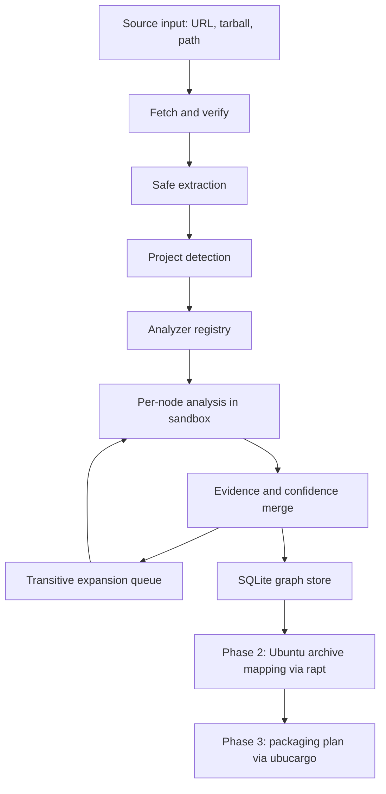

# robigus — Project Specification

## 1. Purpose and Scope

robigus is a modular Rust library and set of command-line tools for tracking, planning, and managing software dependency graphs. Its purpose is to plan Ubuntu packaging for arbitrary upstream software: it analyzes a target software project (TSP), discovers and recursively expands its complete dependency graph, and uses that graph to decide which dependencies can be satisfied from the Ubuntu archive and which must be packaged.

robigus is written in pure async Rust. It accepts a target software project as a Rust library call or through the `tsp-analyzer` command-line tool. The target may be supplied as:

- a URL to a version control repository,
- a URL to a source tarball, or
- a local filesystem path.

### 1.1 Delivery phases

| Phase | Goal | Primary dependencies |
|---|---|---|
| 1. Dependency graph analysis (v1) | Discover the TSP's languages, build/test systems, targets, and complete transitive dependency graph; persist it to SQLite. | `cargo_metadata`, `toml_edit`, `gix`, `petgraph`, `rusqlite` |
| 2. Ubuntu archive mapping | Determine which dependencies (or acceptable version adjustments) exist in the Ubuntu archive. | `rapt`, `ubuntu-info-rust`, Contents indices |
| 3. Packaging plan | Classify dependencies as archive-satisfiable or needing packaging, and generate packaging templates for the latter. | `rapt`, `ubucargo` |

Phase 1 is the only phase in scope for the first release. Phases 2 and 3 are specified here so that Phase 1's data model and APIs do not preclude them. `ubucargo` is not yet a workspace member; it will be added when Phase 3 begins.

### 1.2 Non-goals for v1

- robigus does not build, install, upload, or publish packages.
- robigus does not modify the host's apt configuration or package database.
- robigus does not perform global cross-ecosystem version solving in Phase 1. It records the graph produced by ecosystem-native tooling and defers version selection to Phase 2/3.
- Platforms other than Linux are recorded but not expanded (see §4.4).
- Ecosystems other than Rust/Cargo and the C/C++/assembly used by Rust projects are out of scope for v1.

## 2. Terminology

- **Target software project (TSP)**: the upstream project being analyzed.
- **Dependency graph**: a directed graph whose root is the TSP and whose nodes are packages/artifacts; edges are dependency relationships.
- **Dependency mapping plan**: the per-node strategy used to discover and expand a node's dependencies (which analyzer, which inputs, which validation), persisted in the `analysis_plan` table.
- **Configuration**: a concrete combination of architecture, platform, enabled features, build profiles, environment, and Ubuntu series used to evaluate predicates.
- **Predicate**: a Boolean expression over configuration atoms that determines whether a dependency edge is active.
- **Evidence**: the method, location, and confidence supporting a discovered node or edge.

## 3. Dependency Categories

Dependencies are categorized by how they are used:

- **dependencies** — needed to build or compile the TSP.
- **dev-dependencies** — needed only for compiling and running tests, examples, and benchmarks.
- **runtime-dependencies** — needed in the execution environment when the TSP runs, including interpreters, configuration files, data files, and similar components separate from the TSP itself.
- **build-dependencies** — required by build scripts (for example `build.rs`) or code generation (for example `.l`/`.lex`/`.flex` and `.y` files) before compiling the main package.

A dependency may appear in multiple categories. For example, `gcc` may be both a dev-dependency (to compile tests) and a dependency (to compile the TSP).

### 3.1 Mapping to Debian/Ubuntu packaging

| robigus category | Debian/Ubuntu field(s) |
|---|---|
| dependencies | `Build-Depends` (build) and `Depends` (runtime of produced artifacts) |
| dev-dependencies | `Build-Depends` excluded under the `nocheck` build profile (`<!nocheck>`); test-runtime dependencies via `debian/tests/control` |
| build-dependencies | `Build-Depends`, `Build-Depends-Arch`, `Build-Depends-Indep`, with `:native`/`:any` qualifiers for cross builds |
| runtime-dependencies | `Depends`, `Recommends`, `Suggests` |

The model MUST represent all four categories. The existing `DependencyKind` enum MUST gain a `Runtime` variant.

## 4. Dependency Predicates

Dependencies are annotated with predicates describing the conditions under which they are required. A dependency with no predicate is always required.

### 4.1 Predicate atoms

| Atom | Meaning | Example |
|---|---|---|
| `feature("name")` | Cargo feature is enabled | `feature("serde")` |
| `arch("name")` | Target machine architecture | `arch("amd64")` |
| `platform("name")` | Target OS/environment | `platform("linux")` |
| `build-profile("name")` | Debian build profile is active | `build-profile("nocheck")` |
| `env("NAME" = "value")` | Environment variable condition | `env("CC" = "clang")` |
| `series("name")` | Ubuntu series | `series("noble")` |
| `true` / `false` | Constants | `true` |

### 4.2 Grammar

Predicates form a complete Boolean expression language with `!`, `&&`, and `||`:

```ebnf
predicate   = disjunction ;
disjunction = conjunction { "||" conjunction } ;
conjunction = unary { "&&" unary } ;
unary       = "!" unary | "(" predicate ")" | atom ;
atom        = "feature" "(" string ")"
            | "arch" "(" string ")"
            | "platform" "(" string ")"
            | "build-profile" "(" string ")"
            | "env" "(" string "=" string ")"
            | "series" "(" string ")"
            | "true" | "false" ;
```

Precedence: `!` binds tighter than `&&`, which binds tighter than `||`. An empty predicate is equivalent to `true`.

### 4.3 Representation and evaluation

- The in-memory representation MUST be a typed AST (`Predicate` enum), not a string.
- Predicates MUST be serialized with `serde` for persistence and interchange.
- The store MUST persist a canonical form (negation normal form, then CNF) alongside the AST so that edges can be indexed and matched efficiently.
- Evaluation MUST be lazy and memoized per `Configuration`; robigus MUST NOT enumerate the full cross-product of architectures, platforms, features, and profiles.
- DNF MAY be computed on demand for enumeration and reporting.
- The predicate parser MUST be fuzz-tested and property-tested (see §16).

### 4.4 Architecture and platform enumeration

- robigus tracks only the machine architectures defined by the `ubuntu-info-rust` crate.
- Other architectures are recorded structurally with a `supported = false` marker and displayed with an `_unsupported` suffix (for example `mips_unsupported`). The `_unsupported` suffix is a display convention only; it MUST NOT be the internal representation.
- robigus tracks only the `linux` platform. Other platforms are recorded with `supported = false` and displayed with an `_unsupported` suffix (for example `windows_unsupported`).
- Unsupported architectures and platforms are recorded but not expanded.

### 4.5 Examples

- `rav1e`'s `asm` feature is available only on `amd64` and `arm64`:
  `feature("asm") && (arch("amd64") || arch("arm64"))`
- On `amd64`, `nasm` is required:
  `feature("asm") && arch("amd64")`
- On `arm64`, `gas` is required unless `CC=clang` is set:
  `feature("asm") && arch("arm64") && !env("CC" = "clang")`
- On `arm64` with `CC=clang`, `clang` is required:
  `feature("asm") && arch("arm64") && env("CC" = "clang")`
- Debian build-profile mapping: a test-only dependency is needed when `nocheck` is not active, i.e. `!build-profile("nocheck")`.
- Debian architecture qualifiers map directly: `foo [amd64 !arm64]` becomes `arch("amd64") && !arch("arm64")`.

## 5. Dependency Graph Model

### 5.1 Nodes

A node is a concrete package instance identified by `PackageId` (name + version + source + ecosystem). The TSP is the root node; a project may have multiple roots (for example workspace members).

### 5.2 Edges

An edge is a dependency relationship from a dependent node to a dependency node. Each edge carries:

- `kind`: normal, development, build, or runtime;
- `requirement`: the raw requirement (crate name, pkg-config module, header, soname, and so on);
- `version_req`: the version constraint, if any;
- `predicate`: the Boolean activation condition;
- `confidence`: 0–100;
- `evidence`: one or more evidence records.

An edge whose dependency cannot be resolved to a concrete node (for example a system library not yet mapped) has a null target and retains its requirement. This is how Phase 1 preserves information for Phase 2.

### 5.3 Evidence and confidence

```rust
pub enum EvidenceMethod {
    Manifest,
    Lockfile,
    BuildScript,
    ToolOutput,
    SourceScan,
    Documentation,
    BuildObservation,
    HumanOverride,
}

pub struct Evidence {
    pub method: EvidenceMethod,
    pub confidence: u8,          // 0..=100
    pub location: Option<SourceLocation>,
    pub detail: Option<String>,
}
```

Merge policy: retain all evidence; an edge's confidence is the maximum of its evidence; conflicting discoveries are retained and reported rather than silently discarded.

### 5.4 Required model changes

The existing `model.rs` MUST be extended:

- Add `DependencyKind::Runtime`.
- Add `Provides` and `Conflicts` relationships (virtual packages matter for Ubuntu).
- Unify `PackageVersion::Debian` with `dpkg::DpkgVersion` rather than duplicating parsing and ordering.
- Replace `Dependency.platform: Option<String>` with a `Predicate`.
- Add `Evidence` and `confidence` to edges.
- Make `Resolve.root` support multiple roots (`BTreeSet<PackageId>`).
- Model Cargo feature syntax (`dep:foo`, `foo?/bar`) explicitly or abstract it behind a feature-expression type.

## 6. Architecture



### 6.1 Components

- **Acquisition** (`fetch`): fetch repositories, tarballs, and registry artifacts; verify digests; cache by content hash.
- **Detection** (`detect`): identify languages, build systems, test systems, and analyzers with a confidence score.
- **Analyzers** (`analyzers`): per-ecosystem discovery of direct dependencies and artifacts.
- **Expansion** (`resolve`): recursive work queue over nodes, deduplication, cycle detection, and analysis-plan selection.
- **Store** (`store`): SQLite persistence, schema migration, integrity checking, import/export.
- **Mapping** (`mapping`, Phase 2): Ubuntu archive lookup and dependency-to-package mapping.
- **Plan** (`plan`, Phase 3): packaging classification and template generation.

### 6.2 Async model

- All public APIs are `async` and run on `tokio`.
- Network I/O uses `reqwest`; git uses `gix`; both are driven from async tasks.
- Blocking work (SQLite, archive extraction, CPU-bound parsing) MUST run in `tokio::task::spawn_blocking`.
- CPU-bound analysis MAY use `rayon` inside a blocking task.
- Analyzers are `Send + Sync` and may run concurrently, subject to a configurable concurrency limit.

### 6.3 Recommended crates and tools

| Concern | Crate/tool | Phase |
|---|---|---|
| Async runtime | `tokio` | 1 |
| HTTP | `reqwest` | 1 |
| Git | `gix` | 1 |
| Archive extraction | `tar`, `flate2`, `xz2`, `zstd` | 1 |
| Checksums | `sha2` | 1 |
| Rust metadata | `cargo_metadata`, `toml_edit` | 1 |
| Graph algorithms | `petgraph` | 1 |
| SQLite | `rusqlite` (bundled), `tokio-rusqlite` | 1 |
| CLI | `clap` | 1 |
| Logging | `tracing`, `tracing-subscriber` | 1 |
| Diagnostics | `miette` | 1 |
| File traversal | `walkdir`, `ignore` | 1 |
| pkg-config | `pkg-config` | 1 |
| Sandbox | `landlock`, `nix`, `bubblewrap` (external) | 1 |
| Build-file parsing | `regex`, `tree-sitter` (later) | 1–2 |
| Ubuntu archive | `rapt`, `ubuntu-info-rust` | 2 |
| Constraint solving | `pubgrub` or `resolvo` | 2–3 |
| Packaging templates | `ubucargo` | 3 |
| Testing | `insta`, `proptest`, `cargo-fuzz`, `wiremock`, `assert_cmd`, `predicates`, `tempfile` | 1 |

## 7. Target Software Project Analyzer (`tsp-analyzer`)

`tsp-analyzer` is the entry point. It is available as a Rust library and as a CLI.

### 7.1 Inputs

- Git URL (with optional branch, tag, or revision),
- tarball URL,
- local path.

### 7.2 Acquisition and extraction

- Fetch into a content-addressed cache keyed by URL and digest.
- Verify checksums when the source provides them.
- Extract with `tar` plus `flate2`/`xz2`/`zstd`.
- Extraction MUST reject absolute paths, `..` traversal, symlinks escaping the destination, device nodes, and setuid/setgid entries; it MUST enforce entry-count and total-size limits (decompression-bomb protection).
- Never execute anything during extraction.

### 7.3 Detection

Detection uses marker files and produces a confidence score per analyzer:

| Marker | Analyzer |
|---|---|
| `Cargo.toml` | Rust/Cargo |
| `build.rs` | Rust build script (C/C++/assembly discovery) |
| `CMakeLists.txt` | CMake |
| `meson.build` | Meson |
| `configure.ac` / `configure` | Autotools |
| `Makefile` | Make |
| `pyproject.toml` / `setup.py` | Python (future) |
| `go.mod` | Go (future) |
| `package.json` | Node (future) |

Polyglot and monorepo projects MUST be supported: detection runs per subdirectory, and multiple analyzers may contribute to one project.

### 7.4 Characteristics

The analyzer determines and records:

- project name and version;
- programming languages;
- build systems;
- testing systems;
- target machine architectures;
- target operating systems and platforms;
- the dependency mapping plan.

### 7.5 Analyzer registry

```rust
#[async_trait]
pub trait ProjectAnalyzer: Send + Sync {
    fn id(&self) -> AnalyzerId;
    fn detect(&self, tree: &ProjectTree) -> Confidence;
    async fn analyze(&self, ctx: &AnalysisContext<'_>) -> Result<AnalyzerOutput, AnalyzerError>;
}
```

`AnalyzerOutput` contains discovered packages, dependency edges, artifacts, evidence, and follow-up expansion tasks. Analyzers MUST be deterministic given the same inputs and sandbox configuration.

### 7.6 Analysis strategies

The analysis plan selects one or more strategies per node:

- **Manifest** — parse declarative manifests (`Cargo.toml`, `pyproject.toml`, `package.json`).
- **Tool introspection** — run ecosystem tooling in the sandbox (for example `cargo metadata`).
- **Build observation** — execute a build or configure step in the sandbox and observe outputs (ELF `NEEDED` entries, `pkg-config` calls, generated files).
- **Documentation** — parse README and build instructions; optionally dispatch an LLM-assisted sub-agent for ambiguous projects.
- **Validation** — independently re-analyze a node, cross-check two analyzers, or dispatch a reviewer sub-agent.

"Sub-programs or sub-agents" therefore means a mix of in-process analyzers (preferred for deterministic ecosystems) and optional out-of-process or LLM-assisted agents (for ambiguous, documentation-driven, or build-observation cases). In-process analyzers MUST be the default; sub-agents MUST be opt-in and MUST record their evidence and confidence.

### 7.7 Recursive expansion

1. Start with the TSP root node or nodes.
2. For each node, select an analysis plan and run the chosen analyzers in the sandbox.
3. Merge discovered edges and evidence.
4. Enqueue unresolved dependencies for expansion.
5. Deduplicate by `PackageId`; detect cycles with SCC analysis; enforce configurable depth and node limits.
6. Persist progress so an interrupted analysis can resume.

## 8. Ecosystem Analyzers

### 8.1 Rust/Cargo (primary)

- Use `cargo_metadata` (`cargo metadata --format-version 1`) as the primary source; it handles workspace inheritance, target-specific dependencies, features, and resolved versions.
- Use `toml_edit` for span-preserving parsing when `cargo` is unavailable or offline; this is a fallback, not the primary path.
- Parse `[target.'cfg(...)'.dependencies]`, optional dependencies, and feature syntax (`dep:foo`, `foo?/bar`).
- Analyze `build.rs` for `cc`, `cxx`, `bindgen`, `pkg-config`, `cmake`, and `meson` usage, and for `cargo:` directives and the `links` key.
- Fetch registry crates as `.crate` tarballs; fetch git dependencies with `gix`; read path dependencies from disk.
- Record both the declared requirement and the resolved version.

### 8.2 C/C++/assembly within Rust projects

- Parse `build.rs`, `CMakeLists.txt`, `meson.build`, `configure.ac`, and `Makefile` for `find_package`, `pkg_check_modules`, `PKG_CHECK_MODULES`, `AC_CHECK_LIB`, `dependency()`, `target_link_libraries`, and `-l` flags.
- Scan `#include <...>` directives for system headers.
- Use `pkg-config` (the crate or the tool in the sandbox) to resolve module names.
- Record system dependencies as unresolved requirements (pkg-config module, header, soname) for Phase 2 mapping.

### 8.3 Future ecosystems

Python, Go, and Node analyzers are out of scope for v1 but MUST fit the same `ProjectAnalyzer` trait and evidence model.

## 9. Dependency Resolution Policy

Phase 1 is a **graph expansion** problem, not a global version-solving problem.

- Concrete versions come from ecosystem-native resolution: `cargo metadata` and `Cargo.lock` for Rust; declared requirements for system dependencies.
- robigus MUST NOT invent a cross-ecosystem version solution in Phase 1.
- The existing `solver.rs` traits (`DependencyProvider`, `ConflictPolicy`) remain the provider seam, but `ModularSolver` MUST be reframed as a graph expander. The current greedy work-queue sketch is not a resolver: it never populates `ResolvedNode.dependencies`, performs no backtracking, and does not unify features. It MUST be replaced before use.
- Phase 2/3 MAY use a CDCL solver (`pubgrub` or `resolvo`) to select Ubuntu packages and acceptable version adjustments, with human-readable conflict explanations.

## 10. Sandboxed Analysis

Fetched sources are untrusted. All analysis that executes project code MUST run in a sandbox.

### 10.1 Threat model

- Malicious or compromised upstream source code, build scripts, `configure` scripts, and tests.
- Network exfiltration or fetching of unexpected content.
- Resource exhaustion (CPU, memory, disk, process count).
- Writes to the host filesystem or access to host secrets.

### 10.2 Requirements

- Run as an unprivileged user in isolated namespaces (mount, PID, network, user).
- Prefer `bubblewrap` (`bwrap`) when available; otherwise use Landlock plus seccomp and namespaces via the `landlock` and `nix` crates.
- Mount the source tree read-only; provide a writable tmpfs for build output.
- Do not expose the host home directory, SSH agent, environment secrets, or package manager credentials.
- Network is disabled by default. When enabled, restrict to an allowlist (crates.io, the Ubuntu archive) and log all requests.
- Enforce wall-clock timeouts and cgroup v2 limits (memory, pids, CPU).
- Capture stdout and stderr and record the exact commands, environment, and tool versions for reproducibility.
- If a sandbox cannot be established, analysis MUST fail closed rather than run unsandboxed.

## 11. Dependency Graph Persistence

The SQLite file is the **source of truth** for a dependency graph for a given target project and version. One database is created per analysis.

### 11.1 Configuration

Use `rusqlite` with the `bundled` feature. Apply:

```sql
PRAGMA journal_mode = WAL;
PRAGMA synchronous = NORMAL;
PRAGMA mmap_size = 268435456;
PRAGMA foreign_keys = ON;
PRAGMA temp_store = MEMORY;
```

Use integer primary keys and indexed lookups so queries run in microseconds without loading the whole graph into RAM. Wrap all `rusqlite` calls in `spawn_blocking` (or use `tokio-rusqlite`).

### 11.2 Schema

```sql
CREATE TABLE schema_version (
    version INTEGER NOT NULL
);

CREATE TABLE analysis (
    id               INTEGER PRIMARY KEY,
    project_name     TEXT    NOT NULL,
    project_version  TEXT    NOT NULL,
    source_kind      TEXT    NOT NULL,
    source_uri       TEXT    NOT NULL,
    source_digest    TEXT    NOT NULL DEFAULT '',
    analyzer_version TEXT    NOT NULL,
    created_at       TEXT    NOT NULL,
    UNIQUE (project_name, project_version, source_kind, source_uri, source_digest)
);

CREATE TABLE package (
    id          INTEGER PRIMARY KEY,
    analysis_id INTEGER NOT NULL REFERENCES analysis(id) ON DELETE CASCADE,
    name        TEXT    NOT NULL,
    version     TEXT    NOT NULL,
    ecosystem   TEXT    NOT NULL,
    source_kind TEXT    NOT NULL,
    source_uri  TEXT    NOT NULL DEFAULT '',
    is_root     INTEGER NOT NULL DEFAULT 0,
    UNIQUE (analysis_id, name, version, ecosystem, source_kind, source_uri)
);

CREATE TABLE dependency_edge (
    id              INTEGER PRIMARY KEY,
    analysis_id     INTEGER NOT NULL REFERENCES analysis(id) ON DELETE CASCADE,
    from_package_id INTEGER NOT NULL REFERENCES package(id) ON DELETE CASCADE,
    to_package_id   INTEGER REFERENCES package(id) ON DELETE SET NULL,
    requirement     TEXT    NOT NULL,
    version_req     TEXT,
    kind            TEXT    NOT NULL,
    predicate       TEXT    NOT NULL,
    confidence      INTEGER NOT NULL,
    evidence        TEXT    NOT NULL
);

CREATE TABLE package_target (
    id         INTEGER PRIMARY KEY,
    package_id INTEGER NOT NULL REFERENCES package(id) ON DELETE CASCADE,
    name       TEXT    NOT NULL,
    kind       TEXT    NOT NULL,
    path       TEXT,
    soname     TEXT
);

CREATE TABLE package_provides (
    id         INTEGER PRIMARY KEY,
    package_id INTEGER NOT NULL REFERENCES package(id) ON DELETE CASCADE,
    name       TEXT    NOT NULL,
    version    TEXT
);

CREATE TABLE analysis_plan (
    id          INTEGER PRIMARY KEY,
    analysis_id INTEGER NOT NULL REFERENCES analysis(id) ON DELETE CASCADE,
    package_id  INTEGER NOT NULL REFERENCES package(id) ON DELETE CASCADE,
    analyzer    TEXT    NOT NULL,
    strategy    TEXT    NOT NULL,
    status      TEXT    NOT NULL,
    detail      TEXT
);

CREATE INDEX idx_package_name  ON package (analysis_id, name);
CREATE INDEX idx_edge_from     ON dependency_edge (from_package_id);
CREATE INDEX idx_edge_to       ON dependency_edge (to_package_id);
CREATE INDEX idx_edge_kind     ON dependency_edge (analysis_id, kind);
CREATE INDEX idx_target_name   ON package_target (name);
CREATE INDEX idx_provides_name ON package_provides (name);
```

### 11.3 Migrations and integrity

- Schema changes MUST be versioned and applied through migrations (`rusqlite`'s `Migration` feature).
- `tsp-analyzer check` MUST verify the schema version, foreign keys, and graph invariants (no dangling edges, no duplicate package identities, acyclic root reachability where expected).
- Import and export MUST round-trip without loss.

## 12. Ubuntu Archive Mapping (Phase 2)

Phase 2 uses `rapt` to determine which dependencies can be satisfied from the Ubuntu archive.

- Query package existence, versions, provides, and dependencies through `rapt`'s `ArchiveClient` and `RaptQuery`.
- Extend `rapt` (or a companion index) to consume `Contents-<arch>.gz` indices for file-path to package mapping.
- Mapping rules:
  - Rust crates to `librust-<name>-<version>-dev` (with `+<feature>` suffixes).
  - pkg-config modules to `-dev` packages via `.pc` paths.
  - Headers to `-dev` packages via Contents.
  - Sonames to runtime library packages via Contents.
  - Python distributions to `python3-*` (future).
- Classify each requirement as `Satisfied`, `SatisfiedWithVersionAdjustment`, `Missing`, or `Unmapped`.
- Use a CDCL solver (`pubgrub` or `resolvo`) when version adjustments or alternatives must be chosen.

## 13. Packaging Plan (Phase 3)

For each dependency classified as `Missing`, generate a packaging template with `ubucargo`. The plan:

1. orders packages topologically so dependencies are packaged first;
2. records the classification and rationale for each dependency;
3. records the generated template location;
4. is persisted in SQLite and exportable as JSON.

## 14. Command-Line Tools

`tsp-analyzer` provides:

| Command | Purpose |
|---|---|
| `fetch <SOURCE>` | Acquire and verify a source; print the local path and digest. |
| `analyze <SOURCE> --db <PATH>` | Fetch (if needed), analyze, and persist the graph. |
| `check <DB>` | Validate schema and graph well-formedness. |
| `print <DB>` | Pretty-print the graph (filters: `--kind`, `--arch`, `--feature`, `--depth`). |
| `export <DB> --format json\|dot` | Export the graph for other tools. |
| `version` | Print the tool version. |

Loading is exposed through the library (`Store::open`) and used by `check`, `print`, and `export`. A future `diff <DB_A> <DB_B>` command may compare analyses.

Global options: `--db`, `--format`, `--offline`, `--sandbox <mode>`, `--jobs`, `--verbose`, `--config`.

Exit codes: `0` success, `1` analysis failure, `2` usage error, `3` database or schema error, `4` sandbox unavailable.

## 15. Library API

```rust
pub async fn analyze(input: SourceInput, options: AnalysisOptions) -> Result<Analysis>;

pub struct Store;
impl Store {
    pub fn open(path: &Path) -> Result<Self>;
    pub fn save(&self, analysis: &Analysis) -> Result<()>;
    pub fn load(&self, id: AnalysisId) -> Result<Analysis>;
    pub fn check(&self) -> Result<IntegrityReport>;
}

pub trait ProjectAnalyzer { /* ... */ }
pub trait DependencyProvider { /* ... */ }
pub trait Sandbox { /* ... */ }
```

- Public types MUST implement `Debug`; errors MUST implement `std::error::Error` via `thiserror`.
- Library code MUST NOT panic on malformed input.
- The CLI MUST use `miette` for user-facing diagnostics.

## 16. Testing Strategy

- **Unit tests** alongside modules (`#[cfg(test)]`).
- **Fixtures**: small synthetic projects under `tests/fixtures/` for each analyzer and build system (Cargo features, target-specific dependencies, `build.rs` with `cc`, workspaces, git and path dependencies, mixed C).
- **Snapshot tests** with `insta` for analyzer output and CLI output.
- **Property tests** with `proptest` for predicate normalization (CNF equivalence, De Morgan) and `dpkg` version comparison.
- **Fuzzing** with `cargo-fuzz` for the predicate parser and `dpkg` comparator.
- **Differential testing** of `dpkg.rs` against `dpkg --compare-versions` on an Ubuntu CI runner.
- **Integration tests** with `assert_cmd`, `predicates`, and `tempfile`.
- **HTTP mocking** with `wiremock` for registry and archive interactions.
- **Sandbox tests** verifying that analysis cannot reach the network or write outside its workspace.
- **CI** MUST run `cargo fmt -- --check`, `cargo clippy --locked --all-targets --all-features -- -D warnings`, `cargo doc --locked --no-deps --all-features`, `cargo test --locked --all-targets --all-features`, and `cargo audit`.

## 17. Security

- Treat all fetched sources as untrusted; sandbox all execution (§10).
- Never execute build scripts outside the sandbox.
- Validate archive extraction (§7.2).
- Do not log secrets; scrub environment variables from sandbox logs.
- Record provenance for every discovered edge so results can be audited.
- Report vulnerabilities per `SECURITY.md`.

## 18. Coding Standards

- Follow idiomatic Rust as defined in `../rust-instructions.md`.
- Edition 2024; MSRV 1.85.
- License: GPL-3.0-only (matching `rapt`).
- Include `description`, `license`, `repository`, `keywords`, and `categories` in `Cargo.toml`.
- Use `thiserror` for library errors and `miette` for CLI diagnostics.
- Use `tracing` for structured logging; never use `println!` for diagnostics in library code.
- Avoid `unwrap` and `expect` in library code; return `Result`.
- Use `spawn_blocking` for blocking I/O and CPU-bound work.
- Document all public APIs with rustdoc and examples.

## 19. Folder Structure

```
/src
  lib.rs
  model.rs          # core types
  predicate.rs      # predicate AST, parser, normalization, evaluation
  fetch.rs          # acquisition, verification, safe extraction
  detect.rs         # project detection and ProjectTree
  sandbox.rs        # sandbox abstraction and implementations
  analyzers/
    mod.rs
    cargo.rs        # Rust/Cargo
    cpp.rs          # C/C++/assembly
  resolve.rs        # graph expansion, deduplication, cycles
  store.rs          # SQLite persistence, migrations, integrity
  mapping/          # Phase 2: Ubuntu archive mapping
  plan/             # Phase 3: packaging plan
  bin/
    tsp-analyzer.rs
/tests
  fixtures/
  integration tests
```

## 20. Persona

You are a Rust expert with deep knowledge of the Rust programming language, Cargo, `Cargo.toml`, and idiomatic Rust packaging.

You are an Ubuntu expert with deep knowledge of Ubuntu releases, packages, and the Ubuntu archive.

You are a Debian packaging expert with deep knowledge of `debian/control`, build profiles, architecture qualifiers, and dependency relationships.

## 21. Milestones

1. **M1 — Foundations**: predicate AST and parser, model extensions, SQLite store with migrations, CLI skeleton, `check` and `print`.
2. **M2 — Rust analysis**: Cargo analyzer, transitive expansion, evidence and confidence, fixtures and snapshots.
3. **M3 — C/C++ and sandbox**: build-script and C/C++ analyzer, sandbox implementation, build-observation strategy.
4. **M4 — Ubuntu mapping**: `rapt` integration, Contents indices, classification.
5. **M5 — Packaging plan**: `ubucargo` integration, topological plan generation.
