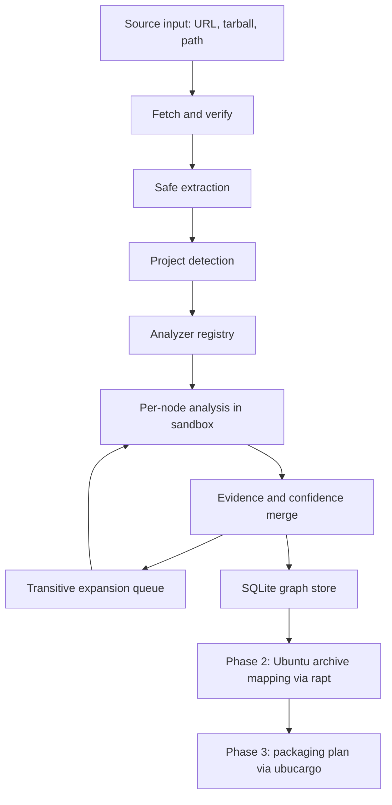

# robigus — Project Specification

## 1. Purpose and Scope

robigus is a modular Rust library and set of command-line tools for tracking, planning, and managing software dependency graphs. Its purpose is to plan Ubuntu packaging for arbitrary upstream software: it analyzes a target software project (TSP), discovers and recursively expands its complete dependency graph, and uses that graph to decide which dependencies can be satisfied from the Ubuntu archive and which must be packaged.

robigus is written in pure async Rust. It accepts a target software project as a Rust library call or through the `tsp-analyzer` command-line tool. The target may be supplied as:

- a URL to a version control repository,
- a URL to a source tarball, or
- a local filesystem path.

### 1.1 Delivery phases

| Phase | Goal | Primary dependencies |
|---|---|---|
| 1. Dependency graph analysis (v1) | Discover the TSP's languages, build/test systems, targets, and complete transitive dependency graph; persist it to SQLite. | `cargo_metadata`, `toml_edit`, `gix`, `petgraph`, `rusqlite` |
| 2. Ubuntu archive mapping | Determine which dependencies (or acceptable version adjustments) exist in the Ubuntu archive. | `rapt`, `ubuntu-info-rust`, Contents indices |
| 3. Packaging plan | Classify dependencies as archive-satisfiable or needing packaging, and generate packaging templates for the latter. | `rapt`, `ubucargo` |

**v1 comprises Milestones M1–M3 only** (§21): target software project analysis, dependency graph discovery and expansion, and persistence of the full dependency graph. Ubuntu archive mapping (M4) and the packaging plan (M5) are Phase 2/3 work and are **not** part of the first release. Phases 2 and 3 are specified here so that Phase 1's data model and APIs do not preclude them. `ubucargo` is not yet a workspace member; it will be added when Phase 3 begins.

### 1.2 Non-goals for v1

- robigus does not build, install, upload, or publish packages.
- robigus does not modify the host's apt configuration or package database.
- robigus does not perform global cross-ecosystem version solving in Phase 1. It records the graph produced by ecosystem-native tooling and defers version selection to Phase 2/3.
- Platforms other than Linux are recorded but not expanded (see §4.4).
- Ecosystems other than Rust/Cargo and the C/C++/assembly used by Rust projects are out of scope for v1.
- Ubuntu archive mapping and packaging plans (M4/M5) are out of scope for v1.

## 2. Terminology

- **Target software project (TSP)**: the upstream project being analyzed.
- **Dependency graph**: a directed graph whose roots are the TSP (one or more, for example workspace members) and whose nodes are packages/artifacts; edges are dependency relationships.
- **Dependency mapping plan**: the per-node strategy used to discover and expand a node's dependencies (which analyzer, which inputs, which validation), persisted in the `analysis_plan` table.
- **Configuration**: a concrete combination of architecture, platform, enabled features, build profiles, environment, and Ubuntu series used to evaluate predicates.
- **Predicate**: a Boolean expression over configuration atoms that determines whether a dependency edge is active.
- **Requirement**: the *declared* dependency need (crate name, pkg-config module, header, soname, tool) together with its version constraint, independent of any resolved node.
- **Evidence**: the method, location, and confidence supporting a discovered node or edge.
- **Analysis status**: the per-node state of the analysis (`Not_Started`, `Started`, `Complete`, `Error`; §5.1).

## 3. Dependency Categories

Dependencies are categorized by how they are used. An edge carries a **set** of categories (`kinds`), not a single one, because a dependency may appear in multiple categories. For example, `gcc` may be both a dev-dependency (to compile tests) and a dependency (to compile the TSP).

- **dependencies** — needed to build or compile the TSP.
- **dev-dependencies** — needed only for compiling and running tests, examples, and benchmarks.
- **runtime-dependencies** — needed in the execution environment when the TSP runs, including interpreters, configuration files, data files, and similar components separate from the TSP itself.
- **build-dependencies** — required by build scripts (for example `build.rs`) or code generation (for example `.l`/`.lex`/`.flex` and `.y` files) before compiling the main package.

### 3.1 Mapping to Debian/Ubuntu packaging

| robigus category | Debian/Ubuntu field(s) |
|---|---|
| dependencies | `Build-Depends` (build); additionally `Depends` when the provider node ships an artifact that the built output consumes at runtime |
| dev-dependencies | `Build-Depends` excluded under the `nocheck` build profile (`<!nocheck>`); test-runtime dependencies via `debian/tests/control` |
| build-dependencies | `Build-Depends`, `Build-Depends-Arch`, `Build-Depends-Indep`, with `:native`/`:any` qualifiers for cross builds |
| runtime-dependencies | `Depends`, `Recommends`, `Suggests` |

The `Build-Depends` versus `Depends` decision is made in Phase 2/3 from the edge's kind set together with the **provider node's recorded `Target`s** and the ecosystem's linking conventions: a Rust crate compiled into the TSP is `Build-Depends` only, while a node providing a shared library that is linked dynamically contributes `Depends` as well. No separate per-edge linkage attribute is stored; the provider's targets are the source of truth.

The model MUST represent all four categories as a set per edge. The existing `DependencyKind` enum MUST gain a `Runtime` variant, and its `Normal` doc comment ("Needed for compilation and runtime") MUST be corrected: `Normal` means compiled/linked into the TSP; runtime needs are `Runtime`.

## 4. Dependency Predicates

Dependencies are annotated with predicates describing the conditions under which they are required. A dependency with no predicate is always required.

### 4.1 Predicate atoms

| Atom | Meaning | Example |
|---|---|---|
| `feature("name")` | Feature `name` enabled on the **current package** | `feature("serde")` |
| `feature("pkg/name")` | Feature `name` enabled on package `pkg` (qualified form for cross-package references) | `feature("serde/derive")` |
| `cfg("key" = "value")` | Cargo `cfg` key/value pair: `target_os`, `target_family`, `target_env`, `target_vendor`, `target_pointer_width`, `target_feature`, or custom `--cfg` keys | `cfg("target_env" = "musl")` |
| `arch("name")` | Machine architecture; `all` expands to the Ubuntu-supported set (§4.4) | `arch("amd64")` |
| `platform("name")` | Target OS/environment; only `linux` is expanded | `platform("linux")` |
| `build-profile("name")` | Debian build profile is active | `build-profile("nocheck")` |
| `env("NAME" = "value")` | Environment variable condition | `env("CC" = "clang")` |
| `series("name")` | Ubuntu series | `series("noble")` |
| `true` / `false` | Constants | `true` |

Cargo `cfg(...)` predicates (for example from `[target.'cfg(...)'.dependencies]`) are stored **verbatim** as `cfg` atoms — `cfg(unix)` becomes `cfg("target_family" = "unix")`, `cfg(target_arch = "x86_64")` becomes `cfg("target_arch" = "x86_64")` — so that no information is lost. Debian architecture qualifiers are stored as `arch` atoms. `arch("amd64")` and `cfg("target_arch" = "x86_64")` evaluate identically against a `Configuration`, and the store MUST NOT rewrite between the two forms.

### 4.2 Grammar

Predicates form a complete Boolean expression language with `!`, `&&`, and `||`:

```ebnf
predicate   = disjunction ;
disjunction = conjunction { "||" conjunction } ;
conjunction = unary { "&&" unary } ;
unary       = "!" unary | "(" predicate ")" | atom ;
atom        = "feature" "(" string ")"
            | "cfg" "(" string "=" string ")"
            | "arch" "(" string ")"
            | "platform" "(" string ")"
            | "build-profile" "(" string ")"
            | "env" "(" string "=" string ")"
            | "series" "(" string ")"
            | "true" | "false" ;
```

Precedence: `!` binds tighter than `&&`, which binds tighter than `||`. An empty predicate is equivalent to `true`. Package-qualified features (`feature("pkg/name")`) are ordinary string atoms; the `/` carries no grammar meaning.

### 4.3 Representation and evaluation

- The in-memory representation MUST be a typed AST (`Predicate` enum), not a string.
- Predicates MUST be serialized with `serde` for persistence and interchange.
- The store MUST persist the AST (in a deterministic **canonical serialization**: constant folding, de-duplication of identical operands, and sorted operands under `&&`/`||`) used for equality, deduplication, and display. Canonicalization is a pure syntax transformation and MUST NOT alter semantics.
- No CNF or DNF is persisted. Equivalence and matching are done by AST equality and query-time evaluation. DNF MAY be computed on demand for enumeration and reporting, with a size guard (node or term cap) so pathological inputs cannot blow up.
- Evaluation MUST be lazy and memoized per `Configuration`; robigus MUST NOT enumerate the full cross-product of architectures, platforms, features, and profiles.
- The predicate parser MUST be fuzz-tested and property-tested (see §16).

### 4.4 Architecture and platform enumeration

- The internal representation is `MachineArch`: `Ubuntu(Architecture)` (from the `ubuntu-info-rust` crate), `All`, or `Unsupported(String)`.
- `All` is stored as-is and expands, at evaluation time, to every machine architecture defined by `ubuntu-info-rust`.
- The default analysis set is every `ubuntu-info-rust` architecture **except** `i386`: `amd64`, `amd64v3`, `arm64`, `armhf`, `ppc64el`, `riscv64`, `s390x`. `i386` is supported and can be enabled through configuration, but is not analyzed by default. This default is robigus's own; `rapt`'s query defaults are independent.
- Architectures outside the `ubuntu-info-rust` set are recorded as `Unsupported(name)` stubs — evidence that they were detected — and are never expanded. They display with an `_unsupported` suffix (for example `mips_unsupported`); the suffix is a display convention only and MUST NOT be the internal representation.
- robigus tracks only the `linux` platform. Other platforms are recorded as `Unsupported` stubs (for example `windows_unsupported`) and are not expanded.

### 4.5 Examples

- `rav1e`'s `asm` feature is available only on `amd64` and `arm64`:
  `feature("asm") && (arch("amd64") || arch("arm64"))`
- On `amd64`, `nasm` is required:
  `feature("asm") && arch("amd64")`
- On `arm64`, `gas` is required unless `CC=clang` is set:
  `feature("asm") && arch("arm64") && !env("CC" = "clang")`
- On `arm64` with `CC=clang`, `clang` is required:
  `feature("asm") && arch("arm64") && env("CC" = "clang")`
- Debian build-profile mapping: a test-only dependency is needed when `nocheck` is not active, i.e. `!build-profile("nocheck")`.
- Debian architecture qualifiers map directly: `foo [amd64 !arm64]` becomes `arch("amd64") && !arch("arm64")`.
- Cargo target-specific dependency: `[target.'cfg(any(target_os = "linux", target_family = "unix"))'.dependencies]` becomes `cfg("target_os" = "linux") || cfg("target_family" = "unix")`.

## 5. Dependency Graph Model

### 5.1 Nodes

A node is a concrete package instance identified by `PackageId` (name + version + source + ecosystem). The TSP is the root node; a project may have multiple roots (for example workspace members).

```rust
pub struct Node {
    pub id: PackageId,
    /// Workspace-relative source directory, if the node exists in the analysis tree.
    pub path: Option<PathBuf>,
    pub status: AnalysisStatus,
    /// Features unified across the graph (Cargo resolver v2 semantics, §9).
    pub active_features: BTreeSet<String>,
    pub targets: Vec<Target>,
    pub provides: Vec<Provide>,   // virtual packages: name + optional version
    pub conflicts: Vec<Conflict>, // name + optional version constraint
}

#[derive(Debug, Clone, Copy, PartialEq, Eq, Serialize, Deserialize)]
pub enum AnalysisStatus { NotStarted, Started, Complete, Error }
// Serialized exactly as "Not_Started", "Started", "Complete", "Error".
```

Analysis-status semantics:

- `Not_Started` — initial state; no analysis has been performed for this node.
- `Started` — analysis work has started but is not complete. The status MUST be persisted **before** work begins so an interrupted run can resume (§7.7).
- `Complete` — the node's analysis is complete. A node MAY be marked `Complete` only when every dependency edge it discovered resolves to a node that is also `Complete`. Edges with no target (unresolved requirements, §5.2) are exempt: they have no node to complete in Phase 1.
- `Error` — an error occurred that must be resolved before the analysis can complete; the failure is recorded in the node's `analysis_plan` rows.

### 5.2 Edges

An edge is a dependency relationship from a dependent node to a dependency node.

```rust
pub struct Edge {
    pub from: PackageId,
    /// `None` = unresolved requirement preserved for Phase 2.
    pub to: Option<PackageId>,
    pub requirement: Requirement,
    /// Set of categories; a dependency may serve several (§3).
    pub kinds: BTreeSet<DependencyKind>,
    /// Activation condition; default `true`.
    pub predicate: Predicate,
    pub confidence: u8,          // 0..=100
    pub evidence: Vec<Evidence>,
}

pub struct Requirement {
    pub kind: RequirementKind,   // Crate | PkgConfig | Header | Soname | Tool | Generic
    pub name: String,            // crate name, pkg-config module, header path, soname, tool name
    pub version_req: Option<VersionConstraint>,
}
```

An edge whose dependency cannot be resolved to a concrete node (for example a system library not yet mapped) has `to = None` and retains its requirement. This is how Phase 1 preserves information for Phase 2.

Merge policy: when two discoveries produce the same edge identity (same `from`, `to`, `requirement`, and `predicate`), their `kinds` sets are unioned, their evidence is merged, and the confidence is the maximum of the two. Conflicting discoveries are retained and reported rather than silently discarded.

### 5.3 Evidence and confidence

```rust
pub enum EvidenceMethod {
    Manifest,
    Lockfile,
    BuildScript,
    ToolOutput,
    SourceScan,
    Documentation,
    BuildObservation,
    LlmSubAgent,
    HumanOverride,
}

pub struct Evidence {
    pub method: EvidenceMethod,
    pub confidence: u8,          // 0..=100
    pub location: Option<SourceLocation>,
    pub detail: Option<String>,
}

pub struct SourceLocation {
    /// Workspace-relative file path.
    pub path: PathBuf,
    pub start_line: Option<u64>,
    pub end_line: Option<u64>,
}
```

Confidence is tiered on an L0–L4 ladder so that caps (for example for LLM evidence, §7.6) are enforceable:

| Tier | Confidence range | Meaning |
|---|---|---|
| L0 | 0–19 | Unsupported guess; MUST NOT be persisted as sole evidence |
| L1 | 20–39 | Documentation or naming heuristic only |
| L2 | 40–59 | Source scan with unverified anchors |
| L3 | 60–79 | Verified anchor or sandboxed tool output, not independently cross-checked |
| L4 | 80–100 | Cross-validated: two independent methods agree |

Merge policy: retain all evidence; an edge's confidence is the maximum of its evidence. `check` MUST validate that persisted evidence respects tier caps (in particular `LlmSubAgent` evidence MUST NOT exceed L3).

### 5.4 Required model changes

The existing `model.rs` MUST be extended as follows before M1 closes:

- Add `DependencyKind::Runtime`; convert `Dependency.kind` (and edges) to a kind **set** (`BTreeSet<DependencyKind>`).
- Replace `Dependency.platform: Option<String>` with a `Predicate`.
- Model Cargo feature syntax with a `FeatureExpr` type (`Simple("foo")`, optional-dependency `foo?`, dependency-feature `foo/bar`, `foo?/bar`, `dep:foo`); `Dependency.features` becomes `BTreeSet<FeatureExpr>`.
- Replace `Resolve`/`ResolvedNode` with a `DependencyGraph` backed by `petgraph` (node weight = `Node`, edge weight = `Edge`) plus a `PackageId → NodeIndex` index. The current `ResolvedNode.dependencies: BTreeSet<PackageId>` cannot carry `kind`, `requirement`, `predicate`, or `evidence`. `Resolve.root` becomes `BTreeSet<PackageId>` (multiple roots).
- Unify `PackageVersion::Debian` with `dpkg::DpkgVersion` — one parser, one ordering. First fix `DpkgVersion`: it derives `Eq` structurally while `Ord` compares semantically, so `1.02 != 1.2` under `==` while comparing `Equal` under `Ord` — a broken `Ord`/`Eq` contract that corrupts sorted containers. `PartialEq` MUST agree with `Ord`. Identity ordering (as used by `Ord` on `PackageId`) and semantic version ordering MUST remain separate concerns.
- Delete or replace `solver.rs`'s `debian_compare_versions` stub (currently always `Equal`); it must not survive the solver rework (§9).
- Add `SourceKind::Tarball { url, digest }` so tarball inputs (§7.1) are representable; `SourceKind::Path` MUST record a deterministic tree digest so local-path analyses are reproducible.
- Give `DpkgVersion::parse` a typed `thiserror` error instead of `String`.
- Make `PackageId`'s `Display` include ecosystem and source so logs and reports are unambiguous.

## 6. Architecture



### 6.1 Components

- **Acquisition** (`fetch`): fetch repositories, tarballs, and registry artifacts; verify digests; cache by content hash.
- **Detection** (`detect`): identify languages, build systems, test systems, and analyzers with a confidence score.
- **Analyzers** (`analyzers`): per-ecosystem discovery of direct dependencies and artifacts.
- **Expansion** (`expand`): recursive work queue over nodes, deduplication, cycle detection (SCC), analysis-plan selection, per-node status tracking, and resumability.
- **Store** (`store`): SQLite persistence, schema migration, integrity checking, export.
- **Mapping** (`mapping`, Phase 2): Ubuntu archive lookup and dependency-to-package mapping.
- **Plan** (`plan`, Phase 3): packaging classification and template generation.

### 6.2 Async model

- All public APIs are `async` and run on `tokio`. The one deliberate exception is `ProjectAnalyzer::detect`, which is synchronous by design: it is pure marker inspection over an in-memory `ProjectTree` with no I/O (§7.5).
- Network I/O uses `reqwest`; git uses `gix`. `gix` operations are blocking and MUST run inside `spawn_blocking`.
- Blocking work (SQLite, archive extraction, CPU-bound parsing) MUST run in `tokio::task::spawn_blocking`.
- CPU-bound analysis MAY use `rayon` inside a blocking task.
- Analyzers are `Send + Sync` and may run concurrently, subject to a configurable concurrency limit.

### 6.3 Recommended crates and tools

| Concern | Crate/tool | Phase |
|---|---|---|
| Async runtime | `tokio` | 1 |
| HTTP | `reqwest` | 1 |
| Git | `gix` | 1 |
| Archive extraction | `tar`, `flate2`, `xz2`, `zstd` | 1 |
| Checksums | `sha2` | 1 |
| Rust metadata | `cargo_metadata`, `toml_edit` | 1 |
| Graph algorithms | `petgraph` | 1 |
| Core types | `serde`, `thiserror`, `semver`, `url`, `async-trait`, `ubuntu-info-rust` | 1 |
| SQLite | `rusqlite` (bundled), `rusqlite_migration` | 1 |
| CLI | `clap` | 1 |
| Logging | `tracing`, `tracing-subscriber` | 1 |
| Diagnostics | `miette` | 1 |
| File traversal | `walkdir`, `ignore` | 1 |
| pkg-config | `pkg-config` | 1 |
| Sandbox | `landlock`, `nix`, `bubblewrap` (external) | 1 |
| Build-file parsing | `regex`, `tree-sitter` (later) | 1–2 |
| Ubuntu archive | `rapt`, `ubuntu-info-rust` | 2 |
| Constraint solving | `pubgrub` or `resolvo` | 2–3 |
| Packaging templates | `ubucargo` | 3 |
| Testing | `insta`, `proptest`, `cargo-fuzz`, `wiremock`, `assert_cmd`, `predicates`, `tempfile` | 1 |

## 7. Target Software Project Analyzer (`tsp-analyzer`)

`tsp-analyzer` is the entry point. It is available as a Rust library and as a CLI.

### 7.1 Inputs

- Git URL (with optional branch, tag, or revision),
- tarball URL,
- local path.

### 7.2 Acquisition and extraction

- Fetch into a content-addressed cache keyed by URL and digest (`--cache <PATH>`, default under the XDG cache directory).
- **Checksum provenance**: registry `.crate` artifacts MUST be verified against the checksum recorded in the registry index (mandatory, never optional). Git sources MUST record the exact resolved commit; when a lockfile pins it, that revision is used. A bare tarball URL has no trusted digest unless one is supplied via configuration or CLI; robigus records the computed SHA-256 and marks the provenance `unverified` in metadata.
- Path inputs: a deterministic tree digest (hash over the canonical, sorted file list and contents) MUST be computed so local-path analyses are reproducible.
- Extract with `tar` plus `flate2`/`xz2`/`zstd`.
- Extraction MUST reject absolute paths, `..` traversal, symlinks escaping the destination, device nodes, and setuid/setgid entries; it MUST enforce entry-count and total-size limits (decompression-bomb protection).
- Never execute anything during extraction.

### 7.3 Detection

Detection uses marker files and produces a confidence score per signal:

| Marker | Signal |
|---|---|
| `Cargo.toml` | Rust/Cargo analyzer |
| `build.rs` | C/C++/assembly discovery inside the Rust analyzer |
| `CMakeLists.txt` | C/C++ strategy: CMake |
| `meson.build` | C/C++ strategy: Meson |
| `configure.ac` / `configure` | C/C++ strategy: Autotools |
| `Makefile` | C/C++ strategy: Make |
| `pyproject.toml` / `setup.py` | Python (future analyzer; recorded, not analyzed in v1) |
| `go.mod` | Go (future) |
| `package.json` | Node (future) |

v1 ships two analyzers: `cargo` and `cpp`. CMake, Meson, Autotools, and Make are **strategies inside the `cpp` analyzer**, not separate analyzers. Markers for future ecosystems are recorded in the analysis plan with status `Skipped` so the record shows what was seen but not analyzed.

Polyglot and monorepo projects MUST be supported: detection runs per subdirectory, and multiple analyzers may contribute to one project. Detection MUST skip `target/`, `vendor/`, `node_modules/`, `.git/`, and anything matched by the `ignore` crate's default rules. Crates under `vendor/` are analyzed only when referenced by an in-tree manifest; unreferenced vendored crates are not expanded. Workspace membership follows Cargo: `members` entries are globs whose `*` does not cross `/`, `exclude` entries are path prefixes that override `members`, and both are normalized (`./a` and `a/` name `a`). A Cargo package directory not reached by an ancestor workspace's `members` becomes a separate root only when it has its own `[workspace]` or is listed explicitly in an ancestor workspace's `exclude`; any other such package (test fixtures, examples) is recorded as a detection signal and a non-member crate, but is not a root. A package with no enclosing Cargo root (the top level, or an independent crate in a monorepo whose top level is not Cargo) is always a root. Root assignment MUST NOT depend on marker file names: markers attach to roots shallowest first.

### 7.4 Characteristics

The analyzer determines and records:

- project name and version;
- programming languages;
- build systems;
- testing systems;
- target machine architectures;
- target operating systems and platforms;
- the dependency mapping plan.

### 7.5 Analyzer registry

```rust
#[async_trait]
pub trait ProjectAnalyzer: Send + Sync {
    fn id(&self) -> AnalyzerId;
    /// Synchronous by design: pure marker inspection, no I/O.
    fn detect(&self, tree: &ProjectTree) -> Confidence;
    async fn analyze(&self, ctx: &AnalysisContext<'_>) -> Result<AnalyzerOutput, AnalyzerError>;
}
```

`AnalyzerOutput` contains discovered nodes (with status `Not_Started`), dependency edges, targets, provides/conflicts, evidence, analysis-plan rows, and follow-up expansion tasks. Analyzers MUST be deterministic given the same inputs and sandbox configuration.

### 7.6 Analysis strategies

The analysis plan selects one or more strategies per node:

- **Manifest** — parse declarative manifests (`Cargo.toml`, `pyproject.toml`, `package.json`).
- **Tool introspection** — run ecosystem tooling in the sandbox (for example `cargo metadata`).
- **Build observation** — execute a build or configure step in the sandbox and observe outputs (ELF `NEEDED` entries, `pkg-config` calls, generated files).
- **Documentation** — parse README and build instructions; optionally dispatch an LLM-assisted sub-agent for ambiguous projects.
- **Validation** — independently re-analyze a node, cross-check two analyzers, or dispatch a reviewer sub-agent.

In-process analyzers MUST be the default; sub-agents (out-of-process or LLM-assisted) are opt-in via configuration, run inside the same sandbox as any other analysis, and MUST record their evidence with method `LlmSubAgent`. The following rules apply to LLM sub-agents:

- **Line-level and AST anchor rule**: the sub-agent MUST return precise, continuous file paths with starting and ending lines for every claim. The orchestrator MUST parse these locations and verify that the referenced strings and constructs actually exist in the codebase before accepting the evidence. Claims that cannot be verified are discarded.
- **No-code-reproduction constraint**: to prevent token bloat and superficial pattern matching, sub-agents MUST NOT copy large chunks of source code into their reports. They MUST summarize the logic and map identifiers (variables, function signatures) rather than quoting exact text.
- **Confidence cap**: LLM-derived evidence MUST NOT exceed tier L3 (§5.3). It MUST NOT be the sole evidence for an edge when a deterministic method is available; when it is the only evidence, the edge is flagged in reports.
- Prompt-injection stance: TSP content is untrusted input to the sub-agent (§17). Sub-agents receive no host secrets or credentials, and no network access beyond the analysis allowlist (their LLM API endpoint must be added to the allowlist explicitly when enabled).

### 7.7 Recursive expansion

1. Start with the TSP root node or nodes.
2. For each node: create/refresh its `analysis_plan` rows, set status `Started` and **persist before work begins**, then run the chosen strategies in the sandbox.
3. Merge discovered edges and evidence (union `kinds`, max confidence, §5.2); upsert nodes and edges incrementally so the database always reflects progress.
4. Enqueue unresolved dependencies for expansion.
5. Deduplicate by `PackageId`; detect cycles with SCC analysis (cycles are legal — Cargo dev-dependency cycles — and are recorded, not errors); enforce configurable depth and node limits.
6. Mark a node `Complete` only when all of its targeted dependencies are `Complete` (unresolved requirements exempt, §5.1); failures mark the node `Error` with the cause recorded in its plan rows.
7. **Resume**: because one database is per analysis (§11), re-running `tsp-analyzer analyze` against an existing `--db` resumes the run: `Complete` nodes are skipped, `Started` nodes are re-analyzed, and `Error` nodes are retried after their cause is addressed. The recorded source identity (URI + digest) and configuration MUST match the request or the tool exits with code 3.
8. If limits stop expansion, the run finishes with an incomplete graph: exit code 5 is returned, and every non-`Complete` node remains queryable (§14).

## 8. Ecosystem Analyzers

### 8.1 Rust/Cargo (primary)

- Use `cargo_metadata` (`cargo metadata --format-version 1`) as the primary source; it handles workspace inheritance, target-specific dependencies, features, and resolved versions. It runs **in the sandbox with network access to the crates.io allowlist enabled by default** (§10), so the registry index can be fetched and updated. `toml_edit` is a fallback for offline runs (`--offline`); offline analyses produce declared-but-unresolved edges, record `network_mode = "offline"` in metadata, and carry reduced-confidence evidence.
- Use unfiltered `cargo metadata` (no `--filter-platform`) as the primary source so predicates for all targets are recorded. `cargo metadata --filter-platform <triple>` MAY be used in the Validation strategy to cross-check target-specific evaluation.
- Parse `[target.'cfg(...)'.dependencies]` (stored as `cfg` atoms, §4.1), optional dependencies, and feature syntax (`dep:foo`, `foo?/bar`) via `FeatureExpr`.
- Analyze `build.rs` for `cc`, `cxx`, `bindgen`, `pkg-config`, `cmake`, and `meson` usage, and for `cargo:` directives and the `links` key.
- Fetch registry crates as `.crate` tarballs (checksum-verified, §7.2); fetch git dependencies with `gix` (in `spawn_blocking`); read path dependencies from disk.
- **Path containment**: path dependencies MUST resolve only within the fetched source tree. A path dependency that escapes the analysis root (for example `path = "../../outside"`) MUST be rejected and recorded as an error on that node; the sandbox's read-only source mount enforces the same rule at execution time.
- Record both the declared requirement and the resolved version.

### 8.2 C/C++/assembly within Rust projects

- Parse `build.rs`, `CMakeLists.txt`, `meson.build`, `configure.ac`, and `Makefile` for `find_package`, `pkg_check_modules`, `PKG_CHECK_MODULES`, `AC_CHECK_LIB`, `dependency()`, `target_link_libraries`, and `-l` flags. These build systems are strategies inside the `cpp` analyzer (§7.3).
- Scan `#include <...>` directives for system headers.
- Use `pkg-config` (the crate or the tool in the sandbox) to resolve module names.
- Record system dependencies as unresolved requirements (pkg-config module, header, soname) for Phase 2 mapping.

### 8.3 Future ecosystems

Python, Go, and Node analyzers are out of scope for v1 but MUST fit the same `ProjectAnalyzer` trait and evidence model.

## 9. Dependency Resolution Policy

Phase 1 is a **graph expansion** problem, not a global version-solving problem.

- Concrete versions come from ecosystem-native resolution: `cargo metadata` and `Cargo.lock` for Rust; declared requirements for system dependencies.
- For Cargo nodes, robigus MUST delegate resolution and **feature unification** to cargo itself (resolver v2, via `cargo metadata`) and record the unified result. robigus MUST NOT re-implement Cargo's resolver or feature-unification semantics. Offline fallback edges are declared-but-unresolved.
- **Feature provenance**: because edges carry predicates with package-qualified feature atoms (§4.1), robigus MUST be able to answer "which root feature activations cause this node/requirement to be present" by walking reverse edges and evaluating predicates. The CLI exposes this as `print --why` (§14).
- The existing `solver.rs` traits (`DependencyProvider`, `ConflictPolicy`) remain the Phase 2 provider seam, but `ModularSolver` MUST be reframed as a graph expander or deleted. The current greedy work-queue sketch is not a resolver: it never populates `ResolvedNode.dependencies`, performs no backtracking, and does not unify features. It MUST NOT ship in v1 in its current form. If `ConflictPolicy` is retained for Phase 2, fix its pre-1.0 handling: keying Rust side-by-side domains by major version alone wrongly merges `0.1` and `0.2`, which Cargo treats as incompatible; key pre-1.0 by `major.minor`.
- Phase 2/3 MAY use a CDCL solver (`pubgrub` or `resolvo`) to select Ubuntu packages and acceptable version adjustments, with human-readable conflict explanations.

## 10. Sandboxed Analysis

Fetched sources are untrusted. All analysis that executes project code MUST run in a sandbox.

### 10.1 Threat model

- Malicious or compromised upstream source code, build scripts, `configure` scripts, and tests.
- Network exfiltration or fetching of unexpected content.
- Prompt injection through untrusted content fed to LLM sub-agents (§7.6, §17).
- Resource exhaustion (CPU, memory, disk, process count).
- Writes to the host filesystem or access to host secrets.

### 10.2 Requirements

- Run as an unprivileged user in isolated namespaces (mount, PID, network, user).
- Prefer `bubblewrap` (`bwrap`) when available; otherwise use Landlock plus seccomp and namespaces via the `landlock` and `nix` crates.
- `--sandbox <mode>` accepts `auto` (default: `bwrap` if available, else native), `bwrap`, or `native`. There is **no** `none` mode.
- **Fail closed**: if no sandbox can be established — for example unprivileged user namespaces blocked by AppArmor on stock Ubuntu, `bwrap` missing, or seccomp/namespace setup failure — the tool MUST exit with code 4, print `no sandbox available`, and include a detailed diagnostic listing every mechanism attempted and why each failed. (Operator guidance, not a tool mode: run robigus where namespaces are permitted, such as a configured CI runner.)
- Mount the source tree read-only; provide writable tmpfs for build output and a writable `CARGO_HOME` inside the sandbox (required by `cargo metadata`).
- Do not expose the host home directory, SSH agent, environment secrets, or package manager credentials.
- Network egress is restricted to the allowlist by default; `--offline` disables all egress, and configuration may narrow the allowlist further. Unrestricted, unproxied egress is never available.
- When egress is enabled, it MUST be mediated by an allowlisting forward proxy started by robigus and exposed to the sandbox (proxy environment variables), with direct egress blocked by the network namespace. The proxy validates CONNECT/SNI host names against the allowlist and logs every request.
- Default allowlist: `crates.io` subdomains (registry index and static/CDN hosts), `ubuntu.com` subdomains (archive, security, ports, changelogs), `github.com` subdomains (including codeload and release assets), `gitlab.com` subdomains, and `codeberg.org` subdomains. A configuration file or CLI parameter may add other hosts or remove defaults.
- Enforce wall-clock timeouts and cgroup v2 limits (memory, pids, CPU) when cgroup delegation is available; when it is not, fall back to timeouts and process limits and record that fact in metadata.
- Capture stdout and stderr and record the exact commands, environment (scrubbed), and tool versions for reproducibility (§11 `tool_invocation`).
- If a sandbox cannot be established, analysis MUST fail closed rather than run unsandboxed.

## 11. Dependency Graph Persistence

The SQLite file is the **source of truth** for one analysis of one target project and version. **One database is created per analysis**; re-running `analyze` against an existing database resumes that analysis (§7.7). Because there is exactly one analysis per database, the schema carries no `analysis_id` foreign keys.

### 11.1 Configuration

Use `rusqlite` with the `bundled` feature. All SQLite work runs inside `tokio::task::spawn_blocking` on a shared `Arc<Mutex<rusqlite::Connection>>` — the §11.1 alternative to `tokio-rusqlite`, which is unused because no released version pairs with an MSRV-compatible `rusqlite_migration`. The mutex serializes access; reads (`load`, `check`) run inside deferred transactions so WAL readers see one consistent snapshot while an analysis writes. Schema migrations use the **`rusqlite_migration`** crate with `PRAGMA user_version`; there is no `schema_version` table. Apply:

```sql
PRAGMA journal_mode = WAL;
PRAGMA synchronous = NORMAL;
PRAGMA mmap_size = 268435456;
PRAGMA foreign_keys = ON;
PRAGMA temp_store = MEMORY;
```

WAL mode also allows `check`, `print`, and `export` to read a database while an analysis is writing it.

### 11.2 Schema (v1, `user_version = 1`)

```sql
CREATE TABLE metadata (
    id              INTEGER PRIMARY KEY CHECK (id = 1),
    robigus_version TEXT NOT NULL,
    project_name    TEXT NOT NULL,
    project_version TEXT NOT NULL,
    source_kind     TEXT NOT NULL,
    source_uri      TEXT NOT NULL,
    source_digest   TEXT NOT NULL DEFAULT '',
    configuration   TEXT NOT NULL,  -- JSON: primary Configuration used for analysis
    toolchain       TEXT NOT NULL,  -- JSON: tool name -> version (cargo, rustc, pkg-config, cc, ...)
    network_mode    TEXT NOT NULL,  -- 'allowlist' | 'offline'
    sandbox_mode    TEXT NOT NULL,  -- 'bwrap' | 'native'
    options         TEXT NOT NULL,  -- JSON: AnalysisOptions as applied
    created_at      TEXT NOT NULL,  -- RFC 3339, UTC
    updated_at      TEXT NOT NULL   -- RFC 3339, UTC
);

CREATE TABLE package (
    id              INTEGER PRIMARY KEY,
    name            TEXT NOT NULL,
    version         TEXT NOT NULL,
    ecosystem       TEXT NOT NULL,
    source_kind     TEXT NOT NULL,
    source_uri      TEXT NOT NULL DEFAULT '',
    source_precise  TEXT NOT NULL DEFAULT '',  -- git rev / digest; part of identity
    is_root         INTEGER NOT NULL DEFAULT 0,
    status          TEXT NOT NULL DEFAULT 'Not_Started',
    active_features TEXT NOT NULL DEFAULT '[]', -- JSON array of unified feature names
    path            TEXT NOT NULL DEFAULT ''    -- workspace-relative source dir; '' if none
);
CREATE UNIQUE INDEX idx_package_identity ON package
    (name, version, ecosystem, source_kind, source_uri, source_precise);
CREATE INDEX idx_package_name   ON package (name);
CREATE INDEX idx_package_status ON package (status);

CREATE TABLE dependency_edge (
    id               INTEGER PRIMARY KEY,
    from_package_id  INTEGER NOT NULL REFERENCES package(id) ON DELETE CASCADE,
    to_package_id    INTEGER REFERENCES package(id) ON DELETE SET NULL,
    requirement      TEXT NOT NULL,
    requirement_kind TEXT NOT NULL,   -- 'crate' | 'pkg_config' | 'header' | 'soname' | 'tool' | 'generic'
    version_req      TEXT NOT NULL DEFAULT '',
    kinds            TEXT NOT NULL,   -- JSON array of DependencyKind (a set)
    predicate        TEXT NOT NULL,   -- canonical serialization of the Predicate AST
    confidence       INTEGER NOT NULL CHECK (confidence BETWEEN 0 AND 100),
    evidence         TEXT NOT NULL    -- JSON array of Evidence
);
CREATE UNIQUE INDEX idx_edge_resolved ON dependency_edge
    (from_package_id, to_package_id, requirement, requirement_kind, version_req, predicate)
    WHERE to_package_id IS NOT NULL;
CREATE UNIQUE INDEX idx_edge_unresolved ON dependency_edge
    (from_package_id, requirement, requirement_kind, version_req, predicate)
    WHERE to_package_id IS NULL;
CREATE INDEX idx_edge_from           ON dependency_edge (from_package_id);
CREATE INDEX idx_edge_to             ON dependency_edge (to_package_id);
CREATE INDEX idx_edge_requirement_kk ON dependency_edge (requirement_kind);

CREATE TABLE package_target (
    id         INTEGER PRIMARY KEY,
    package_id INTEGER NOT NULL REFERENCES package(id) ON DELETE CASCADE,
    name       TEXT NOT NULL,
    kind       TEXT NOT NULL,              -- full serialized TargetKind (includes soname for shared libraries)
    soname     TEXT NOT NULL DEFAULT ''    -- denormalized for soname lookups (Phase 2)
);
CREATE UNIQUE INDEX idx_target_unique ON package_target (package_id, name, kind, soname);
CREATE INDEX idx_target_name ON package_target (name);

CREATE TABLE package_provides (
    id         INTEGER PRIMARY KEY,
    package_id INTEGER NOT NULL REFERENCES package(id) ON DELETE CASCADE,
    name       TEXT NOT NULL,
    version    TEXT NOT NULL DEFAULT ''
);
CREATE UNIQUE INDEX idx_provides_unique ON package_provides (package_id, name, version);
CREATE INDEX idx_provides_name ON package_provides (name);

CREATE TABLE package_conflicts (
    id          INTEGER PRIMARY KEY,
    package_id  INTEGER NOT NULL REFERENCES package(id) ON DELETE CASCADE,
    name        TEXT NOT NULL,
    version_req TEXT NOT NULL DEFAULT ''
);
CREATE UNIQUE INDEX idx_conflicts_unique ON package_conflicts (package_id, name, version_req);

CREATE TABLE analysis_plan (
    id         INTEGER PRIMARY KEY,
    package_id INTEGER NOT NULL REFERENCES package(id) ON DELETE CASCADE,
    analyzer   TEXT NOT NULL,
    strategy   TEXT NOT NULL,
    status     TEXT NOT NULL,   -- 'Pending' | 'Running' | 'Complete' | 'Failed' | 'Skipped'
    attempts   INTEGER NOT NULL DEFAULT 0,
    error      TEXT,
    detail     TEXT,
    updated_at TEXT NOT NULL
);
CREATE UNIQUE INDEX idx_plan_unique  ON analysis_plan (package_id, analyzer, strategy);
CREATE INDEX idx_plan_status         ON analysis_plan (status);

CREATE TABLE tool_invocation (
    id           INTEGER PRIMARY KEY,
    package_id   INTEGER REFERENCES package(id) ON DELETE SET NULL,
    tool         TEXT NOT NULL,     -- e.g. 'cargo metadata'; LLM sub-agent calls use 'llm-sub-agent'
    argv         TEXT NOT NULL,     -- JSON array; secrets scrubbed
    env          TEXT NOT NULL,     -- JSON object; secrets scrubbed
    tool_version TEXT,
    sandbox_mode TEXT NOT NULL,
    exit_status  TEXT NOT NULL,
    started_at   TEXT NOT NULL,
    duration_ms  INTEGER NOT NULL,
    log_path     TEXT               -- workspace-relative path to full stdout/stderr
);
CREATE INDEX idx_invocation_package ON tool_invocation (package_id);
```

Schema conventions:

- JSON columns (`configuration`, `toolchain`, `options`, `kinds`, `predicate`, `evidence`, `active_features`) are serde-serialized model types; the store MUST validate them on load, and a parse error is an integrity failure.
- Nullable TEXT columns that participate in unique indexes (`path`, `soname`, `version`, `version_req`) are stored as `''` when absent so uniqueness holds (SQLite treats NULLs as distinct in unique indexes).
- The two partial unique indexes on `dependency_edge` make re-runs idempotent upserts and prevent duplicate edges on resume.

### 11.3 Migrations and integrity

- Schema changes MUST be versioned and applied through `rusqlite_migration` using `PRAGMA user_version`; migrations are forward-only. Opening a database with a **newer** schema version MUST fail with exit code 3.
- `tsp-analyzer check` MUST verify:
  - the schema version;
  - `PRAGMA foreign_key_check`;
  - no duplicate package identities (enforced by unique index, re-verified);
  - every `predicate`, `kinds`, `evidence`, `active_features` JSON value parses into its model type;
  - confidence values are within `0..=100` and within tier caps (in particular `LlmSubAgent` ≤ L3);
  - status invariants: a `Complete` node's targeted dependencies are `Complete`; `Started`/`Error` nodes have at least one plan row and `Error` nodes have a recorded error;
  - informational findings: unresolved requirements grouped by `requirement_kind`, cycles (SCCs with more than one node), and orphan nodes (no incoming edges and not a root).
- JSON export MUST be lossless with respect to the graph model (everything needed to reconstruct the `Analysis`); DOT export is a lossy visualization. A lossless `import` is future work.

## 12. Ubuntu Archive Mapping (Phase 2)

Phase 2 uses `rapt` to determine which dependencies can be satisfied from the Ubuntu archive.

- Query package existence, versions, provides, and dependencies through `rapt`'s `ArchiveClient` and `RaptQuery`.
- `rapt` will be extended — in the `rapt` crate — with structured query APIs (its current `showpkg`/`depends` return human-readable strings) and with `Contents-<arch>.gz` index support for file-path-to-package mapping. These `rapt` features are not needed for Phase 1.
- Mapping rules (per the Debian Rust packaging policy, https://wiki.debian.org/Teams/RustPackaging/Policy):
  - Rust crates map to source package `rust-<crate>` with binary packages `librust-<crate>-dev` and feature variants `librust-<crate>+<feature>-dev`. The crate version is carried in the package **version**, not the package name.
  - pkg-config modules to `-dev` packages via `.pc` paths.
  - Headers to `-dev` packages via Contents.
  - Sonames to runtime library packages via Contents.
  - Python distributions to `python3-*` (future).
- Classify each requirement as `Satisfied`, `SatisfiedWithVersionAdjustment`, `Missing`, or `Unmapped`.
- Use a CDCL solver (`pubgrub` or `resolvo`) when version adjustments or alternatives must be chosen.

## 13. Packaging Plan (Phase 3)

For each dependency classified as `Missing`, generate a packaging template with `ubucargo`. `ubucargo` is published on crates.io (`canonical/ubucargo`) under GPL-3.0-or-later, which is compatible with robigus's GPL-3.0-only. It currently ships as a binary crate with no library target; Phase 3 integration MUST either invoke it as a subprocess or add/require a library target.

The plan:

1. orders packages so dependencies are packaged first, computed over the **SCC condensation** of the graph (dev/build dependency cycles are legal and must not break the sort);
2. records the classification and rationale for each dependency;
3. records the generated template location;
4. is persisted in SQLite and exportable as JSON.

## 14. Command-Line Tools

`tsp-analyzer` provides:

| Command | Purpose |
|---|---|
| `fetch <SOURCE>` | Acquire and verify a source; print the local path and digest. |
| `analyze <SOURCE>` | Fetch (if needed), analyze, and persist. Requires the global `--db`. If the database already exists, the analysis is **resumed**; the recorded source identity and configuration MUST match (§7.7). |
| `check <DB>` | Validate schema and graph well-formedness (§11.3). |
| `print <DB>` | Pretty-print the graph. Filters: `--kind`, `--arch`, `--platform`, `--feature`, `--build-profile`, `--series`, `--env`, `--depth`, `--status`, and `--why <PKG\|REQUIREMENT>` (feature/requirement provenance, §9). Filters evaluate predicates against the recorded configuration unless `--config` overrides it. |
| `export <DB> --format json\|dot` | Export the graph. JSON is lossless; DOT is a lossy visualization. |
| `version` | Print the tool version. |

Global options: `--db <PATH>` (required for commands that read or write a database; the per-command `--db` form is retired), `--format`, `--offline`, `--sandbox <auto|bwrap|native>`, `--jobs`, `--verbose`, `--config <PATH>`, `--cache <PATH>`.

Exit codes: `0` success, `1` analysis failure, `2` usage error, `3` database or schema error (including resume identity mismatch and newer schema version), `4` sandbox unavailable, `5` analysis finished with an incomplete graph (limits or node errors).

## 15. Library API

```rust
pub async fn analyze(input: SourceInput, options: AnalysisOptions) -> Result<Analysis>;

pub struct Analysis {
    pub metadata: AnalysisMetadata,
    pub graph: DependencyGraph,
}

pub enum SourceInput {
    Git { url: Url, reference: GitReference },
    Tarball { url: Url, digest: Option<String> },
    Path { path: PathBuf },
}

pub struct AnalysisOptions {
    pub configuration: Configuration,   // primary arch/platform/features/profiles/env/series
    pub network: NetworkPolicy,         // Allowlist(default) | Custom(Vec<Host>) | Offline
    pub sandbox: SandboxPreference,     // Auto | Bwrap | Native
    pub limits: Limits,                 // depth, node count, wall clock
}

pub struct Store { /* rusqlite connection behind a mutex, driven via spawn_blocking */ }
impl Store {
    pub async fn open(path: &Path) -> Result<Self>;               // create/open + migrate
    pub async fn metadata(&self) -> Result<AnalysisMetadata>;
    pub async fn upsert_node(&self, node: &Node) -> Result<()>;
    pub async fn upsert_edges(&self, from: &PackageId, edges: &[Edge]) -> Result<()>;
    pub async fn update_status(&self, package: &PackageId, status: AnalysisStatus) -> Result<()>;
    pub async fn record_invocation(&self, invocation: &ToolInvocation) -> Result<()>;
    pub async fn load(&self) -> Result<Analysis>;
    pub async fn check(&self) -> Result<IntegrityReport>;
}

pub trait ProjectAnalyzer: Send + Sync { /* id, detect (sync), analyze (async) */ }
pub trait DependencyProvider: Send + Sync { /* Phase 2 seam */ }

#[async_trait]
pub trait Sandbox: Send + Sync {
    fn mode(&self) -> SandboxMode;   // Bwrap | Native
    async fn run(&self, command: &CommandSpec) -> Result<ProcessOutput, SandboxError>;
}
pub fn establish_sandbox(preference: SandboxPreference)
    -> Result<Box<dyn Sandbox>, SandboxUnavailable>;
```

- All public APIs are `async` except `ProjectAnalyzer::detect`, which is synchronous by design (§7.5).
- `Store` methods are asynchronous: each operation clones the `Arc<Mutex<rusqlite::Connection>>` handle and runs in `tokio::task::spawn_blocking`; callers never touch `rusqlite` directly on an async thread.
- `SandboxUnavailable` implements `std::error::Error` and a `miette` diagnostic, and carries every attempted mechanism with its OS-level cause (drives exit code 4).
- `IntegrityReport` exposes the §11.3 findings as typed fields (schema version, foreign-key result, duplicate identities, invalid JSON columns, status violations, confidence-cap violations, unresolved-requirement counts, cycles, orphans).
- Public types MUST implement `Debug`; errors MUST implement `std::error::Error` via `thiserror`.
- Library code MUST NOT panic on malformed input.
- The CLI MUST use `miette` for user-facing diagnostics.

## 16. Testing Strategy

- **Unit tests** alongside modules (`#[cfg(test)]`).
- **Fixtures**: small synthetic projects under `tests/fixtures/` for each analyzer and build system (Cargo features, target-specific dependencies, `build.rs` with `cc`, workspaces, git and path dependencies, mixed C), plus fixtures for path-dependency escape attempts and vendored crates.
- **Snapshot tests** with `insta` for analyzer output and CLI output; snapshots MUST redact absolute paths, timestamps, and environment-dependent versions.
- **Property tests** with `proptest` for predicate canonicalization (idempotence, De Morgan, commutativity/associativity) and `dpkg` version comparison.
- **Fuzzing** with `cargo-fuzz` for the predicate parser and `dpkg` comparator; fuzz jobs run on nightly CI, separate from the stable gate.
- **Differential testing** of `dpkg.rs` against `dpkg --compare-versions` on an Ubuntu CI runner.
- **Store tests**: migration tests (open an older-version database → migrate; open a newer-version database → exit 3), round-trip save/load tests, and idempotent re-run (upsert) tests.
- **Resume tests**: interrupt an analysis mid-run, resume against the same database, and assert per-node status transitions including the `Complete` precondition.
- **Limit tests**: depth and node limits leave an incomplete graph, exit code 5, and queryable non-`Complete` nodes.
- **Extraction-hardening tests**: absolute paths, `..` traversal, escaping symlinks, device nodes, setuid/setgid entries, and decompression bombs are all rejected.
- **Containment tests**: a path dependency escaping the analysis root is rejected.
- **Integration tests** with `assert_cmd`, `predicates`, and `tempfile`.
- **HTTP mocking** with `wiremock` for registry and archive interactions.
- **Sandbox tests** verifying that analysis cannot reach non-allowlisted hosts or write outside its workspace.
- **CI** MUST run `cargo fmt -- --check`, `cargo clippy --locked --all-targets --all-features -- -D warnings`, `cargo doc --locked --no-deps --all-features`, `cargo test --locked --all-targets --all-features`, `cargo audit`, `cargo deny` (licenses and advisories), and an MSRV job pinned to 1.93.1; CI MUST trigger on pushes as well as pull requests.

## 17. Security

- Treat all fetched sources as untrusted; sandbox all execution (§10).
- Never execute build scripts outside the sandbox.
- Validate archive extraction (§7.2).
- Do not log secrets; scrub environment variables from sandbox logs and `tool_invocation` records.
- LLM sub-agents: run sandboxed; never include host secrets or credentials in prompt context; treat their output as untrusted and require anchor verification (§7.6) before it becomes evidence; record their interactions in `tool_invocation` for audit.
- Record provenance for every discovered edge so results can be audited.
- Provide a robigus-specific `SECURITY.md` with its own reporting path (the current workspace `SECURITY.md` points at the `rapt` repository).
- Report vulnerabilities per `SECURITY.md`.

## 18. Coding Standards

- Follow idiomatic Rust as defined in `../rust-instructions.md`.
- Edition 2024; MSRV 1.93.1 (the default Rust toolchain on Ubuntu 26.04 LTS).
- License: GPL-3.0-only (matching `rapt`; `ubucargo` is GPL-3.0-or-later and compatible).
- Include `description`, `license`, `repository`, `keywords`, `categories`, and `rust-version = "1.93.1"` in `robigus/Cargo.toml`.
- Use `thiserror` for library errors and `miette` for CLI diagnostics; `DpkgVersion::parse` and every parser MUST return typed errors, never `String`.
- Use `tracing` for structured logging; never use `println!` for diagnostics in library code.
- Avoid `unwrap` and `expect` in library code; return `Result`.
- Use `spawn_blocking` for blocking I/O and CPU-bound work.
- `#![forbid(unsafe_code)]` at the crate root, with narrowly scoped `#[allow(unsafe_code)]` only inside `sandbox.rs` where `nix`/`landlock` require it.
- Document all public APIs with rustdoc and examples.

## 19. Folder Structure

```
/src
  lib.rs
  main.rs           # `tsp-analyzer` binary ([[bin]] name = "tsp-analyzer")
  model.rs          # core types (Node, Edge, Requirement, AnalysisStatus, …)
  predicate.rs      # predicate AST, parser, canonicalization, evaluation
  feature.rs        # FeatureExpr: Cargo feature syntax (dep:foo, foo?/bar)
  fetch.rs          # acquisition, verification, safe extraction
  detect.rs         # project detection and ProjectTree
  sandbox.rs        # sandbox abstraction and implementations
  analyzers/
    mod.rs
    cargo.rs        # Rust/Cargo
    cpp.rs          # C/C++/assembly; CMake/Meson/Autotools/Make strategies
  expand.rs         # graph expansion, dedup, SCC, resume, limits
  store.rs          # SQLite persistence, migrations, integrity
  mapping/          # Phase 2 (stub in v1)
  plan/             # Phase 3 (stub in v1)
/tests
  fixtures/
  integration tests
```

## 20. Persona

You are a Rust expert with deep knowledge of the Rust programming language, Cargo, `Cargo.toml`, and idiomatic Rust packaging.

You are an Ubuntu expert with deep knowledge of Ubuntu releases, packages, and the Ubuntu archive.

You are a Debian packaging expert with deep knowledge of `debian/control`, build profiles, architecture qualifiers, and dependency relationships.

## 21. Milestones

1. **M1 — Foundations**: predicate AST and parser (including `cfg` atoms), model extensions (§5.4: kind sets, `Runtime`, `Evidence`, `FeatureExpr`, `DependencyGraph`, `AnalysisStatus`, `SourceKind::Tarball`, dpkg unification with the `Eq`/`Ord` fix), SQLite store with `rusqlite_migration`, sandbox abstraction with fail-closed establishment, CLI skeleton, `check`, `print`, `export`; `robigus/Cargo.toml` metadata and a robigus `SECURITY.md`.
2. **M2 — Rust analysis**: Cargo analyzer (sandboxed `cargo metadata` with allowlisted network, unfiltered so predicates are recorded for all targets), transitive expansion with per-node status and resume, evidence and confidence merge, fixtures and snapshots.
3. **M3 — C/C++ and assisted analysis**: `cpp` analyzer (CMake/Meson/Autotools/Make strategies), sandboxed build-observation strategy, LLM sub-agent integration with anchor verification and the L3 confidence cap.
4. **M4 — Ubuntu mapping** (Phase 2, **not in v1**): `rapt` integration, structured `rapt` query APIs, Contents indices, classification.
5. **M5 — Packaging plan** (Phase 3, **not in v1**): `ubucargo` integration (subprocess or library target), SCC-condensed plan generation.

## 22. Recorded Decisions

Decisions binding on this specification:

1. v1 = M1–M3 only: TSP analysis, dependency graph discovery and expansion, persistence. M4/M5 are Phase 2/3.
2. Default network posture: crates.io access is allowed by default so `cargo metadata` can pull and update registry data; `--offline` disables egress. `toml_edit` remains the offline fallback.
3. Features follow Cargo's model; feature dependencies are mapped throughout the full graph, and the source of a feature-driven requirement is traceable via qualified feature predicates and `print --why`.
4. Cargo `cfg()` conditions are represented by a general `cfg("key" = "value")` atom, stored verbatim (no lossy mapping).
5. `kind` is a set per edge; no separate linkage attribute — `Depends` vs `Build-Depends` is decided in Phase 2/3 from the kind set plus the provider node's targets.
6. One SQLite database per analysis.
7. Predicates are persisted AST-only with query-time evaluation; no persisted CNF/DNF.
8. Sandboxing is mandatory and fails closed; there is no "none" mode. Failures exit 4 with detailed diagnostics of what was attempted.
9. Default network allowlist: crates.io, ubuntu.com, github.com, gitlab.com, codeberg.org (with subdomains); extendable/restrictable via configuration file or CLI.
10. LLM sub-agents are in v1: sandboxed, opt-in, anchor-verified (line-level and AST anchors verified by the orchestrator), subject to the no-code-reproduction constraint, and capped at confidence tier L3.
11. Per-node `AnalysisStatus` (`Not_Started`, `Started`, `Complete`, `Error`) drives resume; a node is `Complete` only when all of its targeted dependencies are `Complete`.
12. Ubuntu Rust package naming follows the Debian Rust packaging policy: `rust-<crate>` sources; `librust-<crate>-dev` and `librust-<crate>+<feature>-dev` binaries; version in the package version, not the name.
13. `rapt` will grow structured query APIs and Contents support in the future; Phase 1 does not depend on them.
14. `ubucargo` is published (crates.io, `canonical/ubucargo`, GPL-3.0-or-later); it is currently a binary crate, so Phase 3 integrates via subprocess or a future library target.
15. Persistence uses `rusqlite` (bundled) with `rusqlite_migration` on `PRAGMA user_version`; all SQLite work runs in `tokio::task::spawn_blocking` on a shared `Arc<Mutex<rusqlite::Connection>>` (§11.1). `tokio-rusqlite` is unused: no released version pairs with `rusqlite_migration` ≤ 2.5 under the workspace MSRV. Turso was evaluated and rejected for v1: `turso-migrate` pins turso 0.4.x, which lacks CHECK-constraint and foreign-key enforcement, and turso 0.8.x does not enforce partial unique indexes — a swap would lose functionality (§11.2, §11.3).
16. `MachineArch` = `Ubuntu(Architecture)` | `All` | `Unsupported(String)`; `All` expands to the `ubuntu-info-rust` set; unsupported architectures are stubbed (`supported = false`, not expanded); the default analysis set excludes `i386` and includes `amd64v3`.
17. Separate analysis roots inside a Cargo root are limited to directories with their own `[workspace]` and crates listed explicitly in an ancestor workspace's `exclude`; other non-member crates are recorded, not rooted (§7.3).
18. Dependency-edge identity uses the canonical predicate in memory as well as in the store: `DependencyGraph::add_edge` canonicalizes the predicate, so equivalent spellings merge into one edge and a graph round-trips through the store unchanged (§4.3, §5.2).
