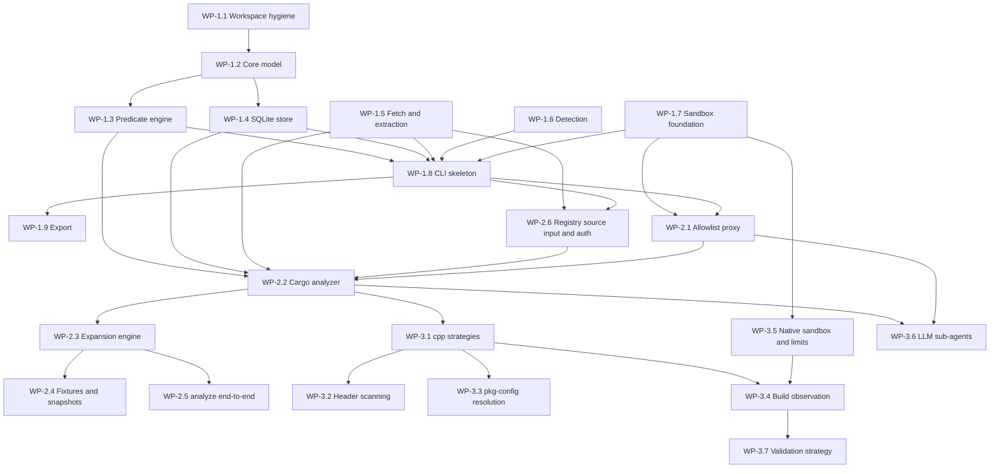
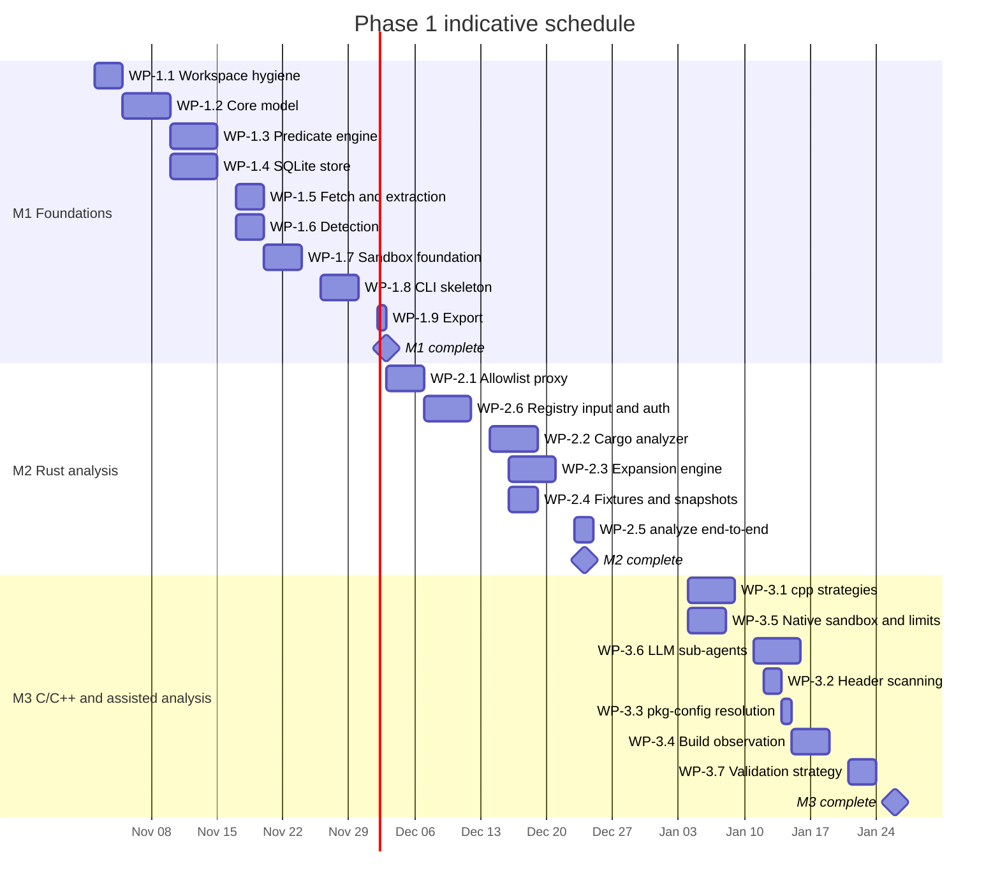

# robigus — Phase 1 Implementation Plan

Status: in progress — **M1 is complete**: every M1 work package meets its acceptance criteria, and the merge to `main`, push CI, and the nightly fuzz run have all passed. M2 has started: WP-2.1 (allowlist proxy) is implemented and verified locally. WP-2.6 (registry source input: a crate fetched from crates.io or a compatible sparse registry, including authenticated private registries) was added after M1 and is planned, not implemented. `analyze`, the Cargo analyzer, expansion, and M3 remain unimplemented.
Scope: v1 = Milestones M1–M3 (dependency graph analysis only)
Normative reference: [`../AGENTS.md`](../AGENTS.md) — if this plan and the spec disagree, the spec wins.

All paths are relative to the workspace root (the directory containing `Cargo.toml`, `rapt/`, and `robigus/`). The robigus crate lives in `robigus/`.

Review baseline: local workspace tests, formatting, clippy, documentation, doctests, fuzz-target clippy, `cargo audit`, and `cargo deny check` passed on Rust 1.93.1. The strict sandbox suite (`ROB_REQUIRE_BWRAP=1`, run as an unprivileged user) passed 22 tests; its two ignored entries are subprocess helpers invoked by other tests. With `ROB_NETWORK_TESTS=1` the live proxy smoke test also passed. Remote PR CI, push-to-`main` CI, and the nightly fuzz run passed for M1; WP-2.1 has not yet run in CI.

---

## 1. Summary

Phase 1 delivers a pure-async Rust library plus the `tsp-analyzer` CLI that can:

1. fetch a target software project (git URL, tarball URL, local path, or a published crate from crates.io or a compatible sparse registry, public or authenticated) into a content-addressed cache with safe extraction;
2. detect languages/build systems and select analyzers;
3. discover the complete transitive dependency graph for Rust/Cargo projects and the C/C++/assembly they use, recording predicates, evidence, and confidence;
4. persist that graph to a one-analysis-per-database SQLite store with resumable, per-node analysis status;
5. run all execution inside a mandatory, fail-closed sandbox with an allowlisted network;
6. validate (`check`), render (`print`), and export (`export`) the graph.

Ubuntu archive mapping (M4) and packaging plans (M5) are explicitly out of scope.

## 2. Ground rules

- **Spec sections are binding.** Each work package below cites the `AGENTS.md` sections it implements.
- **Edition 2024, MSRV 1.93.1 (the default Rust toolchain on Ubuntu 26.04 LTS), GPL-3.0-or-later.** The crate currently has `#![forbid(unsafe_code)]`; the planned native backend is the only permitted scoped exception, if needed.
- **Errors, never panics.** All library errors are typed (`thiserror`); the CLI renders them with `miette`. No `unwrap`/`expect` outside tests.
- **Determinism.** Analyzers MUST produce identical output for identical inputs: `BTreeMap`/`BTreeSet` ordering everywhere, sorted fixture output, redacted snapshots.
- **Fail closed.** If the sandbox cannot be established, nothing runs (exit 4). There is no `none` mode.
- **One database per analysis.** The store is the source of truth; resume reads and writes it.
- **Blocking work in `spawn_blocking`** (SQLite on a shared `Arc<Mutex<rusqlite::Connection>>`, `gix`, extraction, CPU-bound parsing).

## 3. Sequencing overview

### 3.1 Work-package dependency graph

### 3.2 Indicative schedule

Durations and dates below are original indicative estimates, not actual completion dates; parallel tracks assume a second reviewer, not a second implementer.

---

## 4. Milestone M1 — Foundations

Goal (spec §21): predicate AST and parser (including `cfg` atoms), model extensions (§5.4), SQLite store with `rusqlite_migration`, sandbox abstraction with fail-closed establishment, CLI skeleton, `check`, `print`, `export`; `robigus/Cargo.toml` metadata and a robigus `SECURITY.md`.

### WP-1.1 — Workspace and crate hygiene (S, ~2d)

**Spec refs:** §1.1, §18, §16 (CI).

Tasks:

- [x] `robigus/Cargo.toml`: add `description`, `license = "GPL-3.0-only"`, `repository`, `keywords`, `categories`, `rust-version = "1.93.1"`.
- [x] Workspace `Cargo.toml`: add shared deps — `petgraph`, `rusqlite` (bundled), `rusqlite_migration`, `tracing`, `tracing-subscriber`, `miette`, `sha2`, `tar`, `zstd`, `walkdir`, `ignore`, `toml`, `gix`, `cargo_metadata`, `toml_edit`; dev-deps `insta`, `proptest`, `wiremock`. (`reqwest`, `clap`, `flate2`, `xz2`, `regex`, `serde*`, `thiserror`, `tokio`, `ubuntu-info-rust` already exist. `chrono` was later replaced by `jiff` after RUSTSEC-2026-0543 reported it unmaintained.)
- [x] Add `deny.toml` and a `cargo deny` CI job (licenses must accept GPL-3.0-only family; advisories on).
- [x] Repository-level `SECURITY.md` covers the workspace; `robigus/SECURITY.md` gives robigus its own reporting path and sandbox scope (spec §17 updated accordingly).
- [x] CI: MSRV job pinned to 1.93.1, build/test triggers for pushes to `main` and PRs targeting `main`, a separate doctest step, a required unprivileged sandbox job, and a scheduled/manual nightly fuzz workflow (predicate and dpkg targets; the stale missing-target success fallback is removed).
- [x] Baseline: `cargo fmt --check`, `cargo clippy --locked --all-targets --all-features -- -D warnings`, `cargo doc --locked --no-deps --all-features` clean.

Acceptance: CI green on the PR (observed remotely); push-to-`main` CI follows the merge. `cargo deny check` passes; the manifest carries all §18 metadata. `tokio-rusqlite` has been removed from the workspace dependencies (the store uses `rusqlite` via `spawn_blocking`). Cargo's `unused_workspace_dependencies` warnings for `cargo_metadata` (WP-2.2) and `insta` (WP-2.4) are expected until those packages use them; they are warnings and do not fail CI.

### WP-1.2 — Core model extensions (M, ~4d)

**Spec refs:** §2, §3, §5.1–§5.4, §9, §18.

Files: `robigus/src/error.rs` (new), `robigus/src/model.rs`, `robigus/src/dpkg.rs`, `robigus/src/solver.rs`, `robigus/src/feature.rs` (new), `robigus/src/lib.rs`.

Tasks:

- [x] `error.rs`: `RobigusError` plus sub-errors (`StoreError`, `FetchError`, `PredicateError`, `DpkgError`, `SandboxUnavailable`) via `thiserror`; all implement `std::error::Error`.
- [x] `dpkg.rs`: make `PartialEq` agree with `Ord` (including `1.02`/`1.2`); add the equivalence proptest and use typed `DpkgError`.
- [x] Fix remaining dpkg contracts: comparison handles accepted UTF-8 without slicing panics, and equal versions including `1.0`/`1.0-0` hash equally. Deterministic, randomized, and differential `dpkg --compare-versions` tests cover the changes; a comparator fuzz target is configured.
- [x] `model.rs`: unify `PackageVersion::Debian` with `DpkgVersion` (variant becomes `Debian(DpkgVersion)`; `Display` omits epoch `0` and empty revision). Keep identity ordering (`Ord` on `PackageId`) separate from semantic version ordering.
- [x] `DependencyKind::Runtime`; correct the `Normal` doc comment; `Dependency.kind` becomes `BTreeSet<DependencyKind>`.
- [x] `Dependency.platform: Option<String>` → `predicate: Predicate`; `Dependency.features` → `BTreeSet<FeatureExpr>`.
- [x] `feature.rs`: `FeatureExpr` — `Simple("foo")`, `Optional("foo?")`, `DepFeature { dep, feature, weak }` (`foo/bar`, `foo?/bar`), `Dep("dep:foo")` — with parse/display round-trip against Cargo syntax.
- [x] `AnalysisStatus { NotStarted, Started, Complete, Error }` serialized exactly as `"Not_Started"`, `"Started"`, `"Complete"`, `"Error"`.
- [x] `MachineArch { Ubuntu(Architecture), All, Unsupported(String) }` with expansion helpers; default analysis set = `ubuntu-info-rust` `Architecture::ALL` minus `I386` (i.e. `amd64`, `amd64v3`, `arm64`, `armhf`, `ppc64el`, `riscv64`, `s390x`).
- [x] `SourceKind::Tarball { url, digest: Option<String> }`; deterministic tree-digest helper (SHA-256 over the canonical sorted file list + contents) for `SourceKind::Path`.
- [x] `Requirement`/`RequirementKind { Crate, PkgConfig, Header, Soname, Tool, Generic }`; `Node` and `Edge` structs per §5.1–§5.2.
- [x] `DependencyGraph`: `petgraph::stable_graph::StableDiGraph<Node, Edge>` + `BTreeMap<PackageId, NodeIndex>`; `add_node`, `add_edge` implementing the merge policy (union `kinds`, max confidence, merged evidence) over canonical-predicate edge identity (the predicate is canonicalized on insert, matching the store), `edges_from`/`edges_to`, `cycles()` (Tarjan SCCs and self-loops), roots as `BTreeSet<PackageId>`.
- [x] `PackageId` `Display` includes ecosystem and source kind.
- [x] `solver.rs`: delete `ModularSolver`, the always-`Equal` `debian_compare_versions` stub, and solver-only `ResolveError` paths; keep `DependencyProvider`/`ConflictPolicy`/`ConflictDomain` as the Phase 2 seam; fix `ConflictDomain::SideBySide` pre-1.0 keying (`major.minor` for `0.x`, `major.minor.patch` for `0.0.x`).
- [x] `lib.rs`: public module tree and re-exports for the implemented model and foundation APIs; the top-level analysis API remains M2 work.

Tests: unit tests per type; serde round-trips; dpkg property test; merge-policy unit tests.

Acceptance: model and solver-seam tests green, dpkg comparison is panic-free on accepted input with consistent `Eq`/`Ord`/`Hash`, and differential/fuzz coverage is present. The full §15 `analyze`/`AnalysisOptions` API is deferred to M2; this work package supplies the foundation only.

### WP-1.3 — Predicate engine (L, ~5d)

**Spec refs:** §4 (all), §5.3, §16.

Files: `robigus/src/predicate.rs`, `fuzz/` (new cargo-fuzz crate).

Tasks:

- [x] Lexer: identifiers, escaped strings, `!` `&&` `||`, parens, `true`/`false`; byte-span errors feeding `PredicateError` (miette-friendly).
- [x] Recursive-descent parser implementing the §4.2 EBNF exactly, including `cfg("key" = "value")` and qualified `feature("pkg/name")`.
- [x] Canonicalization: constant folding, de-duplication and sorting of operands under `&&`/`||`; idempotent; `canonical_text()` used for storage and equality.
- [x] `Display` renders the predicate as written; `canonical_text()` (the `Display` of `canonicalized()`) is the storage and equality form; serde (JSON) round-trip.
- [x] Evaluation: `Configuration { arches, platform, features: package → set, build_profiles, env, series, target_cfg }`; `Evaluator` with per-`Configuration` memoization; lazy evaluation; no cross-product enumeration.
- [x] `cfg` atoms evaluate against `target_cfg`; `arch("all")` expands to the `ubuntu-info-rust` set; `Unsupported` arch atoms evaluate `false`; `arch("amd64")` ≡ `cfg("target_arch" = "x86_64")` at evaluation time, and the store never rewrites between the forms.
- [x] DNF on demand with a node/term cap.
- [x] proptest: canonicalization idempotence; De Morgan equivalence; `eval(canonical(p)) == eval(p)`; `parse(display(p)) == p`.
- [x] cargo-fuzz targets: arbitrary UTF-8 `parse → display → parse`, and generated AST `canonicalize → display → parse` with canonicalization stability.
- [x] Add the full `parse arbitrary text → canonicalize → display → parse` chain and a dpkg comparator fuzz target. Nightly fuzz execution remains to be verified in CI.
- [x] Unit tests for every §4.5 example.

Acceptance: property tests and §4.5 examples pass; predicate and dpkg fuzz targets are configured. A scheduled workflow definition alone does not verify remote fuzz runs.

### WP-1.4 — SQLite store (L, ~5d)

**Spec refs:** §11 (all), §5.3, §15.

Files: `robigus/src/store.rs` (+ `store/schema.rs`, `store/migrations.rs`). The current lockfiles use bundled `rusqlite` 0.41.1, `rusqlite_migration` 2.7.0, and `libsqlite3-sys` 0.39.1 (patched SQLite), compatible with MSRV 1.93.1.

Tasks:

- [x] Migration v1 = the full §11.2 DDL (`metadata`, `package`, `dependency_edge`, `package_target`, `package_provides`, `package_conflicts`, `analysis_plan`, `tool_invocation` + indexes) via `rusqlite_migration` on `PRAGMA user_version`; forward-only; opening a newer-version database → `StoreError::SchemaTooNew` (exit 3).
- [x] Pragmas on open: WAL, `synchronous = NORMAL`, `mmap_size`, `foreign_keys = ON`, `temp_store = MEMORY`.
- [x] `Store` over a shared `Arc<Mutex<rusqlite::Connection>>` with every operation in `tokio::task::spawn_blocking` (§11.1); async API: `open`, `metadata` (read/write single row), `upsert_node`, `upsert_edges`, `upsert_plan_rows`, `plan_rows`, `update_status`, `record_invocation`, `load`, `check`.
- [x] `upsert_node`: identity conflict on `(name, version, ecosystem, source_kind, source_uri, source_precise)` → update `active_features`/`path`/targets/provides/conflicts. `status` is written on first insert only; later changes go through `update_status` (spec §22.19). Git identity is URL + commit; the requested reference goes in `source_reference` (not identity, §22.21). Ids that would not load back equal are rejected (`StoreError::Unrepresentable`).
- [x] `upsert_plan_rows` / `plan_rows`: rows keyed by subject (`root_path` for detection rows, `package_id` for node rows; exactly one), analyzer, §7.6 strategy, and `build_system` (spec §22.20); package rows require an existing package (no placeholder).
- [x] `upsert_edges`: single transaction; on partial-unique-index violation, SELECT the existing row and merge in Rust (union `kinds`, max confidence, merged evidence) then UPDATE — do not rely on `ON CONFLICT` against partial indexes.
- [x] `''` (not NULL) for absent values in unique-index columns (`path`, `soname`, `version`, `version_req`).
- [x] `update_status` enforces transitions: `Not_Started → Started → Complete | Error`; `Error → Started` (retry); `Complete` is terminal. It also enforces the plan invariants at write time: `Started` requires a plan row; `Error` requires a plan row with a recorded `error` (§22.19).
- [x] `load()`: rebuild `DependencyGraph`; validate every JSON column (`configuration`, `toolchain`, `options`, `kinds`, `predicate`, `evidence`, `active_features`) — parse failures are integrity failures.
- [x] `check()` → `IntegrityReport` per §11.3: schema version, `foreign_key_check`, duplicate identities, JSON validity, confidence bounds and tier caps (`LlmSubAgent` ≤ 79), status invariants (`Complete` ⇒ targeted deps `Complete`; `Started`/`Error` ⇒ plan rows exist; `Error` ⇒ recorded cause), unresolved-requirement counts by kind, SCC cycles, orphan nodes.
- [x] `record_invocation` persists argv/env and `log_path`; the caller is responsible for scrubbing secrets and supplying a workspace-relative path. The sandbox records arguments verbatim and documents that they must not contain secrets.
- [x] Export review hardening: reject unrepresentable paths, provide versions, durations, version constraints whose text does not round-trip, and overly deep JSON before writing; detect semantic duplicate package identities/edges and inconsistent target SONAMEs. `Some(VersionConstraint::Any)` is stored losslessly as the `@any` sentinel. Legacy data is not automatically repaired.

Tests: migration from empty DB; `SchemaTooNew` rejection; save/load round-trip; idempotent double-save (row counts unchanged); status-transition violations detected; corrupted JSON detected; concurrent reader during writer (WAL).

Acceptance: store migration, round-trip, idempotence, status-invariant, corruption, and concurrent-reader tests pass. The implemented API includes the store foundation; §15's top-level `analyze` and `AnalysisOptions` remain M2 work. The fail-closed representability and nesting restrictions are now part of spec §11.3: losslessness covers every value the store accepts.

### WP-1.5 — Fetch and safe extraction (M, ~3d)

**Spec refs:** §7.1, §7.2, §8.1 (registry fetch helper), §17.

Files: `robigus/src/fetch.rs`.

Tasks:

- [x] `SourceInput` dispatch: Git (via `gix` in `spawn_blocking`; record resolved commit; honor locked rev), Tarball (download via `reqwest`; verify a user/config-supplied digest, otherwise record SHA-256 with provenance `unverified`), Path (tree digest; analyze in place, read-only).
- [x] Content-addressed cache `cache/<kind>/<digest>` with XDG-cache default (lock-free, spec §22.27) — done; the `--cache <PATH>` flag lands with the CLI (WP-1.8).
- [x] Registry helper (`RegistryClient`) for WP-2.2: sparse-index lookup, `config.json` `dl` resolution (per-record `dl` overrides honored) + **mandatory** checksum verification against the index `cksum`; yanked versions refused. It is a library helper only: it is not a `SourceInput`, does not extract or cache, and the CLI cannot reach it.
- [x] Safe tar extraction (`tar` + `flate2`/`xz2`/`zstd`): reject absolute paths, `..` components, symlink/hardlink targets escaping the destination, device nodes, setuid/setgid entries; enforce entry-count and total-uncompressed-size limits; never execute anything.
- [x] `FetchOptions`: `DownloadLimits` (connect/request timeouts, streamed size cap) for tarballs and the registry client; `GitOptions` (wall-clock timeout, submodule depth/count limits, submodule URL scheme allowlist, `https` by default); git checkouts held to the extraction limits.
- [x] Git submodules checked out recursively at the superproject's pinned commits (spec §7.2, §22.24); `FetchedSource::source_id()` pins `precise` to the digest.
- [x] `FetchError` taxonomy mapped to exit codes — the taxonomy is done; the exit-code mapping lands with the CLI (WP-1.8).

Tests: malicious-tarball fixtures (traversal, absolute path, escaping symlink, device node, setuid, gzip bomb, entry-count overflow); digest verify/mismatch; cache hit/miss; download size cap and timeout; local-repository git fixtures (default and non-default branch, pinned submodule, scheme restriction, `update = none`, checkout limits).

Cache trust model (spec §7.2): the cache is trusted local state owned by the invoking user; digests are verified on install, and hits are not re-verified, so a cache must not be shared with less-trusted users. Deferred to WP-2.2: the registry helper rejects yanked releases, including potentially lockfile-pinned versions; decide and test the Cargo-compatible behavior there. (WP-2.6 sets the policy for an explicitly requested version: refused unless `--allow-yanked`.)

**Revision (post-M1): registry source input.** WP-1.5 delivered three `SourceInput` variants (Git, Tarball, Path). A fourth — a published crate version fetched from crates.io or any registry implementing the same sparse-index protocol — is now required, so a published crate can be analyzed as the target project without first locating its repository or tarball. It is planned as **WP-2.6** rather than reopening WP-1.5, because M1 is accepted and merged. WP-2.6 reuses this package's `RegistryClient`, safe extraction, cache, and `DownloadLimits`, fixes the defects found in review (index-path casing, download-URL markers, per-record `dl` overrides, unrestricted redirects), and adds registry authentication. WP-1.5's acceptance is unchanged.

Acceptance: every §7.2 hardening rule has a passing test.

### WP-1.6 — Detection (M, ~2d)

**Spec refs:** §7.3, §7.4.

Files: `robigus/src/detect.rs`.

Tasks:

- [x] `ProjectTree`: async `discover` (blocking walk in `spawn_blocking`) using the `ignore` crate with the skip list (`target/`, `vendor/`, `node_modules/`, `.git/`) and `DetectionLimits` (depth 64, 500,000 entries, 1 MiB build descriptions by default); problems are `DetectionDiagnostic`s, not silent (spec §7.3, §22.25).
- [x] `ProjectCharacteristics` (spec §7.4): name/version, languages, analyzers, build systems, test systems; architectures and platforms come from analyzers.
- [x] Marker table per §7.3 with per-signal confidence; `DetectionReport { signals }` sorted for determinism.
- [x] Root rule (spec §7.3, §22.17): membership and excludes are normalized; non-member crates and markers are recorded deterministically. The matched-member + nested `[workspace]` case is tested: the member stays in its ancestor root; the separate-root rule applies to non-members.
- [x] Detector registry for `cargo` and `cpp`; detection emits root-keyed `manifest` plan rows with the build system in its own field (§22.20), and records future-ecosystem markers as `Skipped`. These are detection-only implementations, not dependency analyzers.

Tests: fixtures for monorepo, vendored crate, nested workspace, non-member fixture crate, explicit `exclude`, member-glob and spelling normalization, marker-name independence, polyglot project, malformed/oversized/unreadable manifests, depth and entry limits, characteristics.

Acceptance: detection is deterministic and matches §7.3 semantics on fixtures.

### WP-1.7 — Sandbox foundation (L, ~4d)

**Spec refs:** §10 (all), §6.2, §18 (unsafe policy).

Files: `robigus/src/sandbox.rs`, `robigus/src/sandbox_seccomp.rs`.

Isolation boundary (implemented and tested as an unprivileged user):

- user, mount, PID, network, IPC and UTS namespaces; all capabilities dropped; nested user namespaces disabled;
- the source and system runtime are private read-only OverlayFS mounts remounted `nodev,nosuid`, so host sockets, FIFOs and devices under them are unreachable (previously reproduced through plain read-only binds);
- a seccomp filter limits `socket()` to IP families, `socketpair()` to fixed-peer Unix stream/seqpacket pairs, and denies io_uring and the kernel keyring syscalls (the host session keyring is not namespaced; this was reproduced); foreign ABIs and x32 are killed;
- a fixed `/usr/bin/bash` sanitizer closes every inherited descriptor except stdio and the filter before exec'ing bubblewrap, and fails closed if any survives;
- the availability probe uses the identical policy, so `SandboxUnavailable` means the full policy cannot be established.

Host requirement: bubblewrap ≥ 0.11 (first release with `--overlay-src`/`--ro-overlay`), i.e. Ubuntu 26.04 or later. Ubuntu 24.04 ships 0.9.0 and is unsupported; the probe checks `bwrap --version` first and reports an actionable `SandboxUnavailable` cause instead of an unknown-option failure.

Named Unix sockets are unavailable inside the sandbox. Cgroup/process resource limits remain WP-3.5; allowlisted networking is provided by WP-2.1. Informational: a workload can read bubblewrap's command line, which includes absolute host paths of the source and log directories (no file contents).

`SandboxUnavailable` reports backend probing failures; after selection, `SandboxError::BwrapSetup` reports bubblewrap launch, setup, or supervision failures with the stderr log. A missing completion report does not prove the command never ran. Bubblewrap's completion protocol requires a shell wrapper to restore stdin: a missing requested executable is reported as exit 127, and command signals are encoded as 128 + signal. Command cancellation terminates the child and leaves its pre-launch invocation marked `running`, indicating an interrupted execution. The canonical sandbox working directory is now recorded as `PWD`; non-UTF-8 working directories are rejected before launch.

Tasks:

- [x] `Sandbox` trait, `SandboxMode { Bwrap, Native }`, `SandboxPreference { Auto, Bwrap, Native }`, `CommandSpec`, `ProcessOutput`.
- [x] `establish_sandbox` fail-closed: probe `bwrap`, unprivileged user namespaces, and the full isolation policy; collect `Attempted { mechanism, cause }` for every mechanism tried; `SandboxUnavailable` carries the full list (drives exit 4 and the `no sandbox available` diagnostic).
- [x] bwrap backend: read-only source overlay, writable tmpfs for output **and** `CARGO_HOME`, `--unshare-net` by default, `--die-with-parent`, `--new-session`, minimal `/dev` and `/proc`, plus the seccomp and descriptor controls above.
- [x] Network-enabled sandbox requests fail explicitly until the proxy exists (WP-2.1); no unproxied IP egress fallback is provided. (Superseded by WP-2.1: `NetworkAccess::Allowlist(ProxyPolicy)` now runs through the proxy.)
- [x] Wall-clock timeouts (tokio timer + kill); stdout/stderr captured to workspace logs; environment scrubbed; `tool_invocation` recorded for every execution.
- [x] Crate-root `#![forbid(unsafe_code)]`; the native backend (M3) is the only scoped exception.

Tests: sandbox suite — loopback IP isolation; host stream/seqpacket sockets (top-level and nested) and datagram sockets; host FIFOs in both directions; inherited descriptors; fixed-peer socketpair IPC and `AF_UNIX` socket denial; host keyrings; nested user namespaces and capability/seccomp state; read-only source; hidden host home and environment; recorded `PWD`; setup-failure diagnostics; timeout and recording; a Cargo toolchain smoke test. Runner-gated with an explicit skip reason when the runner lacks namespace support; `ROB_REQUIRE_BWRAP=1` makes unavailable prerequisites fail the suite, and the required CI sandbox job sets it. BPF unit tests cover the filter's control flow, ABI guards and argument-width handling.

Acceptance: met. Fail-closed behavior and host-IPC isolation are verified locally as an unprivileged user, and the required hosted-runner sandbox job has passed remotely with `ROB_REQUIRE_BWRAP=1` (all 19 tests). History: the first remote run failed on `ubuntu-24.04` (bubblewrap 0.9.0 lacks overlay options, diagnosed but not confirmed from the log); the job now runs on `ubuntu-26.04`, enforces bubblewrap ≥ 0.11, logs bwrap's stderr and the namespace sysctls, and on failure lifts the AppArmor user-namespace restriction on the disposable VM. The second remote run passed the probe and 18 of 19 sandbox tests; the Cargo smoke test failed because the runner's rustup toolchain lives under `$HOME`, which the sandbox never exposes. The job now also installs the distribution `cargo` and `rustc` into `/usr/bin`.

### WP-1.8 — CLI skeleton (M, ~3d)

**Spec refs:** §14, §15, §17.

Files: `robigus/src/main.rs`, `robigus/src/cli.rs`, `robigus/src/commands/{mod,fetch,check,print}.rs` (export dispatch is in `mod.rs`).

Tasks:

- [x] clap derive: `fetch`, `analyze` (stub → WP-2.3), `check`, `print`, `export`, `version`; global `--db`, `--format`, `--offline`, `--sandbox <auto|bwrap|native>`, `--jobs`, `--verbose`, `--config`, `--cache`.
- [x] `--config` TOML parses acquisition limits and future network allowlist / sub-agent opt-in placeholders. Acquisition limits are applied; the allowlist is not enforced by `fetch`, and `[subagent]` does not enable an agent.
- [x] Exit-code mapping 0–5 from error kinds; `miette` graphical diagnostics.
- [x] `fetch` prints local path + digest; `check` runs the integrity report (exit 0/3); `print` loads the graph with `--kind`/`--depth`/`--status` filters (predicate filters and `--why` arrive in WP-2.3); `version`.
- [x] `tracing-subscriber` init keyed off `--verbose`.

Tests: `assert_cmd` integration tests per command, including the `--db`-required rule and exit codes 0/1/2/3 at process level; unit tests also verify exit codes 4 and 5 until `analyze` is implemented in WP-2.3.

Acceptance for the skeleton: implemented reader/export commands run against fixture databases; `analyze` explicitly returns not-implemented. Exit codes 0–3 have process-level tests; 4 and 5 have mapping unit tests only and require process-level analysis tests in WP-2.3/WP-2.5.

### WP-1.9 — Export (S, ~1d)

**Spec refs:** §11.3, §14.

Files: `robigus/src/export.rs`, `robigus/src/store.rs`, `robigus/src/commands/mod.rs`.

Tasks:

- [x] JSON export: one consistent database snapshot with metadata, full nodes, resolved and unresolved edges, roots, plans, and invocations; serde round-trip and `AnalysisSnapshot::to_analysis` reconstruction. Stored command arguments and environments are included without further redaction.
- [x] DOT export via `petgraph` `Dot` with labeled nodes and edges, including synthetic nodes for unresolved requirements — documented as lossy. `export` requires `--format json` or `--format dot`.

Tests: JSON snapshot round-trip and `Analysis` reconstruction; concurrent WAL snapshot; malformed records; DOT escaping, disconnected nodes, cycles and unresolved edges; CLI fixture databases and errors. Verification also covers lossy-value rejection before writes, semantic duplicate identities and edges, JSON nesting boundaries, and control-character predicates. Detectable legacy corruption fails closed; previously collapsed/lost distinctions cannot necessarily be recovered or detected, and there is no automatic repair. DOT escaping is tested at the document level; external Graphviz rendering is not part of the test suite.

Acceptance: JSON round-trips every snapshot the store accepts (spec §11.3); DOT is lossy. The store rejects, rather than alters, the few model values it cannot represent (non-UTF-8 or empty optional paths, empty provide versions, non-round-tripping constraint text, JSON nested beyond the default decoder limit); `Some(VersionConstraint::Any)` round-trips. Protect exported JSON: recorded arguments and environment are included.

---

## 5. Milestone M2 — Rust analysis

Goal (spec §21): Cargo analyzer (sandboxed `cargo metadata` with allowlisted network, unfiltered), transitive expansion with per-node status and resume, evidence/confidence merge, fixtures and snapshots.

### WP-2.1 — Allowlist proxy (L, ~4d)

**Spec refs:** §10.2, §7.6 (LLM endpoint allowlisting), §16.

Files: `robigus/src/sandbox/proxy/{mod,policy,server,tls}.rs`, `robigus/src/sandbox.rs` (transport and wiring), `robigus/src/cli.rs` (`[network]` configuration; the plan's separate `config.rs` was not needed).

Transport (spec decision 29): the sandbox keeps its own network namespace. A fixed bootstrap (`/usr/bin/python3 -I -S`) binds `127.0.0.1:3128` inside it and passes the listening socket to robigus over a private `SOCK_SEQPACKET` socketpair mapped to fd 4; the sandbox shell then closes fd 4 and `exec`s the workload, which holds neither the control socket nor the listener. robigus validates the received descriptor (one listening IPv4 TCP socket bound to the proxy address) and serves it until the sandbox exits, then gives in-flight connections a 2-second drain to log their close. Setup failures (bootstrap error, timeout, early exit) are `SandboxError::BwrapSetup` and the workload never starts.

Tasks:

- [x] In-process tokio proxy serving a listener created inside the sandbox's network namespace; `http_proxy`/`https_proxy`/uppercase forms/`CARGO_HTTP_PROXY` point at it, and callers cannot override them. Direct egress stays impossible (no route off the host); the seccomp policy is unchanged. `/etc/ssl/certs` is added read-only for network-enabled runs.
- [x] Request policy: HTTP/1.x `CONNECT` and absolute-form `GET`/`HEAD` `http://` only; literal DNS names only (IP literals and numeric names `403`); allowlist and port checks (default 80, 443); `Host` must match the target (required for HTTP; checked on `CONNECT` when present; duplicates refused); bodies, other methods, origin-form and `https://` without `CONNECT` refused. For `CONNECT`, robigus connects upstream first (`502`/`504` on failure), then requires a well-formed ClientHello whose SNI equals the `CONNECT` host; missing SNI, mismatched SNI, or non-TLS bytes close the tunnel before any client byte is forwarded. Allowed tunnels are relayed blindly (no MITM). Plain HTTP is forwarded in origin form without hop-by-hop/`Proxy-*` headers, one request per connection.
- [x] Host-side resolution refuses any name resolving to a non-public address (loopback, private, shared, link-local/metadata, unique-local, multicast, NAT64, ...); `ProxyPolicy::resolve` pins trusted addresses.
- [x] Default allowlist (`DEFAULT_ALLOWLIST`) with subdomain matching on label boundaries; `[network] allowlist` replaces, `allow` adds, `deny` removes (denial wins). `NetworkConfig::proxy_policy` validates entries as `HostName`s at config load. `--offline` maps to `NetworkAccess::Offline` once `analyze` lands (WP-2.3).
- [x] Logging: `proxy.jsonl` in the invocation's log directory (`request` record with decision/status/reason; `close` record with byte counts and duration), mirrored as `tracing` events under `robigus::proxy`. Client-supplied text is bounded and control characters replaced.

Tests: TLS ClientHello parser unit tests (fragmented records, missing SNI, malformed/duplicate extensions, truncation and corruption sweeps); request parsing/policy unit tests; host-name, allowlist and address-classification tests; in-process proxy tests with `wiremock` and an echo origin (allowed HTTP forwarding and header stripping, denials without upstream contact, non-public resolution, matching/mismatched/missing SNI with byte-level forwarding checks, upstream failure and header timeout, log assertions); sandbox integration tests (`allowlisted_network_is_mediated_by_the_proxy`: allowed, subdomain-denied, unlisted, IP-literal, direct-connection and port-takeover cases, descriptor isolation, recorded environment; `networked_missing_program_is_an_ordinary_exit_127`; `invalid_network_policy_is_rejected_before_launch`); live smoke test `cargo_metadata_reaches_crates_io_through_the_proxy`, enabled with `ROB_NETWORK_TESTS=1`.

Acceptance: §10.2 network rules enforced and verified locally as an unprivileged user (strict suite: 22 passed). The live smoke test passed locally: `cargo metadata --locked` resolved a crates.io dependency through the proxy, contacting only `index.crates.io` and `static.crates.io`. CI does not run the live test (it needs internet access); consider enabling `ROB_NETWORK_TESTS=1` in the sandbox job. Residual risks: domain fronting inside TLS, and exfiltration to allowlisted hosts (documented in `robigus/SECURITY.md`).

### WP-2.6 — Registry source input and authentication (L, ~5d)

**Spec refs:** §7.1, §7.2, §8.1, §10.2, §14, §15, §17. The spec is amended first (see the first task). Numbered 2.6 because it was added after M2 was planned; it is scheduled before WP-2.2, which reuses its registry client and identity rules.

Files: `robigus/src/fetch.rs` (or `robigus/src/fetch/registry.rs` if it grows), `robigus/src/credentials.rs` (new), `robigus/src/commands/fetch.rs`, `robigus/src/cli.rs` (`[registries]` config), `robigus/AGENTS.md`, `robigus/SECURITY.md`, `README.md`.

Goal: a `SourceInput` that names an exact crate version in a Cargo-compatible **sparse** registry: crates.io by default, or a private registry that serves the same index and `.crate` formats, with or without authentication. The `.crate` is downloaded, verified against the index checksum, extracted safely into the cache, and analyzed as the TSP. crates.io is the primary target; authenticated private registries are fully supported in v1 and designed in from the start rather than added later.

References: Cargo's [index format](https://doc.rust-lang.org/cargo/reference/registry-index.html), [registry authentication](https://doc.rust-lang.org/cargo/reference/registry-authentication.html) and [credential provider protocol](https://doc.rust-lang.org/cargo/reference/credential-provider-protocol.html).

#### Current state (gap analysis against the WP-1.5 helper)

- `RegistryClient` already provides sparse-index lookup, `config.json` `dl` resolution, mandatory checksum verification, yanked-version refusal, and `DownloadLimits`. It is unused outside tests and has no `SourceInput`, cache, CLI, offline path, or authentication.
- `SourceKind::CargoRegistry { index_url }` already exists, and the store persists and reconstructs it (`cargo-registry`). No new kind or schema migration is needed.
- Defects to fix:
  - **Index paths are not lowercased.** Sparse index file paths use the lowercased name (`index.crates.io/it/oa/Itoa` returns 404).
  - **Download URLs follow crates.io's layout, not the protocol.** When `config.json`'s `dl` has no markers, the protocol appends `/{crate}/{version}/download`; the helper appends `{name}/{name}-{version}.crate`. Only `{crate}` and `{version}` are substituted; `{prefix}`, `{lowerprefix}` and `{sha256-checksum}` are not.
  - **Per-record `dl` overrides.** `IndexRecord.dl` lets one index line redirect a download anywhere. It is not part of the documented format; remove it.
  - **One bad line fails every lookup.** Any unparsable line aborts the search, even for other versions.
  - **The checksum's format is not validated** before comparison.
  - **Redirects are unrestricted.** The shared HTTP client uses reqwest's default policy (10 redirects, any host, HTTPS-to-HTTP downgrade allowed). This also affects tarball downloads.

#### Design decisions

**Source input**

- **Variant:** `SourceInput::Registry { registry: RegistrySpec, name: String, version: semver::Version, digest: Option<String> }`. `RegistrySpec` holds the normalized index URL and, when chosen by name, the configured registry name (used for credential lookup and diagnostics, never for identity).
- **Exact versions only.** Requirement operators (`^`, `~`, `>=`, `*`) and "latest" are rejected: analyses must be reproducible.
- **Version matching ignores build metadata**, as the index format requires: each version appears once ignoring build metadata. Two records for the requested version that differ only in build metadata make the index malformed for that crate. The record's own `vers` is reported.
- **Name matching follows the index format.** The index file path uses the lowercased name; the name in a record is matched case-insensitively and reported as the index spells it. `-` and `_` are *not* interchangeable (that is a crates.io publishing rule, and `foo-bar` and `foo_bar` are different index files). When a name is not found, the error suggests the other spelling.
- **Name validation:** ASCII alphanumerics, `-` and `_`, starting with a letter, at most 64 characters (crates.io's rules). Names outside these rules are refused with a clear message.
- **`digest`** is an optional expected SHA-256. It must equal the index `cksum`, and it enables offline cache hits, as for tarballs.

**Registries and identity**

- **Sparse protocol only.** Index URLs must be `sparse+https://…`. A bare `https://…` URL is, in Cargo, a **git** index, so it is rejected with a hint that it looks like a git index and to use the registry's sparse URL. Git-protocol indexes are not supported in v1: they require cloning the whole index repository.
- **Normalization:** strip `sparse+`, lowercase the scheme and host, drop a default port, add a trailing slash, and reject userinfo, a query or a fragment. Production URLs must be `https`. Plain `http` is accepted only through a library-only option (`RegistryOptions::allow_insecure_http`, for tests); there is no CLI flag or config key.
- **Single crates.io identity:** crates.io is always `https://index.crates.io/`. The legacy git URL `https://github.com/rust-lang/crates.io-index` (as `registry+…` or bare, as Cargo writes it in `Cargo.lock` and `cargo metadata`) is mapped to it everywhere: source input, store identity, and WP-2.2's dependency mapping. Cargo makes the same substitution internally.
- **Package identity:** a registry package's `SourceId` is `CargoRegistry { index_url }` with `precise` set to the `.crate` checksum. This holds for fetched roots and for dependencies (WP-2.2 reads the checksum from `Cargo.lock`), so a crate that is both the root and a dependency is one node.
- **Default and named registries:** with no registry given, the index is crates.io. `[registries.<name>] index = "sparse+https://…"` in robigus's own config (Cargo's syntax) defines named registries; `--registry <NAME>` selects one and `--index <URL>` gives one directly. Unknown names are usage errors. Cargo's own config files are never read.

**Verification, caching and contents**

- **Checksum:** `cksum` must be 64 hex characters; the `.crate` must match it (mandatory, spec §7.2). The result is `Provenance::Verified`. The index is trusted transport over TLS, as in Cargo; there is no signature to check.
- **Yanked versions:** refused unless `--allow-yanked` is given. Then the fetch output reports `yanked: true`, and the flag is recorded in metadata options once `analyze` exists. This matches Cargo, which never resolves to a yanked version but allows one that is explicitly pinned.
- **Cache:** `cache/crate/<cksum>`, separate from `cache/tarball/`. The cached tree is the `.crate`'s single top-level `<name>-<version>/` directory, which must exist and be the only top-level entry; anything else is an extraction error. (A `.crate` fetched as a tarball URL today caches the wrapper directory, so the two layouts must not share a key.) Identical bytes from two registries share one entry, with distinct `SourceKind`s.
- **Contents:** the `.crate` is a gzip tarball and goes through the existing hardened `extract_tarball` and `ExtractionLimits` unchanged; nothing in it is executed. `Cargo.toml` (normalized), `Cargo.toml.orig` and `.cargo_vcs_info.json` are kept for later analysis.
- **Offline:** `fetch_offline` serves a registry source only with a pinned checksum (`--sha256`) whose cache entry exists. The yanked state cannot be checked offline and is reported as unknown. Index caching is follow-up work.

**Protocol robustness**

- **Index lookups:** request `config.json` first (as Cargo does), then the index file. 404, 410 and 451 on the index file mean "crate not found". Malformed lines for *other* versions are skipped; records whose schema version `v` is above 2 are skipped, as Cargo does; a malformed or duplicate record for the requested version is an error. Unknown `config.json` fields are ignored.
- **Download URL:** from `config.json`'s `dl` only. All five markers are supported (`{crate}`, `{version}`, `{prefix}`, `{lowerprefix}`, `{sha256-checksum}`); with no marker, `/{crate}/{version}/download` is appended. Name and version are percent-encoded where they are substituted.
- **Redirects (all fetches):** at most 5, and never from `https` to `http`. Cross-host redirects are allowed, because registries use CDNs; credentials are never forwarded across hosts (see below). This also hardens tarball fetches.

**Network policy**

- Registry fetches run on the host, like git and tarball fetches, under `DownloadLimits`. They do not use the sandbox proxy, and `[network]` does not apply to them. Their hosts are those the user named.

**Authentication**

Threat model: the token is a long-lived secret that grants access to private source code. It must not leak to hosts other than its registry, into the database, exports, logs, error messages, the process list, the sandbox, or core dumps, and it must not be stored by robigus.

- **When a token is used.** Only for registries whose `config.json` declares `"auth-required": true`, or that answer the unauthenticated `config.json` request with 401. In that case robigus obtains a token and retries `config.json` with it, as Cargo does. A token is never obtained, read or sent for registries that do not require one, including crates.io.
- **Where tokens come from.** robigus stores no tokens and never writes credentials. Per registry, in robigus's config, `credential-provider` selects exactly one source:
  - **Environment variable** (default for named registries): `ROBIGUS_REGISTRY_<NAME>_TOKEN`, where `<NAME>` is the registry name uppercased with `-` replaced by `_`. Intended for CI secret stores. The variable is read only when needed and never logged.
  - **Credential process:** a command implementing Cargo's credential provider protocol (`{"v":[1]}` hello, then a `get`/`read` request with the registry's index URL), so existing providers work unchanged (for example `cargo-credential-libsecret` and `cargo-credential-1password`). The command is given as an argument vector in robigus's config, never through a shell. It runs with a cleared environment plus `PATH` and `HOME`, no inherited descriptors except stdio, a timeout, and a bounded response. Its stderr is passed to the user; its stdout is parsed as protocol messages and never logged. Responses with `cache: "never"` are not reused; `session` and `expires` are cached in memory only, for one robigus process, and dropped at expiry.
  - **Token file:** a path named explicitly in config, for systems without a keyring. The file must be owned by the invoking user, be a regular file not reached through a symlink, and have no group or other permissions (mode `0600` or stricter); otherwise robigus refuses to read it. It holds the token on its first line.
- **Never used:** `~/.cargo/credentials.toml`, Cargo config, `CARGO_REGISTRY_TOKEN` or `CARGO_REGISTRIES_*_TOKEN`, Cargo's built-in providers by name, `.netrc`, and tokens on the command line (which would appear in the process list and shell history). The `--index` flag never uses credentials, so an ad-hoc URL cannot receive a token meant for a named registry.
- **Scoping.** A token is bound to its registry's index URL. It is sent as the `Authorization` header only to the index host and to the `dl` host from that registry's `config.json` when both use `https`. It is never sent on a cross-host redirect, an `http` request, or to any other host. Redirects to another host proceed without the header; if that fails, the error says so.
- **In memory.** Tokens are held in a `RegistryToken` type that does not implement `Display`, `Serialize` or `Clone`; its `Debug` prints `RegistryToken(<redacted>)`; it is zeroed on drop with the `zeroize` crate (already in the tree through rustls). The header value is marked sensitive (`HeaderValue::set_sensitive`) so HTTP tracing omits it. Core dumps are disabled for the process while a token is held (`prctl(PR_SET_DUMPABLE, 0)` on Linux, through `rustix`).
- **Never recorded.** Tokens and `Authorization` headers never appear in `FetchedSource`, the store, `tool_invocation`, exports, proxy logs, `tracing` output or error text. Error messages from registries and credential processes are bounded and passed through a filter that redacts the active token if a server echoes it.
- **Not in the sandbox.** Tokens are used only by the host-side fetch. They are never placed in a sandbox environment, file or argument, and `cargo metadata` inside the sandbox receives none. Analyzing a project whose *dependencies* live in an authenticated registry therefore needs a design for in-sandbox authentication, recorded as a WP-2.2 follow-up; until then such dependencies stay declared-but-unresolved with a recorded reason.
- **Diagnostics.** 401 and 403 produce distinct errors ("authentication required", "token rejected or lacks access"), naming the registry and the configured credential source but never the token. A `WWW-Authenticate: Cargo login_url="…"` value is shown so users know where to obtain a token. There is no retry loop.
- **Maintenance.** Tokens are revoked and rotated at the registry and its credential provider, not in robigus; nothing robigus holds needs cleanup. `robigus/SECURITY.md` documents the supported sources, the recommendation to use a credential process or CI secret store over a token file, least-privilege read-only tokens, and rotation.

**CLI**

- `tsp-analyzer fetch crate:<name>@<version>` uses crates.io; `--registry <NAME>` or `--index <URL>` selects another registry; `--sha256` pins the checksum; `--allow-yanked` as above. The `crate:` prefix is recognized only when followed by a valid name, `@`, and an exact version; to fetch a local directory of that name, write `./crate:…`. `--branch`, `--tag` and `--rev` are usage errors with a registry source. `--format json` adds `name`, `version` and `yanked` (`true`, `false` or `null` when unknown offline).
- Config: `[registries.<name>]` with `index` (required) and `credential-provider`, one of `{ env = true }` (default), `{ process = ["/path/to/provider", "--arg"] }`, or `{ file = "/path/to/token" }`. Validated at load: index URLs must be `sparse+https`, process paths must be absolute, and file paths must be absolute.

#### Tasks

- [ ] **Spec amendment:** §7.1 (fourth input), §7.2 (registry acquisition, sparse-only, cache kind and layout, offline rule, redirect rule), §8.1 (crates.io identity and checksum-pinned registry identity), §10.2 (tokens never enter the sandbox), §14 (`fetch`/`analyze` source syntax and flags), §15 (`SourceInput::Registry`, `RegistrySpec`), §17 (credential handling), and recorded decisions (sparse-only, exact versions, checksum-keyed cache and identity, crates.io identity mapping, yanked policy, authentication model).
- [ ] **HTTP client:** a restricted redirect policy for all fetches (at most 5, no HTTPS-to-HTTP downgrade), and per-request `Authorization` only for in-scope hosts.
- [ ] **Registry client fixes:** lowercase index paths; case-insensitive name matching without `-`/`_` folding; build-metadata-insensitive version matching; tolerant line parsing with skipping of `v > 2`; 404/410/451 handling; `cksum` validation; full `dl` markers and the no-marker default; removal of the per-record `dl` override; permissive `config.json` parsing; `auth-required` and 401 detection.
- [ ] **Index URL handling:** `sparse+https` parsing and normalization, rejection of bare and git URLs, and the crates.io legacy-URL mapping as one shared function also used by WP-2.2.
- [ ] **Credentials module:** `RegistryToken`, the environment, credential-process and token-file sources, in-memory session caching, core-dump suppression, error redaction, and token scoping.
- [ ] **Source input:** `SourceInput::Registry` dispatch in `fetch` and `fetch_offline`; `fetch_registry` downloads with the client, then on a blocking thread verifies, extracts into scratch space, checks the single top-level directory and installs into `cache/crate/<cksum>` atomically. A pinned-checksum cache hit makes no network request.
- [ ] **CLI and config:** `crate:<name>@<version>`, `--registry`, `--index`, `--allow-yanked`, the `[registries]` table with validation, and JSON output fields.
- [ ] **Documentation:** rustdoc with examples; `README.md`, `robigus/SECURITY.md`, and `fetch --help`.

#### Tests

- **Registry protocol (`wiremock`):** `dl` with and without markers and with each marker; mixed-case names and 1-, 2-, 3- and 4+-character index paths; `-`/`_` names are distinct and the error suggests the other spelling; build metadata; checksum mismatch and malformed `cksum`; malformed lines for other versions skipped, duplicate or malformed records for the requested version rejected; `v: 3` records skipped; 404/410/451; yanked refused and allowed; size caps and timeouts.
- **Redirects:** HTTPS-to-HTTP downgrade refused; more than 5 hops refused; cross-host redirect allowed without `Authorization`; tarball fetches covered too.
- **Authentication (`wiremock` with an auth-required registry):**
  - 401 on `config.json` triggers token retrieval and a retried request with the header; `auth-required: true` is honoured; a public registry is never sent a token;
  - the header reaches only the index host and the configured `dl` host, never a redirect target, other host, or `http` URL;
  - 403 versus 401 diagnostics, and the `login_url` hint;
  - each source: environment variable; credential process (hello, `get` request contents, `cache` modes and expiry, `url-not-supported`/`not-found`/`other` errors, timeout, oversized or malformed output, environment cleared); token file permission, owner and symlink checks;
  - redaction: a canary token never appears in `Debug` output, errors (including a server that echoes it), `tracing` output, the store, `tool_invocation` or exports;
  - `--index` never uses credentials; Cargo credential files and `CARGO_REGISTRIES_*` variables are ignored even when present.
- **Archives:** a well-formed `.crate`; a missing, extra or misnamed top-level directory; every existing extraction-hardening fixture packaged as a `.crate`.
- **Cache and offline:** a cache hit makes no requests; offline with `--sha256` hits; offline without a pin or with a cold cache gives `OfflineCacheMiss`; identical bytes from two registries share one entry.
- **Identity:** `sparse+https://index.crates.io/`, `registry+https://github.com/rust-lang/crates.io-index` and the bare legacy URL all map to one identity; a registry `SourceId` round-trips through `upsert_node` and `load`.
- **CLI:** `crate:` parsing (valid, missing version, `^1`, invalid names, conflicts with git flags), named registries, unknown names (exit 2), `[registries]` validation, JSON fields.
- **Live, behind `ROB_NETWORK_TESTS=1`:** fetch `itoa@1.0.11` from crates.io and compare its digest with the known index checksum.

#### Acceptance

A published crate version can be fetched by name and exact version from crates.io, from a `wiremock` public sparse registry, and from a `wiremock` authenticated registry using each credential source. Archives are checksum-verified, extracted with the full §7.2 hardening, cached by checksum, and served offline when pinned. Git-protocol and bare-URL registries fail with explicit diagnostics. No test observes a token outside the `Authorization` header of an in-scope HTTPS request. The live crates.io test passes locally.

### WP-2.2 — Cargo analyzer (L, ~5d)

**Spec refs:** §8.1, §4.1, §5.3, §7.6.

Files: `robigus/src/analyzers/cargo.rs`.

Existing foundations: Cargo marker detection, `FeatureExpr` parsing, source/cache helpers, and graph types. There is no Cargo dependency analyzer or `ProjectAnalyzer::analyze` implementation yet.

Tasks:

- [ ] Run `cargo metadata --format-version 1` **unfiltered** inside the sandbox (writable `CARGO_HOME` tmpfs, proxy env); record `tool_invocation` (argv, scrubbed env, cargo/rustc versions).
- [ ] Map `cargo_metadata::Metadata` → nodes (workspace members as roots) and edges (`dep_kinds` → `kinds` set; `[target.'cfg(...)']` → `cfg` atoms; `optional = true` → feature predicates).
- [ ] Use the existing `FeatureExpr` parser for `dep:foo` / `foo?/bar` in Cargo analysis; populate per-node `active_features` from the resolve graph.
- [ ] `toml_edit` fallback for `--offline`: declared-but-unresolved edges (`to = None`), `Manifest` evidence, `network_mode = "offline"` in metadata, reduced confidence.
- [ ] `build.rs` static scan (regex-based in M2; tree-sitter later): `cc`/`cxx`/`bindgen`/`pkg-config`/`cmake`/`meson` usage, `cargo:` directives, `links` key → `BuildScript`/`SourceScan` evidence at L2; discovered system requirements become unresolved edges.
- [ ] Registry fetches via the registry client as fixed in WP-2.6 (checksum mandatory); git deps via `gix` at the locked rev; path deps with the containment rule — an escaping path dependency marks the node `Error`.
- [ ] Registry identity (WP-2.6 rules): map Cargo's `source` strings with WP-2.6's shared index-URL function — crates.io's legacy `registry+https://github.com/rust-lang/crates.io-index` becomes `https://index.crates.io/`, and `sparse+…` is normalized. Set each registry node's `precise` to its checksum from `Cargo.lock` (the `checksum` field), so a crate that is both the root and a dependency is one node. A registry dependency with no lockfile checksum, or from another git-protocol index, stays declared-but-unresolved with a recorded reason.
- [ ] Dependencies in authenticated registries: WP-2.6 tokens never enter the sandbox, so `cargo metadata` cannot read such registries. Record these dependencies as declared-but-unresolved with a reason naming the registry, and design in-sandbox authentication (for example, the host-side proxy adding the `Authorization` header for that registry's hosts) as a separate follow-up.
- [ ] Confidence mapping per the §5.3 ladder: Manifest+Lockfile agreement L4; Manifest alone L3; SourceScan L2; ToolOutput L3–L4.
- [ ] Determinism: sorted everything.

Tests: fixtures (features, target-specific deps, workspace, git/path deps, vendored crate); insta snapshots with redactions.

Acceptance: analyzer output is deterministic; evidence respects tier caps; §8.1 rules hold.

### WP-2.3 — Expansion engine (L, ~5d)

**Spec refs:** §7.7, §9, §14 (`print --why`), §5.1.

Files: `robigus/src/expand.rs`, `robigus/src/commands/analyze.rs`, `robigus/src/commands/print.rs`.

Tasks:

- [ ] Work queue with `BTreeSet` ordering and a `--jobs` concurrency limit; analyzers `Send + Sync`.
- [ ] Status lifecycle: persist `Started` **before** work; `Complete` only when every targeted dependency is `Complete`; `Error` records the cause in plan rows.
- [ ] Wire the already-implemented graph/store edge merging (union `kinds`, max confidence, merged evidence) into expansion.
- [ ] Wire the existing Tarjan SCC detection into expansion findings. Define SCC-level completion semantics: requiring every dependency to be `Complete` first cannot independently complete a legal cycle.
- [ ] Limits: depth (max distance from roots) and node count → stop, exit 5, non-`Complete` nodes remain queryable.
- [ ] Resume: verify recorded source identity (URI + digest) and configuration against the request → exit 3 on mismatch; skip `Complete`, re-run `Started`, retry `Error`.
- [ ] Wire the `analyze` command: fetch → detect → roots → expand → store.
- [ ] `print --why <PKG|REQUIREMENT>`: reverse walk expanding predicates that contain feature atoms; add predicate filters `--arch`/`--platform`/`--feature`/`--build-profile`/`--series`/`--env` evaluated against the recorded configuration.

Tests: resume (inject a mid-run failure, re-run, assert transitions), limits → exit 5, `check` status invariants, `--why` provenance on feature fixtures.

Acceptance: §7.7 semantics verified end-to-end; `analyze` command complete.

### WP-2.4 — Fixtures and snapshots (M, ~2d)

**Spec refs:** §16.

Files: `robigus/tests/fixtures/**`, `robigus/tests/snapshots/**`, `robigus/tests/README.md`.

Existing detection, store, CLI, and export tests use temporary/synthetic fixtures; the planned analyzer fixture tree, `insta` snapshots, and review checklist do not exist yet. `insta` is declared in the workspace but is not a `robigus` dev-dependency.

Tasks:

- [ ] Fixture projects: feature-gated deps; target-specific deps (`cfg` os/family/arch); `build.rs` using `cc` + `pkg-config`; workspace with members; git dependency (local git fixture repo); path dependency; path-escape attempt; vendored crate; mixed C.
- [ ] insta redactions: absolute paths → `<TMP>`, tool versions → `<VER>`, timestamps → `<TIME>`.
- [ ] Snapshot review checklist in `tests/README.md`.

Acceptance: snapshots identical across CI and local runs.

### WP-2.5 — `analyze` end-to-end integration (M, ~2d)

**Spec refs:** §14, §16.

Files: `robigus/tests/integration/analyze.rs`.

Tasks:

- [ ] E2E: `analyze` fixture → `check` → `print` → `export`.
- [ ] E2E resume; E2E limits (exit 5); E2E identity mismatch (exit 3).
- [ ] E2E offline (`--offline` → `toml_edit` fallback, `network_mode = "offline"`).

Acceptance: §16 integration bullets green.

---

## 6. Milestone M3 — C/C++ and assisted analysis

Goal (spec §21): `cpp` analyzer (CMake/Meson/Autotools/Make strategies), sandboxed build-observation strategy, LLM sub-agent integration with anchor verification and the L3 confidence cap.

### WP-3.1 — cpp analyzer strategies (L, ~5d)

**Spec refs:** §7.3, §8.2.

Files: `robigus/src/analyzers/cpp.rs` (+ `cpp/{cmake,meson,autotools,make}.rs`).

Tasks:

- [ ] CMake: `find_package`, `target_link_libraries`, `pkg_check_modules`.
- [ ] Meson: `dependency()`, `find_library`.
- [ ] Autotools: `configure.ac` `PKG_CHECK_MODULES`, `AC_CHECK_LIB`, `AC_CHECK_HEADERS`.
- [ ] Make: `-l` flags, `pkg-config` invocations.
- [ ] Output: unresolved `Requirement` edges (`PkgConfig`/`Header`/`Soname`/`Tool`/`Generic`) with `SourceScan` evidence at L2; wire the §7.3 detection markers to these strategies.

Tests: per-strategy fixtures; snapshots.

Acceptance: every §8.2 parse target is covered by a fixture.

### WP-3.2 — Header scanning (S, ~1d)

**Spec refs:** §8.2.

Tasks:

- [ ] Scan `#include <...>` over project sources (skip `vendor/`, `target/`); de-duplicate; emit `Header` requirements with L2 evidence.

Tests: mixed-C fixture.

### WP-3.3 — pkg-config resolution (S, ~1d)

**Spec refs:** §8.2, §10.

Tasks:

- [ ] Run `pkg-config --exists`/`--modversion` inside the sandbox for discovered modules (`PKG_CONFIG_PATH` pointed at fixture `.pc` files in tests); `ToolOutput` evidence; the unresolved requirement is retained regardless of resolution.

### WP-3.4 — Build observation (L, ~4d)

**Spec refs:** §7.6, §10, §11 (`tool_invocation`).

Files: `robigus/src/analyzers/observation.rs`.

Tasks:

- [ ] Run `configure`/`cmake`/`meson setup`/`cargo build` in the sandbox under timeouts and resource limits.
- [ ] Parse ELF `NEEDED` entries from built artifacts with the `goblin` crate (no external `readelf` dependency — new dep to add to §6.3 table).
- [ ] Capture `pkg-config` calls via a PATH-shimmed wrapper that logs invocations.
- [ ] Record `tool_invocation`; `BuildObservation` evidence at L4 when cross-checked against static analysis, else L3.

Tests: fixture that builds a small C library; assert `NEEDED` extraction.

### WP-3.5 — Native sandbox backend and resource limits (L, ~4d)

**Spec refs:** §10.2.

Files: `robigus/src/sandbox/native.rs`.

Tasks:

- [ ] `unshare` user/mount/PID/network namespaces via `nix`; Landlock ruleset (read-only source, writable tmpfs); seccomp allowlist via `seccompiler` (new dep — note: spec §6.3 lists only `landlock` + `nix`; `seccompiler` is added to cover the seccomp requirement).
- [ ] cgroup v2 limits (memory/pids/CPU) when delegation is available; otherwise fall back to timeouts + process limits and record the degradation in metadata.
- [ ] `--sandbox native` selects this backend; `auto` prefers bwrap.

Tests: run the WP-1.7 sandbox suite against the native backend (runner-gated).

Acceptance: §10.2 satisfied on hosts without bwrap.

### WP-3.6 — LLM sub-agents (L, ~5d)

**Spec refs:** §7.6, §5.3, §17.

Files: `robigus/src/analyzers/subagent.rs`, `robigus/src/config.rs`.

Tasks:

- [ ] Opt-in via config (endpoint and model); settle the final schema against the current `[subagent] enabled` placeholder. The endpoint MUST be added to the network allowlist explicitly.
- [ ] Orchestrator: build context from README/build docs + file inventory; define the sandboxed execution and credential boundary required by spec §17, then call the API through the proxy and parse a structured response (path, start_line, end_line, summary, identifiers). A host-side `reqwest` call alone is not the required sandboxed sub-agent.
- [ ] **Anchor verification**: define and enforce construct/AST-level verification as required by spec §7.6, not merely line/identifier presence; discard unverifiable claims and record the failure in `analysis_plan`.
- [ ] **No-code-reproduction**: reject responses containing long verbatim quotes.
- [ ] Evidence: `EvidenceMethod::LlmSubAgent`, confidence ≤ 79 (L3 cap); never sole evidence when a deterministic method exists — flag when it is.
- [ ] Record `tool_invocation` with a scrubbed prompt digest; never place host secrets in prompt context.

Tests: `wiremock` mock LLM — valid anchors accepted, invalid anchors discarded, cap enforced, prompt-injection attempt (TSP content instructing exfiltration or policy changes) has no effect.

Acceptance: every §7.6 rule has a passing test.

### WP-3.7 — Validation strategy (M, ~2d)

**Spec refs:** §7.6, §8.1.

Tasks:

- [ ] Re-analyze a node with a second method; diff the edge sets; record disagreements as findings (plan `detail` + report).
- [ ] Cross-checks: `cargo metadata` vs `toml_edit`; `cargo metadata --filter-platform <triple>` vs unfiltered evaluation for target-specific deps.

Tests: fixture with a known divergence between methods.

---

## 7. Cross-cutting work

| Item | Where | Notes |
|---|---|---|
| MSRV CI job (1.93.1) | WP-1.1 | Passed remotely on the PR |
| `cargo deny` (licenses + advisories) | WP-1.1 | Passed remotely on the PR and locally |
| Nightly fuzz CI job | WP-1.3 | Scheduled/manual workflow with predicate and dpkg targets; fails if no targets are found and uploads crash artifacts on failure. Passed remotely after the M1 merge |
| Sandbox-capable CI job | WP-1.7, WP-2.1 | Required unprivileged `ROB_REQUIRE_BWRAP=1` job in the CI gate on `ubuntu-26.04` (bubblewrap ≥ 0.11, distribution `cargo`/`rustc`, `python3`). Passed remotely for M1. The live proxy test needs `ROB_NETWORK_TESTS=1`, which the job does not set yet |
| Push-trigger CI | WP-1.1 | Build/test workflow triggers on pushes to `main` and PRs targeting `main` |
| rustdoc with examples | each WP | Every public item in `robigus` and `rapt` is documented, and both crates enable `#![warn(missing_docs)]` (CI's `-D warnings` makes a gap a failure). Key entry points have doctests (graph, predicates, dpkg, features, store, export, detection, fetch, sandbox); new APIs must keep this up |
| Workspace README | DoD | `README.md` at the workspace root gives an overview of both crates, a `tsp-analyzer` quickstart, library examples, sandbox host requirements, and the development workflow. Update it when `analyze` lands (M2) |
| Security policy | WP-1.1 | `robigus/SECURITY.md` with its own reporting path and sandbox scope; root `SECURITY.md` covers the workspace |
| Tag `v0.1.0` | DoD | After Definition of Done below |

## 8. Test matrix (spec §16 → work packages)

| §16 category | WPs |
|---|---|
| Unit tests | WP-1.2, WP-1.3, WP-1.4 |
| Fixtures | WP-1.6, WP-2.4, WP-3.1 |
| Snapshot tests (insta, redacted) | WP-2.2, WP-2.4, WP-3.1 |
| Property tests (proptest) | WP-1.2 (dpkg), WP-1.3 (predicates) |
| Fuzzing (cargo-fuzz, nightly) | Predicate and dpkg comparator targets configured; remote runs unverified |
| Differential dpkg vs `dpkg --compare-versions` | WP-1.2 — implemented; skips with reason if dpkg unavailable |
| Store: migrations, round-trip, idempotent upsert | WP-1.4 |
| Resume / status transitions | WP-2.3, WP-2.5 |
| Limits → exit 5 | WP-2.3, WP-2.5 |
| Extraction hardening | WP-1.5, WP-2.6 (`.crate` archives) |
| Path containment | WP-2.2 |
| Sandbox escape / fail-closed | WP-1.7, WP-3.5 |
| Integration (assert_cmd/predicates/tempfile) | WP-1.8, WP-2.5 |
| HTTP mocking (wiremock) | WP-1.5, WP-2.1, WP-2.6 (sparse registry), WP-3.6 |
| CI gates (fmt/clippy/doc/test/audit/deny/MSRV) | WP-1.1 |

## 9. PR slicing

Proposed slicing only, not a record of actual PRs or merge state; each eventual PR must keep the full CI gate green.

| PR | Contents | Gate |
|---|---|---|
| 1 | WP-1.1 hygiene + CI additions | CI green, deny clean |
| 2 | WP-1.2 model + dpkg fix + solver cleanup | unit + property tests |
| 3 | WP-1.3 predicate engine (+ fuzz targets) | property + §4.5 examples |
| 4 | WP-1.4 store | store test suite |
| 5 | WP-1.5 fetch/extraction | hardening tests |
| 6 | WP-1.6 detection | fixture tests |
| 7 | WP-1.7 sandbox foundation | sandbox suite |
| 8 | WP-1.8 CLI skeleton | integration tests |
| 9 | WP-1.9 export | round-trip test; CI gate including the sandbox job green — **M1 done** |
| 10 | WP-2.1 proxy | proxy unit/wiremock tests; sandbox proxy integration tests; live smoke test |
| 10a | Spec amendment + WP-2.6 registry source input | registry wiremock and `.crate` hardening tests; redirect tests; CLI tests; live crates.io fetch |
| 10b | WP-2.6 registry authentication | auth-required wiremock registry; credential-source tests; token redaction and scoping tests |
| 11 | WP-2.2 cargo analyzer | snapshots |
| 12 | WP-2.3 expansion + `analyze` + `print --why` | resume/limit tests |
| 13 | WP-2.4 fixtures + WP-2.5 E2E | E2E green — **M2 done** |
| 14 | WP-3.1–3.3 cpp analyzer | fixture tests |
| 15 | WP-3.5 native sandbox | sandbox suite (native) |
| 16 | WP-3.4 build observation | observation tests |
| 17 | WP-3.6 LLM sub-agents | mock-LLM tests |
| 18 | WP-3.7 validation + docs sweep | full gate — **M3 done** |

## 10. Risk register

| Risk | Impact | Likelihood | Mitigation |
|---|---|---|---|
| Unprivileged user namespaces blocked (stock Ubuntu AppArmor) | Tool unusable on some hosts | High on default installs | Fail-closed diagnostics (WP-1.7); document operator guidance; test the exit-4 path |
| Host IPC through sandbox mounts or inherited state | Offline sandbox could reach host services | Mitigated | Private `nodev` overlays, seccomp socket/keyring policy, descriptor sanitation; regressions for sockets, FIFOs, descriptors and keyrings run in the required sandbox job |
| Dpkg comparison/hash regressions | Hashed identities could behave incorrectly | Mitigated | UTF-8, `Eq`/`Hash`, differential, property, and fuzz-target coverage added; verify scheduled fuzz runs |
| Local cache contents tampered after publication | Cache hit returned as verified despite modified contents | Low (trusted-cache policy) | Spec §7.2: the cache is user-owned trusted state and must not be shared with less-trusted users |
| `cargo metadata` needs network + writable `CARGO_HOME` inside sandbox | Primary analyzer fails | Low (smoke test passes locally) | WP-2.1 proxy + tmpfs `CARGO_HOME`; live smoke test behind `ROB_NETWORK_TESTS=1` |
| Proxy breaks cargo TLS | Analysis fails | Low | CONNECT passthrough after host and SNI validation — no MITM; CA bundle overlaid read-only |
| Domain fronting or exfiltration through allowlisted hosts | Data leaves via a permitted endpoint | Medium | Documented residual risk; narrow `[network]` for untrusted analyses; every request logged |
| Host lacks `/usr/bin/python3` | Network-enabled analysis unavailable | Low on Ubuntu | Fails closed with `SandboxError::NetworkUnavailable`; offline analysis unaffected |
| `ON CONFLICT` vs partial unique indexes | Duplicate edges | Medium | Merge in Rust on constraint violation (WP-1.4) |
| insta snapshot churn across environments | CI flakiness | Medium | Redactions from day one (WP-2.4); review checklist |
| petgraph graph not serializable | Data loss on load | None by design | Store is source of truth; `load()` rebuilds the graph |
| LLM anchor verification false positives/negatives | Bad or dropped evidence | Medium | Loose identifier matching + findings recorded; L3 cap bounds impact |
| `gix` API churn | Build breakage | Low | Pin version; isolate behind `fetch.rs` |
| cargo-fuzz nightly job maintenance | CI noise | Low | Scheduled job, separate from the PR gate |
| CI runner lacks namespace support or a new enough bubblewrap | Sandbox job fails | Low on `ubuntu-26.04` (observed on `ubuntu-24.04`; resolved) | The required job sets `ROB_REQUIRE_BWRAP=1`, so missing support fails rather than skips; pinned to `ubuntu-26.04` with a bubblewrap ≥ 0.11 check; AppArmor restriction lifted only on the disposable VM |
| Host bubblewrap older than 0.11 (e.g. Ubuntu 24.04's 0.9.0) | Tool unusable on that host | Medium on LTS installs | Fail closed with an explicit version diagnostic; document the requirement; the native backend (WP-3.5) is the long-term fallback |
| Regex-based `build.rs` analysis false positives | Wrong edges | Medium | L2 confidence cap; build observation (WP-3.4) cross-checks |
| Private registries differ from crates.io (download-URL markers, index casing, extra `config.json` fields) | Registry fetches fail or hit the wrong URL | Medium | Implement the registry protocol's full `dl` rules, not crates.io's layout (WP-2.6); `wiremock` registries for each `dl` form; permissive `config.json` parsing |
| Registry token leaks (logs, errors, store, exports, other hosts, sandbox, core dumps) | Exposure of private source code | Medium without controls | WP-2.6 design: no token storage; per-registry host scoping; no forwarding on redirects or `http`; redacted `RegistryToken` zeroed on drop; core dumps disabled; tokens never enter the sandbox; canary-token tests across every output |
| Credential process misbehaves or hangs | Fetch blocks or leaks environment | Low | Argument vector without a shell; cleared environment; timeout; bounded output; stdout never logged |
| Dependencies hosted in authenticated registries | `cargo metadata` in the sandbox cannot resolve them | Medium for private-registry users | Recorded as declared-but-unresolved with a reason; in-sandbox authentication designed as a WP-2.2 follow-up |
| Unrestricted HTTP redirects (existing tarball and registry fetches) | Downgrade to `http`, or credentials sent to another host | Medium | WP-2.6 redirect policy for all fetches: at most 5 hops, no HTTPS-to-HTTP, no `Authorization` across hosts |
| Registry sources that are only available through git-protocol indexes | Cannot fetch from them | Low (crates.io and major registries offer sparse) | Explicit usage error suggesting the sparse URL; documented non-goal for v1 |

## 11. Definition of Done (Phase 1)

- [ ] All M1–M3 work packages meet their acceptance criteria and are merged; the PR slicing above is illustrative, not a list of required PR numbers.
- [ ] All four source inputs (git, tarball, local path, registry crate) fetch, verify, and cache as specified; registry fetches work against crates.io and against compatible private sparse registries, with and without authentication, and tokens never appear outside in-scope HTTPS `Authorization` headers.
- [ ] `tsp-analyzer analyze` completes on positive fixtures; negative fixtures produce their expected rejection/status/exit code. `check`, `print` (incl. `--why`), and `export` work on the results.
- [ ] Resume verified: interrupted run → re-run → all nodes `Complete`; identity mismatch → exit 3.
- [ ] Limits verified: truncated graph → exit 5 with queryable non-`Complete` nodes.
- [ ] Sandbox: fail-closed verified (exit 4 with diagnostics); bwrap and native backends pass the sandbox suite on a required capable runner; the allowlist proxy blocks non-allowlisted hosts. (Host-IPC isolation is fixed for bwrap and passes locally.)
- [ ] Offline mode produces declared-but-unresolved graphs with `network_mode = "offline"`.
- [ ] LLM sub-agents: opt-in only, anchor-verified, capped at L3, injection-resistant (tested).
- [ ] CI green on PR and push: fmt, clippy `-D warnings`, doc, test, audit, deny, MSRV 1.93.1; nightly fuzz running. (Observed for M1; must stay green through M2/M3.)
- [x] `robigus/Cargo.toml` carries full §18 metadata; `robigus/SECURITY.md` exists with its own reporting path (spec §17).
- [ ] Differential and fuzz tests cover dpkg comparison; accepted-input and `Eq`/`Hash` fixes are implemented, but scheduled fuzz runs remain to be verified.
- [x] rustdoc complete for the current public API (enforced by `missing_docs`); README quickstart. Both must be extended as M2/M3 add APIs and `analyze`.
- [ ] Tag `v0.1.0`.

## 12. Explicit non-goals during Phase 1

- No Ubuntu archive mapping, no `rapt` integration, no packaging templates (M4/M5).
- No cross-ecosystem version solving; no re-implementation of Cargo's resolver or feature unification.
- No `import` command (JSON export is lossless; import is future work).
- No ecosystems beyond Rust/Cargo and the C/C++/assembly used by Rust projects.
- No platforms other than `linux` expanded; unsupported architectures/platforms recorded as stubs only.
- No git-protocol registry indexes, and no version-requirement resolution ("latest", `^1.2`) for registry source inputs; registry inputs name an exact version in a sparse registry (WP-2.6).
- No token storage, `login`/`logout` commands, or use of Cargo's credential files, config or `CARGO_REGISTRIES_*` variables: robigus reads tokens only from its own configured sources (WP-2.6).
- No authentication for registry dependencies resolved inside the sandbox in Phase 1 (WP-2.2 follow-up).
