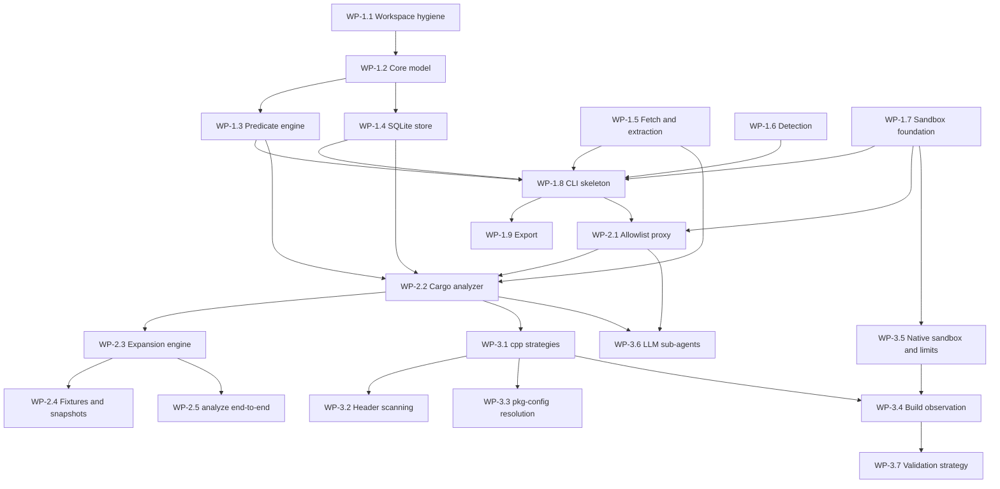
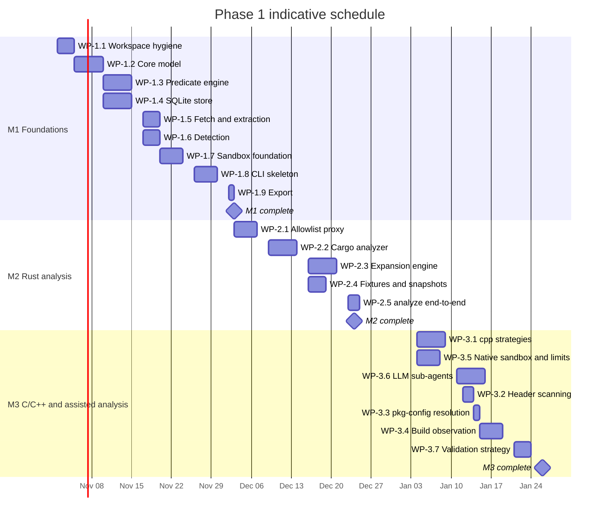

# robigus — Phase 1 Implementation Plan

Status: proposed
Scope: v1 = Milestones M1–M3 (dependency graph analysis only)
Normative reference: [`../AGENTS.md`](../AGENTS.md) — if this plan and the spec disagree, the spec wins.

All paths are relative to the workspace root (the directory containing `Cargo.toml`, `rapt/`, and `robigus/`). The robigus crate lives in `robigus/`.

---

## 1. Summary

Phase 1 delivers a pure-async Rust library plus the `tsp-analyzer` CLI that can:

1. fetch a target software project (git URL, tarball URL, or local path) into a content-addressed cache with safe extraction;
2. detect languages/build systems and select analyzers;
3. discover the complete transitive dependency graph for Rust/Cargo projects and the C/C++/assembly they use, recording predicates, evidence, and confidence;
4. persist that graph to a one-analysis-per-database SQLite store with resumable, per-node analysis status;
5. run all execution inside a mandatory, fail-closed sandbox with an allowlisted network;
6. validate (`check`), render (`print`), and export (`export`) the graph.

Ubuntu archive mapping (M4) and packaging plans (M5) are explicitly out of scope.

## 2. Ground rules

- **Spec sections are binding.** Each work package below cites the `AGENTS.md` sections it implements.
- **Edition 2024, MSRV 1.93.1 (the default Rust toolchain on Ubuntu 26.04 LTS), GPL-3.0-only.** `#![forbid(unsafe_code)]` at the crate root; the only scoped `#[allow(unsafe_code)]` lives in `sandbox.rs`.
- **Errors, never panics.** All library errors are typed (`thiserror`); the CLI renders them with `miette`. No `unwrap`/`expect` outside tests.
- **Determinism.** Analyzers MUST produce identical output for identical inputs: `BTreeMap`/`BTreeSet` ordering everywhere, sorted fixture output, redacted snapshots.
- **Fail closed.** If the sandbox cannot be established, nothing runs (exit 4). There is no `none` mode.
- **One database per analysis.** The store is the source of truth; resume reads and writes it.
- **Blocking work in `spawn_blocking`** (SQLite on a shared `Arc<Mutex<rusqlite::Connection>>`, `gix`, extraction, CPU-bound parsing).

## 3. Sequencing overview

### 3.1 Work-package dependency graph

### 3.2 Indicative schedule

Durations are indicative person-day estimates for a single implementer; parallel tracks assume a second reviewer, not a second implementer.

---

## 4. Milestone M1 — Foundations

Goal (spec §21): predicate AST and parser (including `cfg` atoms), model extensions (§5.4), SQLite store with `rusqlite_migration`, sandbox abstraction with fail-closed establishment, CLI skeleton, `check`, `print`, `export`; `robigus/Cargo.toml` metadata and a robigus `SECURITY.md`.

### WP-1.1 — Workspace and crate hygiene (S, ~2d)

**Spec refs:** §1.1, §18, §16 (CI).

Tasks:

- [ ] `robigus/Cargo.toml`: add `description`, `license = "GPL-3.0-only"`, `repository`, `keywords`, `categories`, `rust-version = "1.93.1"`.
- [ ] Workspace `Cargo.toml`: add shared deps — `petgraph`, `rusqlite` (bundled), `rusqlite_migration`, `tracing`, `tracing-subscriber`, `miette`, `sha2`, `tar`, `zstd`, `walkdir`, `ignore`, `toml`, `gix`, `cargo_metadata`, `toml_edit`; dev-deps `insta`, `proptest`, `wiremock`. (`reqwest`, `clap`, `flate2`, `xz2`, `chrono`, `regex`, `serde*`, `thiserror`, `tokio`, `ubuntu-info-rust` already exist.)
- [ ] Add `deny.toml` and a `cargo deny` CI job (licenses must accept GPL-3.0-only family; advisories on).
- [ ] Add a robigus `SECURITY.md` with its own reporting path (the workspace one points at `rapt`).
- [ ] CI: add an MSRV job pinned to 1.93.1; trigger workflows on pushes as well as PRs; reserve a nightly fuzz job (wired up once targets exist in WP-1.2/WP-1.3).
- [ ] Baseline: `cargo fmt --check`, `cargo clippy --locked --all-targets --all-features -- -D warnings`, `cargo doc --locked --no-deps --all-features` clean.

Acceptance: CI green on PR and push; `cargo deny check` passes; manifest carries all §18 metadata.

### WP-1.2 — Core model extensions (M, ~4d)

**Spec refs:** §2, §3, §5.1–§5.4, §9, §18.

Files: `robigus/src/error.rs` (new), `robigus/src/model.rs`, `robigus/src/dpkg.rs`, `robigus/src/solver.rs`, `robigus/src/feature.rs` (new), `robigus/src/lib.rs`.

Tasks:

- [ ] `error.rs`: `RobigusError` plus sub-errors (`StoreError`, `FetchError`, `PredicateError`, `DpkgError`, `SandboxUnavailable`) via `thiserror`; all implement `std::error::Error`.
- [ ] `dpkg.rs`: fix the `Eq`/`Ord` contract — `PartialEq` MUST agree with `Ord` (today `1.02 != 1.2` under `==` while `Ord` says `Equal`). Add a proptest asserting `a == b ⇔ a.cmp(b) == Equal`. Convert `parse` to a typed `DpkgError`.
- [ ] `model.rs`: unify `PackageVersion::Debian` with `DpkgVersion` (variant becomes `Debian(DpkgVersion)`; `Display` omits epoch `0` and empty revision). Keep identity ordering (`Ord` on `PackageId`) separate from semantic version ordering.
- [ ] `DependencyKind::Runtime`; correct the `Normal` doc comment; `Dependency.kind` becomes `BTreeSet<DependencyKind>`.
- [ ] `Dependency.platform: Option<String>` → `predicate: Predicate`; `Dependency.features` → `BTreeSet<FeatureExpr>`.
- [ ] `feature.rs`: `FeatureExpr` — `Simple("foo")`, `Optional("foo?")`, `DepFeature { dep, feature, weak }` (`foo/bar`, `foo?/bar`), `Dep("dep:foo")` — with parse/display round-trip against Cargo syntax.
- [ ] `AnalysisStatus { NotStarted, Started, Complete, Error }` serialized exactly as `"Not_Started"`, `"Started"`, `"Complete"`, `"Error"`.
- [ ] `MachineArch { Ubuntu(Architecture), All, Unsupported(String) }` with expansion helpers; default analysis set = `ubuntu-info-rust` `Architecture::ALL` minus `I386` (i.e. `amd64`, `amd64v3`, `arm64`, `armhf`, `ppc64el`, `riscv64`, `s390x`).
- [ ] `SourceKind::Tarball { url, digest: Option<String> }`; deterministic tree-digest helper (SHA-256 over the canonical sorted file list + contents) for `SourceKind::Path`.
- [ ] `Requirement`/`RequirementKind { Crate, PkgConfig, Header, Soname, Tool, Generic }`; `Node` and `Edge` structs per §5.1–§5.2.
- [ ] `DependencyGraph`: `petgraph::stable_graph::StableDiGraph<Node, Edge>` + `BTreeMap<PackageId, NodeIndex>`; `add_node`, `add_edge` implementing the merge policy (union `kinds`, max confidence, merged evidence) over canonical-predicate edge identity (the predicate is canonicalized on insert, matching the store), `edges_from`/`edges_to`, `scc()` (Tarjan), roots as `BTreeSet<PackageId>`.
- [ ] `PackageId` `Display` includes ecosystem and source kind.
- [ ] `solver.rs`: delete `ModularSolver`, the always-`Equal` `debian_compare_versions` stub, and solver-only `ResolveError` paths; keep `DependencyProvider`/`ConflictPolicy`/`ConflictDomain` as the Phase 2 seam; fix `ConflictDomain::SideBySide` pre-1.0 keying (`major.minor` for `0.x`, `major.minor.patch` for `0.0.x`).
- [ ] `lib.rs`: public module tree and re-exports matching the §15 sketch.

Tests: unit tests per type; serde round-trips; dpkg property test; merge-policy unit tests.

Acceptance: `cargo test -p robigus` green; no solver stub remains; the public API compiles as sketched in §15.

### WP-1.3 — Predicate engine (L, ~5d)

**Spec refs:** §4 (all), §5.3, §16.

Files: `robigus/src/predicate.rs`, `fuzz/` (new cargo-fuzz crate).

Tasks:

- [ ] Lexer: identifiers, escaped strings, `!` `&&` `||`, parens, `true`/`false`; byte-span errors feeding `PredicateError` (miette-friendly).
- [ ] Recursive-descent parser implementing the §4.2 EBNF exactly, including `cfg("key" = "value")` and qualified `feature("pkg/name")`.
- [ ] Canonicalization: constant folding, de-duplication and sorting of operands under `&&`/`||`; idempotent; `canonical_text()` used for storage and equality.
- [ ] `Display` renders the canonical text; serde (JSON) round-trip.
- [ ] Evaluation: `Configuration { arches, platform, features: package → set, build_profiles, env, series, target_cfg }`; `Evaluator` with per-`Configuration` memoization; lazy evaluation; no cross-product enumeration.
- [ ] `cfg` atoms evaluate against `target_cfg`; `arch("all")` expands to the `ubuntu-info-rust` set; `Unsupported` arch atoms evaluate `false`; `arch("amd64")` ≡ `cfg("target_arch" = "x86_64")` at evaluation time, and the store never rewrites between the forms.
- [ ] DNF on demand with a node/term cap.
- [ ] proptest: canonicalization idempotence; De Morgan equivalence; `eval(canonical(p)) == eval(p)`; `parse(display(p)) == p`.
- [ ] cargo-fuzz target: `parse → canonicalize → display → parse` must succeed and be stable.
- [ ] Unit tests for every §4.5 example.

Acceptance: fuzz + property tests wired into CI (nightly for fuzz); all §4.5 examples pass.

### WP-1.4 — SQLite store (L, ~5d)

**Spec refs:** §11 (all), §5.3, §15.

Files: `robigus/src/store.rs` (+ `store/schema.rs`, `store/migrations.rs`).

Tasks:

- [ ] Migration v1 = the full §11.2 DDL (`metadata`, `package`, `dependency_edge`, `package_target`, `package_provides`, `package_conflicts`, `analysis_plan`, `tool_invocation` + indexes) via `rusqlite_migration` on `PRAGMA user_version`; forward-only; opening a newer-version database → `StoreError::SchemaTooNew` (exit 3).
- [ ] Pragmas on open: WAL, `synchronous = NORMAL`, `mmap_size`, `foreign_keys = ON`, `temp_store = MEMORY`.
- [ ] `Store` over a shared `Arc<Mutex<rusqlite::Connection>>` with every operation in `tokio::task::spawn_blocking` (§11.1); async API: `open`, `metadata` (read/write single row), `upsert_node`, `upsert_edges`, `update_status`, `record_invocation`, `load`, `check`.
- [ ] `upsert_node`: identity conflict on `(name, version, ecosystem, source_kind, source_uri, source_precise)` → update `status`/`active_features`/`path`.
- [ ] `upsert_edges`: single transaction; on partial-unique-index violation, SELECT the existing row and merge in Rust (union `kinds`, max confidence, merged evidence) then UPDATE — do not rely on `ON CONFLICT` against partial indexes.
- [ ] `''` (not NULL) for absent values in unique-index columns (`path`, `soname`, `version`, `version_req`).
- [ ] `update_status` enforces transitions: `Not_Started → Started → Complete | Error`; `Error → Started` (retry); `Complete` is terminal.
- [ ] `load()`: rebuild `DependencyGraph`; validate every JSON column (`configuration`, `toolchain`, `options`, `kinds`, `predicate`, `evidence`, `active_features`) — parse failures are integrity failures.
- [ ] `check()` → `IntegrityReport` per §11.3: schema version, `foreign_key_check`, duplicate identities, JSON validity, confidence bounds and tier caps (`LlmSubAgent` ≤ 79), status invariants (`Complete` ⇒ targeted deps `Complete`; `Started`/`Error` ⇒ plan rows exist; `Error` ⇒ recorded cause), unresolved-requirement counts by kind, SCC cycles, orphan nodes.
- [ ] `record_invocation` writes scrubbed argv/env and a workspace-relative `log_path`.

Tests: migration from empty DB; `SchemaTooNew` rejection; save/load round-trip; idempotent double-save (row counts unchanged); status-transition violations detected; corrupted JSON detected; concurrent reader during writer (WAL).

Acceptance: store tests green; schema matches §11.2 exactly; `Store` API matches §15.

### WP-1.5 — Fetch and safe extraction (M, ~3d)

**Spec refs:** §7.1, §7.2, §8.1 (registry fetch helper), §17.

Files: `robigus/src/fetch.rs`.

Tasks:

- [ ] `SourceInput` dispatch: Git (via `gix` in `spawn_blocking`; record resolved commit; honor locked rev), Tarball (download via `reqwest`; verify a user/config-supplied digest, otherwise record SHA-256 with provenance `unverified`), Path (tree digest; analyze in place, read-only).
- [ ] Content-addressed cache `cache/<kind>/<digest>`; `--cache <PATH>` with XDG-cache default.
- [ ] Registry helper for WP-2.2: sparse-index lookup + `static.crates.io` download + **mandatory** checksum verification against the index `cksum`.
- [ ] Safe tar extraction (`tar` + `flate2`/`xz2`/`zstd`): reject absolute paths, `..` components, symlink/hardlink targets escaping the destination, device nodes, setuid/setgid entries; enforce entry-count and total-uncompressed-size limits; never execute anything.
- [ ] `FetchError` taxonomy mapped to exit codes.

Tests: malicious-tarball fixtures (traversal, absolute path, escaping symlink, device node, setuid, gzip bomb, entry-count overflow); digest verify/mismatch; cache hit/miss.

Acceptance: every §7.2 hardening rule has a passing test.

### WP-1.6 — Detection (M, ~2d)

**Spec refs:** §7.3, §7.4.

Files: `robigus/src/detect.rs`.

Tasks:

- [ ] `ProjectTree`: `ignore`-crate walk with the skip list (`target/`, `vendor/`, `node_modules/`, `.git/`) and a depth limit.
- [ ] Marker table per §7.3 with per-signal confidence; `DetectionReport { signals }` sorted for determinism.
- [ ] Root rule (spec §7.3, §22.17): Cargo `members` globs (`*` does not cross `/`) and `exclude` path prefixes, both normalized; inside a Cargo root, only directories with their own `[workspace]` or crates listed explicitly in `exclude` become separate roots, and other non-member crates are recorded (`DetectionReport::non_member_crates`) but not rooted; markers attach to roots shallowest first so roots never depend on marker file names; vendored crates are never roots.
- [ ] Analyzer registry: `cargo`, `cpp`; future-ecosystem markers recorded as `Skipped` plan rows.

Tests: fixtures for monorepo, vendored crate, nested workspace, non-member fixture crate, explicit `exclude`, member-glob and spelling normalization, marker-name independence, polyglot project.

Acceptance: detection is deterministic and matches §7.3 semantics on fixtures.

### WP-1.7 — Sandbox foundation (L, ~4d)

**Spec refs:** §10 (all), §6.2, §18 (unsafe policy).

Files: `robigus/src/sandbox.rs`.

Tasks:

- [ ] `Sandbox` trait, `SandboxMode { Bwrap, Native }`, `SandboxPreference { Auto, Bwrap, Native }`, `CommandSpec`, `ProcessOutput`.
- [ ] `establish_sandbox` fail-closed: probe `bwrap` and unprivileged-userns availability; collect `Attempted { mechanism, cause }` for every mechanism tried; `SandboxUnavailable` carries the full list (drives exit 4 and the `no sandbox available` diagnostic).
- [ ] bwrap backend: read-only source bind, writable tmpfs for output **and** `CARGO_HOME`, `--unshare-net` by default, `--die-with-parent`, `--new-session`, minimal `/dev` and `/proc`.
- [ ] Network: disabled in M1. Requesting network before the proxy exists (WP-2.1) MUST fail closed with an explicit error — never silently allow egress.
- [ ] Wall-clock timeouts (tokio timer + kill); stdout/stderr captured to workspace logs; environment scrubbed; `tool_invocation` recorded for every execution.
- [ ] Crate-root `#![forbid(unsafe_code)]`; the native backend (M3) is the only scoped exception.

Tests: sandbox suite (no egress, no writes outside workspace, fail-closed diagnostics when unavailable) — runner-gated with an explicit skip reason when the CI runner lacks namespace support.

Acceptance: fail-closed behavior verified; a trivial command runs isolated under bwrap.

### WP-1.8 — CLI skeleton (M, ~3d)

**Spec refs:** §14, §15, §17.

Files: `robigus/src/main.rs`, `robigus/src/cli.rs`, `robigus/src/commands/{fetch,check,print,export,version}.rs`.

Tasks:

- [ ] clap derive: `fetch`, `analyze` (stub → WP-2.3), `check`, `print`, `export`, `version`; global `--db`, `--format`, `--offline`, `--sandbox <auto|bwrap|native>`, `--jobs`, `--verbose`, `--config`, `--cache`.
- [ ] `--config` TOML file: network allowlist overrides, limits, sub-agent opt-in placeholder.
- [ ] Exit-code mapping 0–5 from error kinds; `miette` graphical diagnostics.
- [ ] `fetch` prints local path + digest; `check` runs the integrity report (exit 0/3); `print` loads the graph with `--kind`/`--depth`/`--status` filters (predicate filters and `--why` arrive in WP-2.3); `version`.
- [ ] `tracing-subscriber` init keyed off `--verbose`.

Tests: `assert_cmd` integration tests per command, including every exit code and the `--db`-required rule.

Acceptance: all M1 commands run against fixture databases; §14 exit codes verified.

### WP-1.9 — Export (S, ~1d)

**Spec refs:** §11.3, §14.

Files: `robigus/src/commands/export.rs` (+ `src/export.rs` helpers).

Tasks:

- [ ] JSON export: serde serialization of the full `Analysis` (metadata, nodes, edges, plans, invocations) — lossless by construction.
- [ ] DOT export via `petgraph` `Dot` with node/edge labels — documented as lossy.

Tests: JSON → `Analysis` round-trip equality; DOT smoke test.

Acceptance: §11.3 losslessness holds for JSON.

---

## 5. Milestone M2 — Rust analysis

Goal (spec §21): Cargo analyzer (sandboxed `cargo metadata` with allowlisted network, unfiltered), transitive expansion with per-node status and resume, evidence/confidence merge, fixtures and snapshots.

### WP-2.1 — Allowlist proxy (L, ~4d)

**Spec refs:** §10.2, §7.6 (LLM endpoint allowlisting), §16.

Files: `robigus/src/sandbox/proxy.rs`, `robigus/src/config.rs`.

Tasks:

- [ ] In-process tokio listener on the host side, exposed to the sandbox through proxy env vars (`HTTP_PROXY`/`HTTPS_PROXY`); direct egress blocked by the network namespace.
- [ ] HTTPS: filter `CONNECT` by SNI/Host; HTTP: filter by `Host`. Allowed → blind TCP passthrough (no MITM; TLS stays end-to-end). Denied → close + log.
- [ ] Default allowlist: `crates.io`, `ubuntu.com`, `github.com`, `gitlab.com`, `codeberg.org` subdomains; `[network] allow/deny` config overrides; `--offline` disables egress entirely.
- [ ] Request logging via `tracing` to a workspace log file.

Tests: `wiremock` allowed/denied hosts; log assertions; smoke test running `cargo metadata` through the proxy inside the sandbox.

Acceptance: §10.2 network rules enforced; cargo reaches crates.io through the proxy and nothing else.

### WP-2.2 — Cargo analyzer (L, ~5d)

**Spec refs:** §8.1, §4.1, §5.3, §7.6.

Files: `robigus/src/analyzers/cargo.rs`.

Tasks:

- [ ] Run `cargo metadata --format-version 1` **unfiltered** inside the sandbox (writable `CARGO_HOME` tmpfs, proxy env); record `tool_invocation` (argv, scrubbed env, cargo/rustc versions).
- [ ] Map `cargo_metadata::Metadata` → nodes (workspace members as roots) and edges (`dep_kinds` → `kinds` set; `[target.'cfg(...)']` → `cfg` atoms; `optional = true` → feature predicates).
- [ ] `FeatureExpr` parsing for `dep:foo` / `foo?/bar`; per-node `active_features` from the resolve graph.
- [ ] `toml_edit` fallback for `--offline`: declared-but-unresolved edges (`to = None`), `Manifest` evidence, `network_mode = "offline"` in metadata, reduced confidence.
- [ ] `build.rs` static scan (regex-based in M2; tree-sitter later): `cc`/`cxx`/`bindgen`/`pkg-config`/`cmake`/`meson` usage, `cargo:` directives, `links` key → `BuildScript`/`SourceScan` evidence at L2; discovered system requirements become unresolved edges.
- [ ] Registry fetches via the WP-1.5 helper (checksum mandatory); git deps via `gix` at the locked rev; path deps with the containment rule — an escaping path dependency marks the node `Error`.
- [ ] Confidence mapping per the §5.3 ladder: Manifest+Lockfile agreement L4; Manifest alone L3; SourceScan L2; ToolOutput L3–L4.
- [ ] Determinism: sorted everything.

Tests: fixtures (features, target-specific deps, workspace, git/path deps, vendored crate); insta snapshots with redactions.

Acceptance: analyzer output is deterministic; evidence respects tier caps; §8.1 rules hold.

### WP-2.3 — Expansion engine (L, ~5d)

**Spec refs:** §7.7, §9, §14 (`print --why`), §5.1.

Files: `robigus/src/expand.rs`, `robigus/src/commands/analyze.rs`, `robigus/src/commands/print.rs`.

Tasks:

- [ ] Work queue with `BTreeSet` ordering and a `--jobs` concurrency limit; analyzers `Send + Sync`.
- [ ] Status lifecycle: persist `Started` **before** work; `Complete` only when every targeted dependency is `Complete`; `Error` records the cause in plan rows.
- [ ] Edge merge on insert (union `kinds`, max confidence, merged evidence) — shared with `Store::upsert_edges`.
- [ ] SCC cycle detection (Tarjan) recorded as findings, never errors.
- [ ] Limits: depth (max distance from roots) and node count → stop, exit 5, non-`Complete` nodes remain queryable.
- [ ] Resume: verify recorded source identity (URI + digest) and configuration against the request → exit 3 on mismatch; skip `Complete`, re-run `Started`, retry `Error`.
- [ ] Wire the `analyze` command: fetch → detect → roots → expand → store.
- [ ] `print --why <PKG|REQUIREMENT>`: reverse walk expanding predicates that contain feature atoms; add predicate filters `--arch`/`--platform`/`--feature`/`--build-profile`/`--series`/`--env` evaluated against the recorded configuration.

Tests: resume (inject a mid-run failure, re-run, assert transitions), limits → exit 5, `check` status invariants, `--why` provenance on feature fixtures.

Acceptance: §7.7 semantics verified end-to-end; `analyze` command complete.

### WP-2.4 — Fixtures and snapshots (M, ~2d)

**Spec refs:** §16.

Files: `robigus/tests/fixtures/**`, `robigus/tests/snapshots/**`, `robigus/tests/README.md`.

Tasks:

- [ ] Fixture projects: feature-gated deps; target-specific deps (`cfg` os/family/arch); `build.rs` using `cc` + `pkg-config`; workspace with members; git dependency (local git fixture repo); path dependency; path-escape attempt; vendored crate; mixed C.
- [ ] insta redactions: absolute paths → `<TMP>`, tool versions → `<VER>`, timestamps → `<TIME>`.
- [ ] Snapshot review checklist in `tests/README.md`.

Acceptance: snapshots identical across CI and local runs.

### WP-2.5 — `analyze` end-to-end integration (M, ~2d)

**Spec refs:** §14, §16.

Files: `robigus/tests/integration/analyze.rs`.

Tasks:

- [ ] E2E: `analyze` fixture → `check` → `print` → `export`.
- [ ] E2E resume; E2E limits (exit 5); E2E identity mismatch (exit 3).
- [ ] E2E offline (`--offline` → `toml_edit` fallback, `network_mode = "offline"`).

Acceptance: §16 integration bullets green.

---

## 6. Milestone M3 — C/C++ and assisted analysis

Goal (spec §21): `cpp` analyzer (CMake/Meson/Autotools/Make strategies), sandboxed build-observation strategy, LLM sub-agent integration with anchor verification and the L3 confidence cap.

### WP-3.1 — cpp analyzer strategies (L, ~5d)

**Spec refs:** §7.3, §8.2.

Files: `robigus/src/analyzers/cpp.rs` (+ `cpp/{cmake,meson,autotools,make}.rs`).

Tasks:

- [ ] CMake: `find_package`, `target_link_libraries`, `pkg_check_modules`.
- [ ] Meson: `dependency()`, `find_library`.
- [ ] Autotools: `configure.ac` `PKG_CHECK_MODULES`, `AC_CHECK_LIB`, `AC_CHECK_HEADERS`.
- [ ] Make: `-l` flags, `pkg-config` invocations.
- [ ] Output: unresolved `Requirement` edges (`PkgConfig`/`Header`/`Soname`/`Tool`/`Generic`) with `SourceScan` evidence at L2; wire the §7.3 detection markers to these strategies.

Tests: per-strategy fixtures; snapshots.

Acceptance: every §8.2 parse target is covered by a fixture.

### WP-3.2 — Header scanning (S, ~1d)

**Spec refs:** §8.2.

Tasks:

- [ ] Scan `#include <...>` over project sources (skip `vendor/`, `target/`); de-duplicate; emit `Header` requirements with L2 evidence.

Tests: mixed-C fixture.

### WP-3.3 — pkg-config resolution (S, ~1d)

**Spec refs:** §8.2, §10.

Tasks:

- [ ] Run `pkg-config --exists`/`--modversion` inside the sandbox for discovered modules (`PKG_CONFIG_PATH` pointed at fixture `.pc` files in tests); `ToolOutput` evidence; the unresolved requirement is retained regardless of resolution.

### WP-3.4 — Build observation (L, ~4d)

**Spec refs:** §7.6, §10, §11 (`tool_invocation`).

Files: `robigus/src/analyzers/observation.rs`.

Tasks:

- [ ] Run `configure`/`cmake`/`meson setup`/`cargo build` in the sandbox under timeouts and resource limits.
- [ ] Parse ELF `NEEDED` entries from built artifacts with the `goblin` crate (no external `readelf` dependency — new dep to add to §6.3 table).
- [ ] Capture `pkg-config` calls via a PATH-shimmed wrapper that logs invocations.
- [ ] Record `tool_invocation`; `BuildObservation` evidence at L4 when cross-checked against static analysis, else L3.

Tests: fixture that builds a small C library; assert `NEEDED` extraction.

### WP-3.5 — Native sandbox backend and resource limits (L, ~4d)

**Spec refs:** §10.2.

Files: `robigus/src/sandbox/native.rs`.

Tasks:

- [ ] `unshare` user/mount/PID/network namespaces via `nix`; Landlock ruleset (read-only source, writable tmpfs); seccomp allowlist via `seccompiler` (new dep — note: spec §6.3 lists only `landlock` + `nix`; `seccompiler` is added to cover the seccomp requirement).
- [ ] cgroup v2 limits (memory/pids/CPU) when delegation is available; otherwise fall back to timeouts + process limits and record the degradation in metadata.
- [ ] `--sandbox native` selects this backend; `auto` prefers bwrap.

Tests: run the WP-1.7 sandbox suite against the native backend (runner-gated).

Acceptance: §10.2 satisfied on hosts without bwrap.

### WP-3.6 — LLM sub-agents (L, ~5d)

**Spec refs:** §7.6, §5.3, §17.

Files: `robigus/src/analyzers/subagent.rs`, `robigus/src/config.rs`.

Tasks:

- [ ] Opt-in via config (`[subagents] enabled`, endpoint, model); the endpoint MUST be added to the network allowlist explicitly.
- [ ] Orchestrator: build context from README/build docs + file inventory; call the API with `reqwest` through the proxy; parse a structured response (path, start_line, end_line, summary, identifiers).
- [ ] **Anchor verification**: read the referenced files; verify the lines exist and the referenced identifiers appear; discard unverifiable claims and record the failure in `analysis_plan`.
- [ ] **No-code-reproduction**: reject responses containing long verbatim quotes.
- [ ] Evidence: `EvidenceMethod::LlmSubAgent`, confidence ≤ 79 (L3 cap); never sole evidence when a deterministic method exists — flag when it is.
- [ ] Record `tool_invocation` with a scrubbed prompt digest; never place host secrets in prompt context.

Tests: `wiremock` mock LLM — valid anchors accepted, invalid anchors discarded, cap enforced, prompt-injection attempt (TSP content instructing exfiltration or policy changes) has no effect.

Acceptance: every §7.6 rule has a passing test.

### WP-3.7 — Validation strategy (M, ~2d)

**Spec refs:** §7.6, §8.1.

Tasks:

- [ ] Re-analyze a node with a second method; diff the edge sets; record disagreements as findings (plan `detail` + report).
- [ ] Cross-checks: `cargo metadata` vs `toml_edit`; `cargo metadata --filter-platform <triple>` vs unfiltered evaluation for target-specific deps.

Tests: fixture with a known divergence between methods.

---

## 7. Cross-cutting work

| Item | Where | Notes |
|---|---|---|
| MSRV CI job (1.93.1) | WP-1.1 | Fails fast on newer-only APIs |
| `cargo deny` (licenses + advisories) | WP-1.1 | `deny.toml`; GPL-3.0-only family |
| Nightly fuzz CI job | after WP-1.2/WP-1.3 | `cargo-fuzz` targets: predicate parser, dpkg comparator |
| Sandbox-capable CI job | WP-1.7 | Runner must allow user namespaces; skip with explicit reason otherwise |
| Push-trigger CI | WP-1.1 | Workflows currently run on PRs only |
| rustdoc with examples | each WP | `cargo doc --locked --no-deps --all-features` with `-D warnings` |
| `robigus/SECURITY.md` | WP-1.1 | Own reporting path |
| Tag `v0.1.0` | DoD | After Definition of Done below |

## 8. Test matrix (spec §16 → work packages)

| §16 category | WPs |
|---|---|
| Unit tests | WP-1.2, WP-1.3, WP-1.4 |
| Fixtures | WP-1.6, WP-2.4, WP-3.1 |
| Snapshot tests (insta, redacted) | WP-2.2, WP-2.4, WP-3.1 |
| Property tests (proptest) | WP-1.2 (dpkg), WP-1.3 (predicates) |
| Fuzzing (cargo-fuzz, nightly) | WP-1.2 (dpkg), WP-1.3 (parser) |
| Differential dpkg vs `dpkg --compare-versions` | WP-1.2 |
| Store: migrations, round-trip, idempotent upsert | WP-1.4 |
| Resume / status transitions | WP-2.3, WP-2.5 |
| Limits → exit 5 | WP-2.3, WP-2.5 |
| Extraction hardening | WP-1.5 |
| Path containment | WP-2.2 |
| Sandbox escape / fail-closed | WP-1.7, WP-3.5 |
| Integration (assert_cmd/predicates/tempfile) | WP-1.8, WP-2.5 |
| HTTP mocking (wiremock) | WP-2.1, WP-3.6 |
| CI gates (fmt/clippy/doc/test/audit/deny/MSRV) | WP-1.1 |

## 9. PR slicing

Roughly one work package per PR; each PR must keep the full CI gate green.

| PR | Contents | Gate |
|---|---|---|
| 1 | WP-1.1 hygiene + CI additions | CI green, deny clean |
| 2 | WP-1.2 model + dpkg fix + solver cleanup | unit + property tests |
| 3 | WP-1.3 predicate engine (+ fuzz targets) | property + §4.5 examples |
| 4 | WP-1.4 store | store test suite |
| 5 | WP-1.5 fetch/extraction | hardening tests |
| 6 | WP-1.6 detection | fixture tests |
| 7 | WP-1.7 sandbox foundation | sandbox suite |
| 8 | WP-1.8 CLI skeleton | integration tests |
| 9 | WP-1.9 export | round-trip test — **M1 done** |
| 10 | WP-2.1 proxy | wiremock tests |
| 11 | WP-2.2 cargo analyzer | snapshots |
| 12 | WP-2.3 expansion + `analyze` + `print --why` | resume/limit tests |
| 13 | WP-2.4 fixtures + WP-2.5 E2E | E2E green — **M2 done** |
| 14 | WP-3.1–3.3 cpp analyzer | fixture tests |
| 15 | WP-3.5 native sandbox | sandbox suite (native) |
| 16 | WP-3.4 build observation | observation tests |
| 17 | WP-3.6 LLM sub-agents | mock-LLM tests |
| 18 | WP-3.7 validation + docs sweep | full gate — **M3 done** |

## 10. Risk register

| Risk | Impact | Likelihood | Mitigation |
|---|---|---|---|
| Unprivileged user namespaces blocked (stock Ubuntu 24.04 AppArmor) | Tool unusable on some hosts | High on default installs | Fail-closed diagnostics (WP-1.7); document operator guidance; test the exit-4 path |
| `cargo metadata` needs network + writable `CARGO_HOME` inside sandbox | Primary analyzer fails | Medium | WP-2.1 proxy + tmpfs `CARGO_HOME`; smoke test through proxy |
| Proxy breaks cargo TLS | Analysis fails | Low | CONNECT passthrough after host validation — no MITM |
| `ON CONFLICT` vs partial unique indexes | Duplicate edges | Medium | Merge in Rust on constraint violation (WP-1.4) |
| insta snapshot churn across environments | CI flakiness | Medium | Redactions from day one (WP-2.4); review checklist |
| petgraph graph not serializable | Data loss on load | None by design | Store is source of truth; `load()` rebuilds the graph |
| LLM anchor verification false positives/negatives | Bad or dropped evidence | Medium | Loose identifier matching + findings recorded; L3 cap bounds impact |
| `gix` API churn | Build breakage | Low | Pin version; isolate behind `fetch.rs` |
| cargo-fuzz nightly job maintenance | CI noise | Low | Scheduled job, separate from the PR gate |
| CI runner lacks namespace support | Sandbox tests skip | Medium | Runner-gated tests with explicit skip reason; keep at least one sandbox-capable job |
| Regex-based `build.rs` analysis false positives | Wrong edges | Medium | L2 confidence cap; build observation (WP-3.4) cross-checks |

## 11. Definition of Done (Phase 1)

- [ ] All M1–M3 work packages merged; PRs 1–18 closed.
- [ ] `tsp-analyzer analyze` completes on every fixture; `check`, `print` (incl. `--why`), `export` work on the results.
- [ ] Resume verified: interrupted run → re-run → all nodes `Complete`; identity mismatch → exit 3.
- [ ] Limits verified: truncated graph → exit 5 with queryable non-`Complete` nodes.
- [ ] Sandbox: fail-closed verified (exit 4 with diagnostics); bwrap and native backends pass the sandbox suite; allowlist proxy blocks non-allowlisted hosts.
- [ ] Offline mode produces declared-but-unresolved graphs with `network_mode = "offline"`.
- [ ] LLM sub-agents: opt-in only, anchor-verified, capped at L3, injection-resistant (tested).
- [ ] CI green on PR and push: fmt, clippy `-D warnings`, doc, test, audit, deny, MSRV 1.93.1; nightly fuzz running.
- [ ] `robigus/Cargo.toml` carries full §18 metadata; robigus `SECURITY.md` exists.
- [ ] rustdoc complete for the public API; README quickstart.
- [ ] Tag `v0.1.0`.

## 12. Explicit non-goals during Phase 1

- No Ubuntu archive mapping, no `rapt` integration, no packaging templates (M4/M5).
- No cross-ecosystem version solving; no re-implementation of Cargo's resolver or feature unification.
- No `import` command (JSON export is lossless; import is future work).
- No ecosystems beyond Rust/Cargo and the C/C++/assembly used by Rust projects.
- No platforms other than `linux` expanded; unsupported architectures/platforms recorded as stubs only.